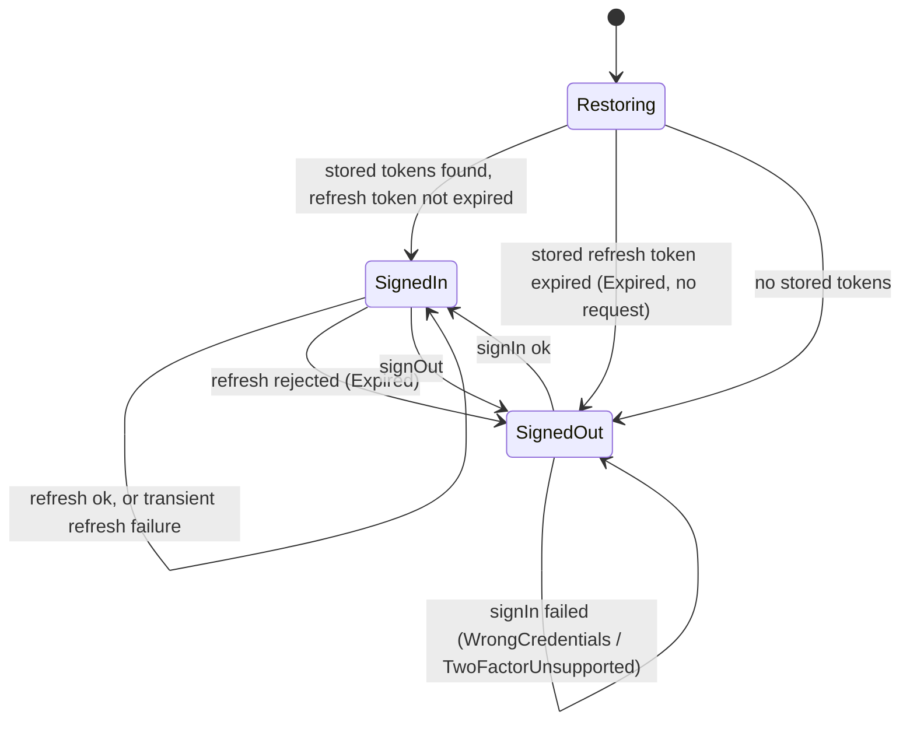

# Sankaku KMP Client

*   **Author:** the Tessera authors
*   **Status:** Approved
*   **Date:** 2026-10-29

--------------------------------------------------------------------------------

## Overview

The official sankakucomplex.com site uses about 300 MB of memory per open page. Images on revisited pages stop rendering, and searching reloads on every tag edit (see The Problem).

This project is a third-party client for Sankaku's existing, undocumented API. It's a Kotlin Multiplatform (KMP) app with a Compose Multiplatform UI. Desktop JVM is the first target and Android the second. Both share the API, auth and data code.

The app is called **Tessera** (decision 2026-10-30, `docs/adr/0003-renamed-to-tessera.md`): it may not use Sankaku's name or logo. "Sankaku" in this document means the site and its API; the repository, modules and Kotlin packages keep `sankaku` for now.

The app talks to the API directly, with no server in between:

*   It logs in the way the official web app does. Username and password go to `login.sankakucomplex.com`, followed by a token exchange on `sankakuapi.com` with `client_id: sankaku-web-app`.
*   It sends a current Chrome User-Agent for the device's platform, with Chrome's matching client hints (M6, #196).

Phase 0, a JVM spike run on 2026-10-29, showed this works with no Cloudflare clearance, no browser and no proxy. The spike is now `cli/`.

The predecessor is a small Nuxt 4 web app in `~/Development/nuxt/sankaku-app`. It's deleted at the end of M1 (see Non-Functional Requirements → Rollout). In this document, "this repository" always means the Kotlin repository.

## The Problem

**What hurts today:**

*   **The official site** is the only first-party way to browse, search, favourite and read books. It has three concrete problems:
    *   **Memory.** Each open page uses about 300 MB. The author's usual 100 open tabs reach about 30 GB of RAM.
    *   **Images disappear.** After a few minutes, revisiting a tab shows posts whose images no longer render, even on the first page.
    *   **Filtering.** Every tag added or removed reloads the results, even while the user is still typing. The tags saved in the page's query string then drift out of sync with the filter input.
*   **The Nuxt client** was meant to fix this, but it only does login, token refresh and one explore grid hardcoded to `rating:s`. Favourites, popular, top, search and books are empty pages, or controls that aren't wired up. It's also a web app, so it can't become a native mobile or desktop app.
*   **Knowledge of the API** lived only in a few hundred lines of TypeScript and an uncommitted `.env` file. Phase 0 added findings that weren't written down anywhere:
    *   which headers remove image URLs
    *   that refresh tokens rotate
    *   that favouriting is `POST` (add) and `DELETE` (remove) on `/posts/{id}/favorite`

**Proposed solution:** a new KMP codebase made of:

*   **`:sharedLogic`:** the API client with one table of headers per endpoint, a client-side rate limiter, auth with secure token storage, the repositories, paging and post state.
*   **`:sharedUI`:** the Compose UI, including tabs.
*   **`:desktopApp` and `:androidApp`:** entry modules that only start the app.
*   **`:cli`:** the Phase 0 spike, kept as a smoke test against the live API.

## Goals

Goals 1–9 are the v1 scope for desktop. Goal 10 is Android. Goal 11 is the public release (M6, decided 2026-11-01 in #196).

1.  **Sign in.** A user can sign in with username and password on desktop. After a restart they're still signed in without typing anything. That lasts until 90 days pass without the app refreshing its token; each refresh starts a new 90 days (the server's `refresh_token_ttl`). Signing in is optional, and browsing works signed out.
2.  **Session survives errors.** A network failure, timeout, 403, 429 or 5xx never signs the user out. Only a refresh that the server explicitly rejects does (see Auth session).
3.  **Browse.** A user can scroll an infinite grid of posts (the keyset endpoint, 30 per page) and open any post to see its full-size image.
4.  **Search and filter.** A user can search by tags with autocomplete, filter by rating, and combine tags. Editing tags sends no request until the search is submitted. The sidebar presets **Popular** and **Top** open a grid of their own tags alone, a clean slate (see Open Questions).
5.  **Favourite, vote and react.** A user can favourite and unfavourite a post from the post viewer (F), rate it 1–5 (`PUT`/`DELETE /posts/{id}/vote`) and add a reaction. Each change shows immediately and is reverted if the API call fails. Favourites are a grid with the `fav:<name>` tag, which can be filtered further. Reactions are emoji shortcodes, toggled with `POST /posts/reaction {post_id, reaction}`; the rating shown is `total_score / vote_count`, and `user_vote` is the user's own.
6.  **Books.** A user can browse books (pools) and read one page by page.
7.  **Images stay visible.** Images already loaded keep showing from the disk cache, however old their signed URLs are. Previews are downloaded as soon as their page of posts arrives. An image URL the host refuses is replaced by fetching that post again, and the image is retried once.
8.  **Smoke test.** The command-line smoke test (`:cli`) runs the Phase 0 flow and every discovery step against the live API, and exits non-zero on any failure. It's the first thing to run when the app breaks.
9.  **Tabs.** Middle-click (or Cmd/Ctrl-click) on a post, tag or top-bar entry opens it in a background tab. 100 background tabs stay within the memory requirement.
10. **Android.** Goals 1–5, 7 and 9 work on an Android phone using the same shared modules, with everything shared that makes good Android UX (see UI → Android). Only touch layout, platform storage and entry-point code is Android-specific. Android has the same tabs as desktop (decision 2026-10-30, `docs/adr/0001-tabs-replace-later.md`), worked through from a tab bar at the bottom.
11. **Public release.** Anyone who finds Tessera can install it, use it with their own Sankaku account and keep it updated, without help from the author. It isn't promoted (no store listings, no community posts); promoting it is a later decision.
    *   **Where:** the Android APK and the macOS DMG are on GitHub Releases of a public mirror (see Rollout), and the APK installs and updates through Obtainium.
    *   **First launch:** one screen, shown once, says what the app is, states the terms risk and asks the user to confirm they're 18 or older (Continue or Quit).
    *   **Sign-up:** the sign-in screen links to Sankaku's own sign-up page in the browser. **As built (#211):** "Create an account" under Sign in, on the desktop dialog and the Android screen, opens <https://login.sankakucomplex.com/registration> in the system browser.
    *   **Settings:** a tab with Account, Privacy, Storage, Updates, Diagnostics and About (see Screens).
    *   **Updates:** the app tells the user when a newer release exists.
    *   **Bug reports:** a user can report a bug or a crash as a GitHub issue, and nothing is sent without them.

## Non-Goals

*   **Web, wasm, JS, iOS and native macOS builds.** The JVM desktop build covers macOS.
*   **Cloudflare clearance, WebView solving, embedded Chromium, or a proxy server.** Phase 0 found no challenge. If one appears later, that's a new design.
*   **Promoting the app.** It's public but not advertised (goal 11). The more people use it, the more traffic shares the web app's identity, which is what Sankaku would have to block (see Risks and mitigations).
*   **App stores.** Google Play prohibits sexual content and apps that use a service against its terms. F-Droid has accepted no new NSFW apps since 2021, IzzyOnDroid takes no explicit content, and Samsung's Galaxy Store bans apps that give access to sexual websites. There's no Homebrew cask, since official casks must pass Gatekeeper. Sources: `docs/research/public-release-distribution.md`.
*   **Registering accounts in the app.** Sign-up is a link to Sankaku's own page.
*   **Imitating Chrome's TLS or HTTP/2 fingerprint.** The client sends Chrome's User-Agent and client hints, but OkHttp's handshake. If Sankaku starts blocking on the handshake, the response (a client such as `zhkl0228/impersonator`, or Cronet on Android) is a new design.
*   **Pull requests from others.** The public mirror takes issues only; its history is replaced at every release.
*   **Telemetry or automatic crash reports.** Reports are GitHub issues that the user files.
*   **On-disk favourites in v1.** That is the opt-in offline copy of favourite files. v1 only has Coil's image cache, which the app can evict.
*   **Flash playback.** Flash shows its preview and "Open in browser". In-app video and GIF playback were moved into scope on 2026-10-30 (GitHub issue #9; see Screens).
*   **Dedicated popular and top screens.** They're grid presets, not separate features.
*   **Uploading, commenting, editing tags or wiki pages, and other write actions** besides favouriting, voting and reactions.
*   **Migrating Nuxt sessions or data.** Users sign in again.
*   **Syncing tabs between devices** (decision 2026-10-30). Both platforms save tabs in the same format, so it stays possible (Future Improvements).
*   **Dynamic colour on Android.** The app keeps its amber and graphite scheme.
*   **Sankaku's name or logo** anywhere in the app or its releases. The README still describes it as an unofficial client for sankakucomplex.com.

## Open Questions

"Discovery step N" refers to the numbered steps under Detailed Implementation Plan → Discovery steps (M0). Each one answers a question here and stays as a `:cli` step.

*   **Status code for an expired access token.** It's unknown whether the API returns 401, or treats the request as anonymous. A *malformed* token gets 401 (2026-10-29). Discovery step 3 replays the expired Phase 0 token after 2026-11-05. If an expired token gets a 401, Ktor's plugin refreshes reactively and nothing else is needed. If it gets an anonymous 200, the proactive expiry check (see Auth session) is built as well. M1 starts without it; the interceptor is added if needed.
*   **2FA.** The test account has no 2FA. The request and response shape when 2FA is on is unknown, as is the meaning of `mfa_method`. A recorded browser login (HAR file) from an account with 2FA turned on is needed first. Until then, v1 shows "2FA isn't supported yet".
*   **Favourites query times out (settled at the M2 gate, 2026-10-30).** The keyset `fav:<name>` query returned 408 `snackbar__account_search-query-timeout` on 2026-10-29 and posts on 2026-10-30, also with `rating:s`: the timeout is the search-time limit and comes and goes. The favourites grid stays a keyset `fav:<name>` search; a 408 with that code shows "Sankaku took too long to search" with Retry, on the first page and on later ones. `age:` narrows by the post's age, not the favourite's, so it's no fix.
*   **"Filter" scope.** Does filtering mean only rating and tag filters, or also the account's server-side tag blacklist (`blacklist_tags_system`, `blacklist_is_hidden` on the user)? The server might already apply the blacklist.
*   **Rate limits.** Sankaku's actual limits are unknown. Responses carry no rate-limit headers, only `browsing-limit-*` header names (discovery step 9), whose values aren't recorded yet. Published limits are looked up once by hand and written into `docs/api.md`. Until then the client limiter (see HTTP client) uses conservative starting values. The owner hasn't met a rate-limit response in use (2026-10-30).
*   **Search tag limit.** The cheatsheet says Members may search 2 tags, Gold 6, Platinum 12, but a free account searched 3 tags plus `rating:s` without error. The account's tier is `/users/me` → `user.subscription_level` (0 free, 10 plus, 30 infinite, from the tiers in `/privileges`), and `/privileges` lists reputation rewards `plus_one_tag_to_search_limit[-1…-5]` (+1 tag each, for non-subscribers below level 33). The real limit and the server's error for exceeding it still need a `:cli` step that adds tags until it fails.
*   **AVIF on Android (settled 2026-10-30).** Previews are AVIF, which Android decodes natively from Android 12. `minSdk` is 31 and no decoder is bundled (`docs/adr/0002-minsdk-31.md`).
*   **Unverified accounts (settled 2026-10-30).** Browsing works signed out (steps 1 and 2 get image URLs without V2), so an unverified email needs no handling of its own.

## Critical User Journeys (CUJs)

### CUJ 1: First sign-in

*   **Given**: The app is freshly installed on desktop. There are no stored tokens and the network works.
*   **When**: The app opens, and the user scrolls the grid. Then they click Sign in at the foot of the sidebar, enter username and password in the sign-in dialog, and submit.
*   **Then**:
    *   The app opened on the grid, loaded anonymously.
    *   After sign-in, the dialog closes, and the user stays in the same tab. The grid reloads once from the top with their favourite state. Any request that had failed is retried.
    *   Tokens are in the OS keychain. The password is stored nowhere.
*   **Then (wrong password)**: The dialog shows "Wrong username or password" and keeps the username filled in.

### CUJ 2: Returning after a week

*   **Given**: The user signed in 8 days ago, so the access token (7-day lifetime) has expired but the refresh token hasn't.
*   **When**: The user opens the app.
*   **Then**: The first API request triggers one token refresh: through a 401, or through the proactive check if discovery step 3 required it. The app stores the new token pair and shows the grid with no sign-in dialog. If the network is down, it shows an offline banner and stays signed in.

### CUJ 3: Search, open, favourite

*   **Given**: The user is signed in.
*   **When**: The user types `blue_ha`, picks `blue_hair` from autocomplete, adds `rating:s`, presses Enter, opens a result and clicks the favourite button.
*   **Then**:
    *   No request is sent while typing; one search runs on Enter.
    *   The post view shows the full-size image.
    *   The favourite button changes at once, before the API call returns, and the new state survives a reload.
    *   If the API call fails, the button changes back and an error shows.

### CUJ 4: Coming back to an old grid

*   **Given**: A grid tab was loaded over an hour ago, so its signed image URLs have passed their expiry time.
*   **When**: The user switches to that tab, scrolls further, and opens a post they hadn't opened before.
*   **Then**:
    *   All grid previews show from the disk cache with no image requests, because they were downloaded when their page arrived.
    *   The new post shows its cached preview, blurred, as a placeholder. The sample request is refused because its URL has expired. The app fetches that post again for fresh URLs, retries once, and the sample replaces the placeholder without a visible error.

### CUJ 5: Reading a book

*   **Given**: The user is signed in.
*   **When**: The user opens Books, picks a book, and pages through it with arrow keys or swipes.
*   **Then**: Pages show in book order, and the next page is preloaded.

### CUJ 6: The API changed

*   **Given**: Sankaku changed a response field or a header requirement.
*   **When**: The developer runs the `:cli` smoke test.
*   **Then**: It prints the step table and exits non-zero. The failing step shows its name, status code, and the response's `code`/`error`/`message` field.

### CUJ 7: Opening posts for later

*   **Given**: A grid with search tags `blue_hair rating:s` is open.
*   **When**: The user middle-clicks three posts while scrolling, keeps scrolling, then switches to the first new tab. In that post, they choose "Add to search" on its `smile` tag with a middle-click.
*   **Then**:
    *   The three posts open in the background as kept posts, right after the grid's tab (its block), and the grid keeps its scroll position.
    *   The kept posts load nothing until viewed.
    *   The new tab, opened for later, goes at the end of this session and shows a grid for `blue_hair rating:s smile` (see Tabs → Queue).

### CUJ 8: Filtering favourites

*   **Given**: The user is signed in.
*   **When**: The user opens Favourites from the top bar and adds `rating:s`.
*   **Then**: The current tab shows a grid for `fav:<name> rating:s`. Unfavouriting a post there dims its cell and shows "Unfavourited · Undo" in place, so the scroll position doesn't jump. The post is gone after the next reload.

### CUJ 9: Android first launch and restart

*   **Given**: The Android app is freshly installed.
*   **When**: The user signs in, long-presses a post in the grid (it opens in a background tab), then force-stops and reopens the app.
*   **Then**: The user is still signed in, the post is still in the queue right after its grid, and the grid opens where it was scrolled to (see Tabs → Queue).

## Technical Plan (Architecture)

### Repository and modules

The project lives in a new repository at `~/Development/kotlin/sankaku-app`. The Phase 0 spike becomes the `:cli` module.

The concepts brief (written during brainstorming) proposed six modules. This plan has three modules that hold code: `:sharedLogic`, `:sharedUI` and `:cli`. Two more, `:desktopApp` and `:androidApp`, are entry modules that only start the app.

The layout follows JetBrains' [recommended KMP project structure](https://kotlinlang.org/docs/multiplatform/multiplatform-project-recommended-structure.html):

*   **Each platform's entry point is its own module** (`androidApp`, `desktopApp`). AGP 9 makes this mandatory: its `com.android.kotlin.multiplatform.library` plugin can't be combined with `com.android.application` in one module.
*   **Shared code is split into `sharedLogic` and `sharedUI`.** JetBrains recommends this split when some consumer must not depend on Compose. Here that consumer is `:cli`.
*   **Shared modules declare a plain `jvm()` target.** So desktop-specific shared code lives in `jvmMain`. The desktop `main` function lives in `desktopApp/src/main/kotlin`, and the Android activity in `androidApp/src/main/kotlin`.
*   **`:androidApp` doesn't apply `kotlin-android`,** because AGP 9 includes Kotlin support.

| Module | Kind | Targets | Contains |
| --- | --- | --- | --- |
| `:sharedLogic` | KMP library | JVM, Android | HTTP clients, rate limiter, endpoint and header table, DTOs, auth session, token stores, request log, repositories, paging sources, `PostStateStore` |
| `:sharedUI` | KMP library with Compose Multiplatform | JVM, Android | `App()`, tabs, screens, view models, Navigation 3 routes, Koin modules, image loading, `composeResources` |
| `:desktopApp` | Kotlin JVM app with Compose Desktop | JVM | the `main` function, the window, native installers |
| `:androidApp` | Android application | Android | `MainActivity`, the manifest, launcher icons |
| `:cli` | Kotlin JVM app | JVM | the smoke test, built on `:sharedLogic` |

`:sharedLogic` has no UI dependency, so `:cli` exercises the exact code the app uses. Android code lives in `androidMain` and `:androidApp` only. The Android parts compile from the first commit, but get no UI work until goal 10.

```text
 :desktopApp (main, window)          :androidApp (MainActivity)
            │                                 │
            └──────────────┬──────────────────┘
                           ▼
 ┌──────────────────────── :sharedUI ────────────────────────────┐
 │  Tabs (one NavBackStack each) → NavDisplay → Screens          │
 │  ViewModels (Koin) · Sign-in dialog · Coil 3 image loader     │
 └───────────────────────────┬───────────────────────────────────┘
                             ▼
 ┌──────────────────────── :sharedLogic ─────────────────────────┐
 │  Main HttpClient (Auth plugin, expiry check) ── Api classes   │
 │  Auth HttpClient (no Auth plugin) ── AuthApi ── AuthSession   │
 │  RateLimiter (per host) · RequestLog                          │
 │  TokenStore (interface + keychain / Tink / in-memory)         │
 │  PostsRepository · PostStateStore · Paging sources · DTOs     │
 └───────┬──────────────────────┬───────────────────────┬────────┘
         ▼                      ▼                       ▼
 login.sankakucomplex.com   sankakuapi.com   s. / v.sankakucomplex.com
 (password login)           (everything else) (signed image URLs)

 :cli ──► :sharedLogic   (smoke test, same code path)
```

### HTTP client

*   **Two Ktor `HttpClient`s, both using the same OkHttp engine on JVM and Android.** Using OkHttp on both platforms gives one TLS stack and the same connection and timeout behaviour everywhere.
    *   The **main client** serves API calls and image loads.
    *   The **auth client** serves login, token exchange and refresh. It has no `Auth` plugin, so auth calls never carry a bearer token and can't trigger a refresh loop. Ktor's `markAsRefreshTokenRequest()` alone would cover the refresh call but not the password login or the token exchange. A separate client covers all three in one place.
*   **Shared settings on both clients:**
    *   the platform's User-Agent and client hints (Detailed Implementation Plan, item 14)
    *   timeouts: connect 10 s, socket 30 s
    *   a request timeout of 30 s for API calls, and none for image hosts, so large files on slow links finish
    *   `lang=en` on every `sankakuapi.com` call
    *   the response hook, which feeds `RequestLog` and `ConnectivityState`
    *   the rate limiter
*   **Client-side rate limiter.** Sankaku's terms prohibit placing "excessive burden" on its servers, and the author wants the app never to reach the server's limit. So the app limits its own requests.
    *   Requests to Sankaku's own servers wait for a token from a fixed bucket before they're sent. The buckets are shared by all tabs. Starting values, set finally by discovery step 9:
        *   `sankakuapi.com`: 2 requests/s, burst 5
        *   `s.sankakucomplex.com` (full files): 4 requests/s, burst 8
    *   `v.sankakucomplex.com` (BunnyCDN: previews and samples) and the login host (one call per sign-in) have no bucket. They're bounded only by OkHttp's concurrency limit.
    *   A 429 from any host pauses that host until `Retry-After` passes (or 30 s without the header). The app shows "Rate-limited, retry in N s" (`ErrorState`), with a Retry button that stays disabled until then. Nothing is retried automatically.
*   **Concurrency.** OkHttp's default of 5 concurrent requests per host stays as a starting value. It's measured against the performance requirements in M1.
*   **Retries.** Image loads retry connect timeouts and IO errors twice, with backoff (Phase 0 saw one connect timeout). API calls get only the single retry after a token refresh.
*   **Headers come from one table, with an entry per endpoint.** The endpoint helper (Detailed Implementation Plan, item 15) is the only code that sets endpoint-specific headers. The two header sets:
    *   **POSTS:** `enable-new-tag-type: true`, `expiration-policy: reduced`, `obfuscate-type: tag,wiki`
    *   **V2:** `accept: application/vnd.sankaku.api+json;v=2`, `api-version: 2`, `platform: web-app`

| Endpoint | Host | Auth | Header set | Notes |
| --- | --- | --- | --- | --- |
| `POST /auth/token` (password) | login | no (auth client) | none | body `{login, mfaParams:{login}, password}` |
| `POST /sso/token-exchange` | API | no (auth client) | none | body `{access_token, client_id: "sankaku-web-app", url: "https://www.sankakucomplex.com"}` |
| `POST /auth/token` (refresh) | API | no (auth client) | none | body `{refresh_token}`; rotates the refresh token; response includes both TTLs |
| `GET /users/me` | API | Bearer | none | works with or without v2 |
| `GET /v2/posts/keyset` | API | Bearer (optional) | POSTS, **never V2** | V2 strips `file_url` and `sample_url`; `limit=30`, `hide_posts_in_books=in-larger-tags` |
| `GET /v2/posts/keyset?tags=fav:<name>` | API | Bearer | POSTS | favourites; discovery step 4 |
| `GET /v2/posts/keyset?tags=id:<id>` | API | Bearer (optional) | POSTS | fresh URLs for one post; multiple ids checked in discovery step 1 |
| `GET /posts/{id}` | API | Bearer | POSTS | the full post: every `tags[]` object (the keyset list has 5) and `file_url`; discovery steps 2 and 10 |
| `POST`/`DELETE /posts/{id}/favorite` | API | Bearer | V2 | only tested with V2; discovery step 5 checks without |
| autocomplete, books, book pages, Popular/Top tags | API | Bearer | unknown | supplied by the author; one `:cli` step each |

*   **The `/users/check-refresh-token` call is dropped.** Refreshing directly gives the same answer in one round trip instead of two.

### Data model

*   **DTOs use kotlinx.serialization** with `ignoreUnknownKeys = true`, and only the fields the app uses. The API is undocumented, so new fields must never break decoding.
*   **`created_at` is a `{json_class, s, n}` object.** A custom serializer turns it into an `Instant`.
*   **Image URLs are temporary.** They're signed and expire about an hour after the post was fetched. Each post keeps `md5` as its stable identity, and images are cached by md5, so an expired URL only matters for an image that hasn't been downloaded yet (see Images).
*   **`PostStateStore`** in `:sharedLogic` holds what changes after a post is loaded.
    *   It's a `StateFlow<Map<postId, PostOverride>>`. `PostOverride` holds `isFavourited`, `favCount`, and the current URLs once a post has been fetched again.
    *   The grid and the post view render the loaded post merged with its override. The paged list itself stays unchanged.
    *   **Clearing:** the store is emptied whenever the signed-in user changes (sign-in, sign-out, a different account). When a post is reloaded from the server, its override is dropped, unless it holds a favourite toggle whose API call is still running.
    *   **Unfavouriting inside a `fav:` grid** keeps the cell, dimmed, with "Unfavourited · Undo". The paged list isn't filtered, so the scroll position doesn't jump.

### Auth session

**Signing in is optional.** The API serves posts to anonymous requests, so the app always opens on a grid and works signed out. Auth changes never navigate:

*   **Sign-in is modal** (a full-screen screen on Android, a dialog on desktop). It opens on top of whatever is showing, and closes without changing any tab's back stack. It opens from:
    *   Sign in at the foot of the sidebar
    *   any action that needs an account while signed out: the favourite button, voting, the Favourites and Following entries
    *   the "Session expired" snackbar's "Sign in" action, shown when a refresh is rejected
*   **Sign-in opened by an action finishes it** (decision 2026-11-01, #133, UX review #126 finding 7). The action carries a reason, shown under the title ("to see Following", "to see your favourites", "to vote", "to favourite"), and itself. On success the action runs once: an entry's grid opens in this tab, or in a background tab if it was a long-press or middle-click; a favourite or vote lands with its usual feedback and reverts if the call fails. A favourite first reads the full post, since the signed-out one can't say whether the account has it already, and stops if it does. It waits until the caches have been cleared for the new account, so that clear can't wipe its override. Back, ✕, Cancel or a click outside drop it. Sign in at the foot of the sidebar and the "Session expired" action carry nothing: no subtitle, the user stays where they were (CUJ 1).
*   **The dialog shows the terms notice** under its fields (see Non-Functional Requirements → Security and privacy).
*   **Screens react to the auth state where they are.** The favourite button and Favourites prompt sign-in when signed out.
*   **After the signed-in status changes, failed requests are retried.** Every grid reloads once from the top, so `is_favorited` reflects the account. A grid whose load had failed (a Paging `LoadState.Error`) calls `retry()`, and a post view whose request had failed requests it again. The screen fills in when the data arrives. There is no separate "needs reload" bookkeeping.

`AuthSession` in `:sharedLogic` owns the tokens. It exposes `state: StateFlow<AuthState>` and `isSignedIn: StateFlow<Boolean>`, which is `state` mapped to "is `SignedIn`". Refreshing is internal to `AuthSession`, not a public state.

Connectivity is separate from auth. `ConnectivityState.offline: StateFlow<Boolean>` is set by the response hook on a connection error, timeout or 5xx (API or image traffic), and cleared by the next successful response. A "Sankaku rejected this client" response doesn't set it.

**Back online, failed loads retry by themselves (#128, from UX review #126 finding 1, option A).** On Android, a `ConnectivityManager` default-network callback (`onAvailable`, acted on once Android has validated the network, so the retry doesn't race the connection coming up) clears `offline` if a connection error set it (`ConnectivityState.unreachable`), and asks for a retry if any request failed to connect since the last retry, even if a later response already cleared `offline`: a 5xx stays until a response says otherwise, and a network handoff while nothing failed does nothing. A network Android never validates (a captive portal) doesn't trigger it; Retry still works. On desktop, the window gaining focus after a request failed to connect asks for a retry, and the response clears `offline` as usual. A retry request (`ConnectivityState.retryRequests`) makes the shown tab retry, once, what failed because Sankaku couldn't be reached: the grid's pages (Paging's `retry()`, only when a page failed with `ApiError.Network`), a post tab's request, and thumbnails and the viewer's image that failed with a connection error (`ImageFailure.Unreachable`; a refusal or decode error waits for a Retry tap). A background tab retries when it's shown. These are the only automatic retries of API calls (see `REVIEW.md`).



*   **The main client uses Ktor's `Auth` plugin with the bearer provider.**
    *   `loadTokens` reads the stored pair from `AuthSession`.
    *   `sendWithoutRequest` matches the `sankakuapi.com` host.
    *   On a 401, the plugin calls `refreshTokens`, which calls `AuthSession.refresh(oldTokens)`, and retries the request once.
*   **Proactive refresh, only if discovery step 3 shows an expired token served as anonymous (200).** If expired tokens get a 401, the plugin's reactive path covers CUJ 2 and long-running sessions, and none of this is built.
    *   One `HttpSend` interceptor on the main client checks, before each `sankakuapi.com` request, whether the stored access token expires within 24 hours.
    *   If it does, the interceptor calls `AuthSession.refresh(current)` and then the provider's `clearToken()`. The client owns its provider, so `AuthSession` never calls into the client.
    *   After a transient refresh failure, no new proactive attempt is made for 60 s, so an outage doesn't double the traffic.
*   **One mutex inside `AuthSession.refresh`.** Under the lock it re-reads the `TokenStore`, not an in-memory copy. If the stored pair already differs from what the caller saw, a refresh has already happened, and that pair is returned without a new request. Only one desktop instance runs (see Non-Functional Requirements → Single instance).
*   **Construction order:** auth client → `AuthApi` → `AuthSession(authApi, tokenStore, clock)` → main client with the `Auth` plugin and interceptor delegating to `AuthSession`. Nothing in the chain depends on something built after it.
*   **Refresh outcomes.** The rejection rows are fixed by discovery step 6, which sends a made-up refresh token and an old, already-rotated one.

| Refresh outcome | Result |
| --- | --- |
| 401, or the exact rejection response recorded by discovery step 6 (status plus body marker, for example `success: false` with an invalid-token code) | sign out: `SignedOut(Expired)`, and the "Session expired" snackbar |
| any other 400, 403, 404, 408, 429, other 4xx, 5xx, timeouts, connection errors, HTML or non-JSON bodies, decoding errors | stay signed in; the failed request shows its error and can be retried |

*   **Sign-in outcomes.** The first row is fixed by discovery step 8.

| Sign-in outcome | Result |
| --- | --- |
| non-2xx, or `success: false`, from the password login | `WrongCredentials`: "Wrong username or password" |
| a 2xx with an MFA marker (for example `mfa_method`) and no token | `TwoFactorUnsupported`: "2FA isn't supported yet" |
| timeout or connection error | "Can't reach Sankaku"; the dialog stays open |

*   **`TokenStore` is an interface in `:sharedLogic`.** It holds the access token, the refresh token, both expiry times and a user summary (`id`, `name`, `avatar_url`). The user summary means `SignedIn` has a user right after a restart, even offline. The password is never stored. Implementations:
    *   **Desktop:** the OS keychain via `java-keyring` (macOS Keychain, Windows Credential Manager, Secret Service on Linux).
        *   The data is stored as three entries, because Windows caps one entry at 2,560 bytes:
            *   `refresh`
            *   `access`
            *   `meta`: the expiries and the user summary
        *   A save writes the entries in that order, with `meta` last. Every partial state left by an interrupted save still works:
            *   a new refresh token with an old access token refreshes through the normal 401 path
            *   an old `meta` only understates the expiries
        *   The platform module probes the keychain once when it's built. If the probe fails, tokens are kept in memory only, and Settings shows "Can't store tokens; you'll need to sign in each launch".
    *   **Android (goal 10):** DataStore encrypted with Tink, using a key in the Android Keystore.
    *   **`:cli`:** in memory only.

### UI

#### Versions

The UI uses the same libraries and patterns as `marinara_engine` (`~/Development/open-source/kotlin/marinara_engine`, a local reference checkout), but not its versions:

*   **Every library uses its newest stable release** when the project is created, and on each upgrade.
*   **Compose Multiplatform uses its newest stable release.** The `org.jetbrains.compose.material3` artifact has its own version numbers, and its newest stable release (1.9.0) lacks the expressive APIs. So `material3` uses the **newest pre-release with the same minor version as Compose Multiplatform**. On 2026-10-29 that's Compose Multiplatform 1.12.2 with `material3` 1.12.0-alpha03, the same pairing `marinara_engine` uses (1.11.1 with 1.11.0-alpha07).
*   **Exact versions live only in `gradle/libs.versions.toml`.** Upgrading means running the dependency-update check (Detailed Implementation Plan, item 2).
*   **M0 checks compatibility** with a sample screen that uses every expressive component.

Libraries:

| Concern | Library |
| --- | --- |
| UI toolkit | Compose Multiplatform (`org.jetbrains.compose`) |
| Theme and components | `org.jetbrains.compose.material3:material3`, through `MaterialExpressiveTheme(motionScheme = MotionScheme.expressive())` |
| Navigation | Navigation 3: `androidx.navigation3:navigation3-runtime`, `org.jetbrains.androidx.navigation3:navigation3-ui` |
| Navigation scenes | `org.jetbrains.compose.material3.adaptive:adaptive-navigation3` |
| View models | `org.jetbrains.androidx.lifecycle` `lifecycle-viewmodel-compose`, `lifecycle-viewmodel-navigation3` |
| Dependency injection | Koin with the compiler plugin; `koin-compose-viewmodel`, `koin-compose-navigation3` |
| Paging | AndroidX Paging 3: `paging-common` (`:sharedLogic`), `paging-compose` (`:sharedUI`) |
| Images | Coil 3 `coil-compose`, `coil-network-ktor3` |
| Zoom | zoomimage `zoomimage-compose-coil3` (`io.github.panpf.zoomimage`), with subsampling on desktop and Android. Telephoto's `zoomable-image-coil3` was the first choice, but it's Android-only. |
| Color scheme | MaterialKolor (`material-kolor`), seeded from amber with a graphite neutral |
| HTTP | Ktor client with the OkHttp engine, auth, content negotiation, kotlinx JSON |
| Build | Kotlin; AGP with `com.android.kotlin.multiplatform.library`; Gradle |

The expressive APIs are pre-release and need `@OptIn(ExperimentalMaterial3ExpressiveApi::class)`. Only `ui/theme` and `ui/components` call them, so a signature change breaks a few files, not every screen (see Risks and mitigations).

#### Wiring

As in `marinara_engine/shared/.../App.kt`:

*   **Routes are `@Serializable` `NavKey` objects in a sealed `Route` hierarchy.**
*   **Each feature has a Koin module** that registers its view models and its `navigation<Route.X> { Screen() }` entries.
*   **`NavDisplay` takes `koinEntryProvider()`** plus the saveable-state and view-model-store entry decorators, so each back-stack entry owns its `ViewModel`.
*   **`MaterialExpressiveTheme`** with the expressive motion scheme wraps the app.
*   **`Navigator` keeps `marinara_engine`'s `goTo`/`goBack`**, and adds `replaceTop` and `openInNewTab`.

#### Tabs

Tabs follow how the author uses the official site: scroll a grid, middle-click posts to look at later.

*   **A tab is a back stack of three kinds of route:**
    *   **`Grid(tags)`:** search bar, filters, results. Favourites is `Grid([fav:<name>])`, and Popular and Top are `Grid(preset tags)`.
    *   **`Post(id, md5, originTags)`:** the image, plus the tags of the grid it was opened from. Each tag on a post offers "Add to search", which opens `Grid(originTags + tag)`, and "Search only this", which opens `Grid([order:popularity, tag])` (see Tags).
    *   **`Books` and `Book(id)`.**
*   **Opening rule, the same everywhere:** a click opens in the current tab; from #161, a click that opens a new search makes it a source in front of the current block instead (Queue → placement). Middle-click or Cmd/Ctrl-click opens a new background tab and leaves the current tab where it is. Where a new tab goes follows Queue → placement below (decision 2026-11-01, ADR 0004; replaces "new tabs open at the end of the strip", 2026-10-30). A post that some tab already shows (its "In tab" mark) opens no second background tab: its chip swells into "Already tab N" (the tab's position from 1) for about 1.5 s, with a polite live region "Already in tab N"; that keeps the post again (#174). Grids, tags and sidebar entries open again unless their search's source is open: from #174 that source is shown instead (one source per search, Queue → Stages). The sheet's Parent and Children thumbnails have the chip as Recommended's do (#342; before, a "Parent post" link had none and only gave the "reject" haptic, #130).
*   **Tab strip:** the tabs scroll with Shift and the wheel or by dragging the strip; a "+N" pill at each end counts the tabs out of view on that side (more than half hidden, so a tab cut by a few pixels doesn't count), drawn over the strip so it never resizes it; the first tab's 8 dp gap from the window's edge scrolls with the tabs, the + stays at the right edge, and the strip scrolls the active tab into view. A tab's hover and press highlight keeps its rounded corners.
*   **Shortcuts:** Cmd/Ctrl-T opens a new grid tab, Cmd/Ctrl-W closes the current tab, Cmd/Ctrl-Shift-E is Clear viewed (#183), and Ctrl-Tab / Ctrl-Shift-Tab switch to the next or previous tab. In the viewer, ← → step through the grid, F toggles favourite, and Esc closes it. F and Ctrl-Tab sit close together because the common loop is favourite, next tab, favourite.
*   **Left hand only (decision 2026-10-30, from a grilling session on the author's loop):** the author scrolls a grid, opens posts in background tabs, then works through the tabs left to right, favouriting, closing or skipping each; a tab may be a grid that opens more tabs. The whole loop works with the left hand on the keyboard and no mouse. Letter keys act only while no text field has focus.
    *   **Tabs:** F, Ctrl-Tab and Cmd/Ctrl-W stay as they are, separate (a favourite may stay open). Closing activates the tab to the right, else the one to the left (built). **Z** (or Cmd/Ctrl-Shift-T) reopens the last closed tab at its old place in the strip and makes it active; again goes further back, up to 20, for the session only. The reopened tab keeps its back stack but reloads like a restored tab, since closing freed its view models.
    *   **Grid cursor:** the first WASD (or arrow) press shows a highlighted cell on the first fully visible cell; WASD then move it and the grid scrolls to keep it in view, held keys repeating. Shift+W/S jump a screen. Scrolled out of view with the mouse, the next press puts it back on the first visible cell instead of jumping the grid. "Sign in to view" cells are passed over. **E** opens the cell's post in a background tab and leaves the cursor where it is; **Space** opens it in the viewer, and closing the viewer leaves the cursor on the post it closed on.
    *   **As built (2026-10-30, GitHub #11–#14):** the keys are in `Shortcuts` (`ui/components`), with `KeyEvent.isCommand` for Cmd-or-Ctrl. `KeyFocusHolder` takes the keys for its screen and takes them again whenever `KeyFocus.returnToContent()` is called (the search panel closing, Esc in the tag list). A search submitted from the keyboard sets `GridCursorRequest`, which the grid it opens takes; it lapses after a few frames so no later grid gets it. The cursor's moves are `nextCell` in `GridCursor.kt`, over the laid-out cells' bounds.
    *   **Viewer:** A/D step like ←/→. Voting stays on 1–5.
    *   **Search:** `/`, Cmd-F and Ctrl-F focus the search bar; Esc leaves it; Enter runs the search and puts the grid cursor on the first cell.
    *   **Tag list:** see Tags → keyboard.
*   **Refresh (decision 2026-10-30):** a grid's pages stay cached for 10 minutes, so a new tab or a grid returned to starts with what was loaded. To see posts released since, the top bar's Refresh button (on a grid; its icon turns while the reload runs), Cmd/Ctrl-R or F5 drop that search's cached pages and reload from the API, then go to the top. Not while a post is open over the grid. A grid shown again with its viewer open (its tab back in front) shows the viewer open at once instead of replaying the opening.
*   **Tab previews:** hovering a tab shows a small preview: the first grid thumbnails, or the post's preview image. They come from the image cache, so they cost no request.
    *   **As built (M2, ticket 06):** after the pointer rests 600 ms, a card under the tab shows its title, then six thumbnails from where the grid was last scrolled to (closer to what the tab looked like than its first six, and more likely still in the memory cache), or the post's preview. Every image is a cache-only request (`cachedPostImageRequest`: memory or disk, never the API or the image host); a miss leaves a blank tile. Each screen tells its tab what it holds when it composes (`DescribeTab`), so a tab never shown since launch (background or restored) shows its title alone. The tab icon of a post tab is cache-only too, so restored post tabs make no request at launch.
    *   **Memory usage (like Chrome's):** "Memory usage ≈ 12.4 MB" under the preview, for a tab that was shown. Decoded bitmaps are nearly all of a tab's memory, but they live in Coil's shared 256 MB memory cache, not in the tab. So the estimate is the decoded bytes of the images the tab's screens hold (every variant of every loaded post, plus a post screen's own) that are in the memory cache right now, plus 8 KB per loaded post for its data (a rough figure: a few KB of JSON per post, about double as JVM objects). An image two tabs show counts in both, as Chrome counts shared memory, and a background tab's figure falls as the cache evicts its images, which is what freeing it would actually give back.
*   **Not tab content:** Settings opens as a tab with its own screen (`Route.Settings`); Diagnostics is a section in it. The sign-in dialog stays a dialog.
    *   **As built (#205; the phone's page decided 2026-11-03):** on desktop Settings is a tab, alone in its tab and one at most (`TabsController.openSettings`). A click on the sidebar's Settings opens it right after the active tab's block, outside it, so no block is split, or shows the one open; Back, Esc and the mouse back button close it (`closeSettings`, a close Z reopens) and show the tab it was opened from this time, else the tab before it. A middle or Cmd/Ctrl-click opens it "later", at the end of the session, as a sidebar grid does, or leaves the open one as it is. A search or a sidebar grid from it opens in front of it, as from a post, and Back on that grid returns to it (#349). It's a queue item of kind other, and is never saved: `tabs.json` leaves it out (the tab it was opened from is saved as active), so the file is unchanged and an older app still reads it. On a phone Settings isn't a queue item: it's a page over the app (`SettingsPage`), for a tap and a long-press alike, with a top app bar (Back, "Settings") and its own top line; the back arrow and system back close it, and the item under it is as it was. The queue holds what's being looked through, and a Settings item would add a queue rule for Back, a place and a count to something that is never that.
*   **`TabsController`** keeps an ordered list of tabs. Each tab has a `NavBackStack` and a `ViewModelStore`. Only the active tab's `NavDisplay` is composed. Saved UI state (such as scroll position) uses one composed `SaveableStateHolder`, keyed by the tab id's string value.
*   **Background tabs hold little state and make no requests:**
    *   A tab that was never viewed holds only its route and makes no requests.
    *   A tab that was viewed keeps its view models, so returning to it keeps its loaded posts and scroll position. Decoded images aren't kept per tab; they live in Coil's shared, bounded memory cache.
    *   Releasing old tabs' view models is added only if the M2 memory measurement misses the 1 GB target.
*   **Persistence (desktop):** the open tabs' routes are saved to `tabs.json` in the app data folder on every change (debounced by 1 s), not on exit, so they survive a crash. They're restored on launch.
    *   **As built (M2, ticket 05):** `TabStateStore` (`load`, `save`, `clear`); desktop writes `tabs.json` in the app data folder, Android (M5, #21) the same file in its files folder. The file is `{"activeIndex": Int, "tabs": [{"id": String, "routes": [Route], "block": String?, "place": GridPlace?}]}`, with routes in `Route.serializer()`'s form. `block` (#161, PR #167) is the id of the tab heading the block this tab was opened into. `place` (#162, PR #171) is where the tab's top grid was scrolled to: `{"post", "cursor", "page", "time"}`, meaning the first post whose top shows, the cursor and number of the page that post came in on, and its upload time in UTC seconds. Both are left out when null, and so are `place`'s defaults (`cursor`, `page` 1, `time`), so a file saved before they existed loads and saves back unchanged. `TabsController` watches the tab list, the active tab and (through `snapshotFlow`) every back stack, and saves 1 s after the last change; the state it launched with isn't written again. Restored tabs are background tabs: nothing loads until one is shown; a restored post tab fetches its post (the post cache starts empty). Changes in the last second before quitting aren't saved.
    *   **v2 (#174, stage 2a):** the file is `{"version": 2, "session": String, "activeIndex": Int, "tabs": [{"id", "routes", "block"?, "place"?, "kind", "touched", "addedIn", "keptAt"?, "closedSource"?, "title"?, "mosaic"?, "posts"?, "gridTouched"?, "openedFrom"?}]}` (`closedSource` is a list of tags: for a kept post whose source closed, that source's search; #184. `title`, #156, is for a post opened without a label (a parent, child or recommended post) that has loaded since: the name `PostTitle.of` gave it, so the tab isn't "Untitled post" after a restart. It is never an id, and it is left out for a labelled post, a post that loaded with no name, and a post not loaded yet, so a file without it loads and saves back unchanged. `TabsController` holds the titles in a map by post id, filled by the post screen when its post loads; the strip, the queue page, the previews and Recently closed read it for a post route with no label, and Clear everything empties it). `kind` is the queue item's kind (`source`, `feed`, `post` or `other`), derived from the top route on every save and again on load; `touched` (UTC seconds) is when the tab was last shown, scrolled, navigated or acted on; `addedIn` is the session it joined; `keptAt` (UTC seconds), for a kept post only, is when it was kept or kept again. `session` is the current session's id. `mosaic` and `posts` (#232, journey check #228 finding 4) are, for a grid on top, what the queue page shows for it: four `{"md5", "rating"?}` from where it was last scrolled to (each post's rating code, so R15 and R18 tiles stay blurred; no rating counts as R15) and how many posts it had loaded. The grid reports them as they change (`TabState.reportMosaic`, once it has posts, so a grid that can't load keeps the saved ones), and a restored source shows them with cache-only requests (`cachedPostImageRequest`; a miss is a blank tile), so the queue page looks as it did before the relaunch at no request. They are never logged, and Clear everything drops them with the tabs. `gridTouched` (#245, journey check #244 finding 1) is `true` when the grid on top is touched (Queue → Untouched grids: scrolled, or a post opened from it in the viewer or kept) and has no `place`, and left out otherwise: a grid with a place counts as touched from the place alone, so files saved before the flag keep their meaning. `TabState.markTouched` sets it, for that grid route; the tab holds it, not the grid's screen, so it outlasts the queue page taking the grid out of composition, a relaunch, Recently closed and fading. Scrolling back to the top doesn't clear it; Back off that grid does, so the same search opened again starts untouched. `openedFrom` (#349) is, for a grid a search opened "now" from a queue item, that item's tab id, so Back on the grid still returns there after a relaunch (Queue → Back on a grid opened from an item); a file without it loads and saves back unchanged, and its grids keep the Back they had. Optional fields are still left out when null.
        *   **Migration:** a file without `version` is v1 (every file before #174). It's migrated as it's read: order, active tab, routes, `block` and `place` unchanged; kind from the top route; every tab touched now and in one session, `earlier`; kept posts kept now. Before the first v2 write (a save or a clear), the v1 text is copied to `tabs.v1.bak` next to it, so the owner's session is never overwritten without a copy. Until something changes, nothing is written and the v1 file stays as it was.
        *   **Broken files:** a file that can't be read or parsed, has routes from another version or a newer `version` is moved to `tabs.json.broken` (the latest one wins) and the app starts with one Browse tab. `{}` is an empty save, not a broken file.
        *   Clear everything deletes `tabs.v1.bak` and `tabs.json.broken` along with the tabs. Both platforms use `FileTabStateStore` with the same three files.
    *   **A grid keeps its place (#162, PR #171):**
        *   The grid reports its place on every change once any restore has finished, and the place is saved with the 1 s debounce. A reopened closed tab keeps its place too.
        *   A restored or reopened grid shows "Loading where you were…" while `PostsRepository.locate` finds the place:
            1.  First, the saved cursor's page, if it still holds the post (one request).
            2.  If that misses, **one** of two searches runs. They're alternatives, not a chain:
                *   A time-ordered search (not For you, and no `order:` or `date:` tag of its own) saved with an upload time: the same search narrowed with `date:` up to the end of the post's UTC hour, up to 5 pages.
                *   Any other search except For you, including a time-ordered one saved without a time: paging from the top, up to 20 pages.
        *   A post that isn't found starts the grid at the top, and nothing is said. That includes a time-ordered search whose `date:` search misses (there's no scan from the top after it) and For you when the cursor misses.
        *   Refresh (the button, Cmd/Ctrl-R, pull to refresh) and ↑ Top on a grid opened midway clear the place and reload from the top. Clear everything clears places along with the tabs.
        *   The place is on-device data, like the routes, and is never logged.
*   **Back:** Back, Esc and the mouse back button act within the current tab; on a lone post, which has nothing under it, they go to the previous queue item (#181). On a phone, on the first item's lone post, with no item before it, Back opens the queue page, as ▤ does, and never closes the app (#340). On a grid a search opened "now" from a queue item, with nothing under it, Back closes that grid and shows the item it was opened from again, where it was left; Undo (touch: on the pill; desktop: Z) reopens it (#349, Queue → Back on a grid opened from an item). While a dialog is open, Esc closes the dialog instead.
    *   **As built (#364):** on desktop, the Esc that no focused element takes goes back through `WindowBackHandler`, the first handler on the window's back dispatcher, not the window's `onKeyEvent`. The dispatcher gives Esc to the handler added last, so any open dialog, menu or sheet closes first, even with nothing focused in it. Before, the window's `onKeyEvent` ran first, and Esc on a Settings confirmation also closed the Settings tab.
*   **Post viewer:** a click on a grid cell opens the post in a viewer over the grid (see Layout). Middle-click still opens a new tab, where the same post screen fills the tab without the previous/next arrows: a lone post (Queue → Lone posts).
*   **Android:** the same tabs and `TabsController`, saved to `tabs.json` in the app's files folder; the queue page and a count pill at the bottom (#178) replace the strip, and long-press replaces middle-click (see UI → Android). There is no "Later" list.

#### Queue (decided 2026-11-01, ADR 0004, #158)

The tabs above become the **queue**: one ordered list of queue items, which are sources, kept posts and feeds (Glossary → The queue). It's built in three stages, so everything in Tabs holds until the stage that changes it lands. Design and history are in `.scratch/tab-queue/`: `notes.md` (Final model and the rounds after it), `stress-test.md` and `mockups.html`.

*   **Why:** in daily use the queue reached 170–400 tabs, because a tab was the only way to keep anything. Closing a grid lost what hadn't been opened, and new tabs at the end buried an artist's posts behind a hundred others.
*   **Items:**
    *   A **source** is a search (an artist is just a tag), gone through in its grid. It keeps its place, ends only when the user closes it (✕, or "Done with …?" offered at the grid's end), and is one item per search whatever its order or rating filter.
    *   A **kept post** is placed after its source.
    *   A **feed** (Following, For you) is a source that persists (owner decision 2026-11-03, #327; replaces #229's "feeds always stand last" as a placement rule): it recurs, is never closed, isn't counted and never fades, and the posts kept from it sit in its block (#265). It goes at the end of the queue when it's added, and is an ordinary item from then on: nothing keeps it last, and placement around it follows Placement below with no feed cases (decided 2026-11-01; built in #229 and #230; kept posts from #265).
        *   **As built (#229, #327):** signed in, Following is always a queue item; For you is one too when "Show For you in the queue" (Settings → Queue, `QueueSettings` in `queue.json`, off by default) is on. Each goes at the end of the queue as it's added (signing in, the setting turned on; `FeedItems.added`), Following before For you when both are; a feed tab already in the queue (opened from the sidebar, or restored) becomes the item where it stands. Signed out there are none: signing out (or the setting turned off) takes them away, with no Recently closed entry, and a Following restored while signed out leaves at launch (`FeedItems.leaving`). A Following reopened from Recently closed while its item is there goes to the item. The rule is `:sharedLogic` `FeedItems` (`pinned`, `added`, `leaving`); `TabsController.pinFeeds` is the seam the shell calls as the sign-in or the setting changes (`QueueFeeds`), and once as the controller is made. A feed item isn't counted in the pill's "n / N" or the queue page's count (`countedItems`): the pill says "▤ Following" on it. It can't be closed (`canClose`: no ✕, no swipe on its row, no Close action, left out of the bulk closes), and is listed on the queue page where it stands, its row saying "Feed" with no position. Opening Following anywhere goes to it (#185's `feedFor`). It keeps its place as a source does (#162); its "N new" and "Continue" come with the marks (3c).
        *   Nothing reorders the queue around a feed: not a change, not a launch (a saved file loads in its order, #327). A feed is in no other block. A search on a feed item never replaces it in place; it opens in front of it, and so in front of the feed's block. A feed tab saved with routes under it becomes the feed alone. A For you opened while it isn't pinned is a feed too, but it can be closed.
        *   **A feed's kept posts (owner decision 2026-11-02, #265; replaces #229's "a feed has no block", where a post kept from a feed stood on its own just before the feeds):** a post kept from Following or For you (a long-press, middle-click, E) goes in that feed's block, after its other kept posts, as a source grid's do (#161), so moving on from the feed reaches it next. A lone post tapped open from a feed goes right after it, in its block, as from a source (#181), so Back returns to the feed. `sourceOf` is the feed for them, so the lone post's top line says "Kept · from Following" and its pane "kept post from Following". `tabs.json` doesn't change: the post's `block` is the feed's id, as for a source. A post kept from a feed before this has no block and stays where it is; nothing guesses where it came from.
            *   **Where the block stands (#327; replaces #229's "Last"):** with the feed, wherever the feed stands. Added at the end, a feed and its block stay there until something goes after them ("later", below) or they're moved.
            *   **Counting:** the kept posts are counted in "n / N" and on the queue page; the feed still isn't. An item's position is the number of counted items up to it (`countedPosition`), so the post after Following in a queue of 29 counted items is "29 / 29", and so is anything after a feed. "Already item N" counts the same, for a source too.
            *   **Placement (#327; replaces #230's "a search opened from a feed's kept post stands just before the feeds"):** the general rules. A search opened "now" on a feed or one of its kept posts goes in front of the feed's block and is shown, and moving on past its block lands back where it was opened. One opened "later" goes to the end of this session, which is after the feeds and their blocks when they were added in this session and are last.
            *   **Back within a feed (#245):** a feed item is its bare feed alone, so `pop()` and `replaceTop()` don't change what heads the block. A kept post's own back stack is its post alone (#181). A grid that stops being a feed by navigation (a For you that isn't an item, with a search run in it) stops heading a feed block: its kept posts then have a source's block, and stand where the grid stands.
            *   **Signing out, For you turned off, or an unpinned For you closed:** the feed goes as before, and its kept posts stay where they stood, as a closed source's do (#184): "from Following (closed)", with `closedSource` the feed's search. When the feed comes back, it heads them again: added by signing in or the setting, it goes at the end and they follow it there (#327); opened from the sidebar, it goes in front of them, as a source on a closed source's search does; Undo and Recently closed bring it back where it stood, in front of them, or move them to the end of the feed item's block when the item is there already. A feed takes back only its own feed's posts; a source on `feed:following order:popularity` takes none (#185).
            *   **Clear viewed (#183):** clears a feed's seen kept posts like any others; the feed stays.
            *   **Fading (#215):** feeds never fade, and nor do their kept posts, which belong to no source.
            *   **Reorder (#327):** as any block. The feed moves its block past the neighbouring block, and a feed's kept post moves within it and leaves it past its first or last place, standing on its own just before or after it, with no source.
    *   A source and the kept posts after it form a **block**. Reordering moves the block; dragging a post out detaches it, and a detached post has no source.
    *   **Closing a source** that has kept posts says "Close artist_x · 30 kept stay". The kept posts stay as a block marked "from artist_x (closed)", and opening a source on that search (a tag, a search, a link; any order or rating) puts it back in front of them. Undo, and a hold on ✕, bring the source back in front of them too (#184).
*   **Placement:**
    *   **Now:** a search opened in place (a tag tap, Search only this tag, Add, Exclude or Remove, or a search submitted on a touched grid) becomes a source in front of the current block and is shown. When its block is gone through, moving on lands on the item that was left, so a rabbit hole unwinds by itself. Back on it unwinds it at once: the grid closes, with Undo, and the item that was left is shown (#349, below).
    *   **Back on a grid opened from an item (owner request, #349):** Back on a grid that a search opened "now" from a queue item (a tag tapped on a post, in the viewer over a grid or on a feed; Search only this; the search line; Child posts, the Children strip's "All", #342), with nothing under it in its tab, closes that grid and shows the item it was opened from, as it was left: the same post, the grid's scroll and its viewer, the sheet where its screen keeps it. It is Back on a lone post going to the previous item (#181), for a grid just added, and it replaces closing it on the queue page, which lost the place in the queue. Nothing else in the queue moves.
        *   **Which grids:** only one this search added to the queue, from any search opened in place (Placement → Now; a sidebar entry, Recommended's "more" and the post's origin line too). A search run in the grid in place (it was untouched) is under it in its tab, so Back first goes back to it, then closes the grid. A search whose source was already open shows that source (#174), which Back doesn't close: it was in the queue before; a grid reached so from another item stops being the one just opened, and Back on it then does what it did before. Start on: Browse isn't opened from an item. Feed items never close (#229). Moved on the queue page, it still returns to its item.
        *   **Touched or not:** it closes however much it was scrolled or opened from, as ✕ closes it, since Undo brings it back with its place (#285).
        *   **Kept posts from it:** they stay where they stand, as a closed source's do (#184): "from tag_t (closed)", just before the block of the item Back returns to (a search "now" goes in front of the current block), and a source on that search heads them again. Undo, a hold and Recently closed put the grid back in front of them. The rule for a closed source applies unchanged; Back doesn't fall back to the tab's own Back for a grid with kept posts.
        *   **Undo:** the close is ✕'s: one Recently closed entry, with the pill's Undo window on a phone (#178) and Z on desktop. Undo puts the grid back where it stood, shown, and Back on it closes it again; moving on past its block still lands on the item it was opened from.
        *   **Older grids:** the grid keeps where it was opened from as `openedFrom` in `tabs.json` (optional, left out when unused), so Back holds after a relaunch, which doesn't end a session. It holds for a grid added in the current session only (from one Clear viewed to the next): one from before the last Clear viewed, a grid from a file saved before #349 (no `openedFrom`), and a grid whose item was closed since keep the Back they had. An item reopened under a new id (Undo, Recently closed) is followed; one that faded and was restored (#215) counts as closed, and a restored grid has no item.
        *   **Desktop and predictive back:** Back, Esc and the mouse back button close it on desktop (`TabsNavigator.goBack`, `TabsController.closeBack`). On a phone Back is predictive (`queueBack`'s `Close`): the grid slides up to a quarter of the width with the item it returns to peeking in, as on a lone post, even when the grid is the first item; cancelled, it springs back. A grid's viewer, a raised sheet and a zoom close first, as their own Back handlers come before it.
    *   **Later:** a search opened in a new tab goes to the end of this session: after the block of the last item added since the last Clear viewed, feeds included (#327), so with the feeds last it goes after them, at the end of the queue.
    *   **Kept posts:** a post opened in the background from a grid goes at the end of that grid's block, a feed's too (#265).
    *   **Untouched grids:** a grid not yet scrolled or opened from is replaced in place, so a quick lookup adds nothing. A grid restored at its place counts as touched. Touched is kept on the queue item and saved with it (#245), so it holds after the queue page and a relaunch.
*   **Lone posts:** only a tap on a grid cell opens a post over its grid (the viewer). Every other way (background, recommended, parent and child, links) opens it alone. The search line opens its search, jumping to its source if that's in the queue. Back on a lone post goes to the previous item, and on a phone, on the first item's, to the queue page (#340).
    *   **As built (#181):** a post's route is the only one in its tab. A tap opens it right after the current item, in its block, and shows it (`TabsController.openLone`), so Back returns to where it was opened from; one opened in the background goes at the end of the block, as before. A post some tab shows already is shown there. Its top line (phone) shows "Kept · from {source}" while `sourceOf` finds the source, going there on a tap; otherwise "From {search}", which opens its search as the search line does. The search line's submit opens the post's search even unchanged: its source if one is open, else a new source "now". Tabs saved before with routes under a post keep only the post at launch; the grid under it is split out as a tab of its own, just before it, only when it's not a copy (`Grid.at`) and no other tab shows that search (`loneAtLaunch`).
*   **Seen:**
    *   A post is seen once the user acts on it in the viewer or on its own, or moves on after it was fully shown. Scrolling past it in a grid doesn't count, and neither does favouriting from the grid.
    *   Seen is stored per post on the device, with the md5 so that exact copies count too. It's pruned after 90 days and cleared on sign-out.
    *   A grid marks a post seen only when the post is kept with that grid as its source and was seen since it was kept (owner decision, 2026-11-02, #262). It dims the cell (about 85%) and adds an eye-slash badge and "seen" to the description, TalkBack's too. A post seen but not kept, kept from another source, or an exact copy of a kept post under another id, looks like any other post in grids, and so does a favourited post on a feed; the seen store still records it for Clear viewed, the queue page's "Kept · seen" and the feed marks. Hiding uses the favourites filter (#90).
*   **Session:** from one **Clear viewed** to the next; closing the app or a crash never ends one.
    *   Clear viewed sits in the queue page's header (Cmd/Ctrl-Shift-E on desktop) and removes the kept posts seen since they were kept. The current item stays, and the clear becomes one Recently closed entry.
    *   Keeping a seen kept post again marks it unseen ("Kept again").
*   **Fading:** a source untouched for 3 days fades, with its place. Its unseen kept posts fade with it.
    *   A faded source is deleted 30 days after it faded (33 days after it was last touched). Its row counts down from fading ("Deleted in N days"), and Up next offers "Last chance" once; no answer means delete.
    *   The item shown never fades, and the first launch after this lands stamps every item as touched.
    *   Built in 3a (#215): see Stages → Stage 3.
*   **Up next:** moving past the last item, whatever it is, shows a card (text only) that offers only what is out of view: a Last chance, then the other faded sources, the one that faded first first ("Pick up artist_x again?"). Nothing in the queue is offered, so it never loops back, and it doesn't depend on sessions (#228, findings 2, 9 and 10; replaces "the oldest unfinished source from an earlier session"). Since #327 it no longer stands before the feeds: a feed is an item like any other, so the card comes past the last feed's block, or past a "later" search that follows the feeds.
    *   **End of the queue:** past the last item, and past Up next when it has offered everything, a card says "You've reached the end", with Back to the start (item 1) and Browse. It is how the queue ends even with nothing to offer (signed out, nothing faded), instead of a swipe that springs back.
    *   Built in 3b (#216), rewritten in #230: see Stages → Stage 3. Touch only, as the queue page is.
*   **Feeds:** Following remembers the newest post reached and where the user stopped, as one merged gap.
    *   A gap is stored as a range. The stop mark is the deepest point reached; refreshing and scrolling up never move a mark.
    *   It shows "N new", "Continue · N left from last time" and "You're caught up" as full-span headings.
    *   A Following gap never expires; the feed offers it once after 7 days (Up next offers no feeds since #230: they're items). A For you gap is dropped after 3 days.
    *   The marks are "on this device", and favourited posts count as seen in feeds.
    *   It needs discovery #160 first: the feed's order, and whether a stored keyset cursor works days later.
*   **Phone gestures (S1):** see UI → Android.
    *   On a grid or a lone post, a sideways swipe moves to the previous or next queue item. Use #122's thresholds. Past the first item it rubber-bands; past the last it shows End of the queue (#230). On the Up next and End of the queue cards it only goes back, to the item the card stands past; forward it rubber-bands (#248).
    *   Drag down on a lone post closes it, but only at peek, at 1×, outside the seek row and, on release, past about 20% of the height or with a deliberate downward fling, the queue swipe's 400 dp/s (#235; it was 30% with no fling, which took too much arm over 40 kept posts; #308 raised the fling from the system's minimum, about 50 dp/s, which closed on almost any release still moving). It then moves on to the next item, the one that takes its place, as ✕ does (#326, the owner's decision: working through the queue, landing on the previous item cost an extra swipe forward after every close). At the end of the queue it shows what moving on would show there, the Up next or End of the queue card, past the item before. Undo brings the post back where it was and shows it.
    *   The viewer over a grid is unchanged.
    *   The sidebar no longer opens with a sideways drag.
    *   **As built (#181, `tabs/QueueSwipe.kt`):**
        *   A grid (and its loading or error states) and a lone post's image opt in with `queueSwipe`; the shell's `QueueSwipeHost` drags the tab's content and draws the neighbour beside it. Between two lone posts only the picture moves, as the viewer's pager does over a grid (#263, `QueuePictureSwipe`): the neighbour's picture comes in beside it in the picture's room, fitted as its own viewer will fit it, and the top row and the sheet stay, showing the post landed on once it's shown. A neighbour not loaded yet shows its kind and title there instead. Towards or from anything else (a grid, a card), the whole screen moves. A lone post whose picture has loaded (Images → What loads where) then peeks in as itself (#263, option A, `LonePostPeek`): its picture fitted where the lone post fits it with the chrome shown, its top row saying why it's there ("Kept · from artist_x") and its title, and the sheet's peek band, so landing changes nothing but the sheet's controls and nothing between items is black. With G only on, an R15 or R18 post never shows its picture in a swipe. Anything else (a grid, a post not loaded yet) peeks in as text: its kind and title. The swipe starts outside the system's gesture insets on both sides, is taken at 2× touch slop sideways before 1× vertically (#122's rule, `swipeStart`), and consumes nothing before that, so a scroll, a cell's hold or a pan below it wins. A second finger lets go. On a lone post it's at 1× only, and it claims sideways moves from 1× slop, as the no-op drag it replaced did, so a short sideways swipe doesn't count as a tap.
        *   Let go, it settles as the viewer's pager does (`swipeTarget`): a fling of 400 dp/s (foundation's `MinFlingVelocityDp`) goes the way it flings, a slower let-go past half the width goes the way it was dragged. Past an end it stretches with the platform's overscroll. Settling steps the queue (`previous`/`next`), which touches the item.
        *   Back on a lone post is predictive: the post slides up to a quarter of the width with the previous item peeking in, then it goes there. With no previous item, the post stays put as the gesture goes, and its commit opens the queue page, whose transition takes the picture to its row (`queueBack`, #340). Back on a grid opened from an item is predictive the same way, with that item peeking in, and closes the grid (#349).
        *   Drag down on a lone post (`dragDownCloses`) closes it on release past 20% of the window's height (`LONE_CLOSE_SHARE`) or with a downward fling faster than the queue swipe's 400 dp/s (`loneDragCloses`, `MIN_FLING`), through ✕'s close with its Undo, landing on the next item (`ClosedTabUndo.dragClose`, #326). Where moving on would bring the Up next or End of the queue card (`UpNextState.ahead`), it lands on the item before (`close(toPrevious)`) and shows that card past it (`showAhead`); the shell's dismissal on a new item spares a card that came up past the item now shown (`itemShown`). With no item before, it lands on whatever is left. Shorter and slower, the picture springs back. Zoomed, the picture isn't draggable, so the pan keeps the touch; a drag that starts up, or anywhere above peek, moves the sheet (`dragDownCloses`); the queue swipe takes only near-horizontal moves (`swipeStart`).
        *   TalkBack: each item's content is a pane titled "Queue item 5 of 29, kept post from artist_x" (`queueItemDescription`); grid cells and a lone post's image have the custom actions "Previous queue item" and "Next queue item", and the image "Close".
*   **Hold, then slide:** holding a cell keeps it. Sliding onto the ♡ that rises above the finger also favourites it, and never unfavourites. The custom actions are Keep, Keep and favourite, and Favourite; on desktop, Shift-E.
*   **Privacy:**
    *   Hide in Recents is on by default.
    *   The app opens on the queue page at a launch and after more than 5 minutes away, when the queue holds more than the current item (#231), with non-G thumbnails blurred until the queue's first use since the app started (#264). "Start on: Queue / Browse" chooses it, and "Always start in G only" turns G only on at every launch (#177).
    *   A G only switch sits in the sidebar.
    *   With G only on, the search panel leaves out suggestions whose tag is rated R15 or R18 (#247), as the queue page leaves out those sources. With G only off (signed out too) the list is the API's. The filter is client-side, on the `rating` autocomplete already returns, so it adds no request. A tag typed in full is still added and searched; the grid's own G only filter applies.
    *   Clear everything clears the queue, the seen store, the marks and the image and video caches.
*   **Stages:**
    1.  **Stage 1:**
        *   Built: placement and blocks in today's tab model (#161, PR #167), grids keep their place (#162, PR #171; see Persistence above), no duplicates (#130, PR #149), and privacy (#164, PR #166).
        *   Open: hold then slide (#163), and the `:cli` discovery (#160, PR #168).
    2.  **Stage 2:** the queue data model, the queue page as the launch screen, S1 swipes and lone posts, retiring the phone's tab bar (after a design round), seen in grids, Clear viewed, blocks, and an accessibility pass. It replaces #132.
        *   **Built: lone posts, S1 swipes and drag down (2c, #181).** See Lone posts and Phone gestures above.
        *   **Built: the queue data model (2a, #174).** No screen changed.
            *   **Items:** `TabState.kind` (`QueueKind`, `:sharedLogic` `queue/`) from the top route: a grid is a source, or a feed when its search is exactly one feed token with at most a rating; a post is a kept post; anything else is other. A kept post's source is its block head when that's a source (`TabsController.sourceOf`). Each tab has `touched`, `addedIn` and, for a kept post, `keptAt`; "Already tab N" keeps the post again (`keepAgain`), and a post newly on top of a tab is kept from then.
            *   **One source per search:** `SourceKey` is the content tags, trimmed, lower-cased, without repeats and sorted, without `order:` or rating tokens (feed, favourites and `threshold:` count). A search with no key (Browse, Popular, Top) never merges. Opening a search whose source is open, now or later, from anywhere, shows that source as it is (or, in the background, opens nothing and returns its position, as "Already tab N" does). On the source shown, the search runs in it, so changing its order or rating still works. Tabs saved before this may hold two sources with one key; they're kept, and the first is the one found (`sourceFor`, for stage 3 too).
            *   **Sessions:** `SessionClock` holds the current session; `SessionClock.atLaunch` started a new one at each launch (#161's boundary); since 2f (#183) it carries on in the saved one, and only Clear viewed calling `startNew()` ends a session.
            *   **Seen store:** `SeenStore`, in `seen.json` (`{"version": 1, "pruned", "posts": [{"i", "m"?, "t"}]}`, least recently seen first): post id, md5 when known, and when last seen. It holds the newest 50,000 posts (about 3.4 MB; 64 ms to load on the desktop JVM), drops posts not seen for 90 days at launch, at most once a day, and is cleared on sign-out (signed in → signed out while running, or a session found run out at launch, so the next account never inherits it) and by Clear everything. `isSeen` matches by id or md5; `seenSince(keptAt)` is "seen since kept". Recorded on ♡ in the viewer or a post tab, a vote and a tag action (`PostActions`, not from the grid), and by `Viewing` on moving on from, or closing, a post whose sample, GIF, first video frame (or Flash preview) loaded as the current page. Grids read it for their seen mark only through the posts kept from them (`TabsController.seenFromGrid`: a kept post whose `sourceOf` is the grid's tab, `seenSince` its `keptAt`, #262; it replaced #182's `isSeen`, which marked any seen post and, on a feed, any favourited one), and the queue page reads it for "Kept · seen" and Clear viewed (`seenSince`). Both redraw on `SeenStore.revision`.
        *   **Built: the queue page and the start settings (2b, #177; option Q1 of `.scratch/bar-less/`).** Touch only: desktop keeps its tab strip.
            *   **The page:** `QueuePage`, a full screen over the app that replaces the tab list sheet (#132) and keeps its positions, find, scrubber, bulk closes, swipe to close (#120), Recently closed and TalkBack actions. The header is "Queue", the count, 🔍, a shield for G only and ⋮ (the bulk closes and Clear everything); Clear viewed's button sits under it (wired in 2f, #183). Rows (`queueRows`) follow queue order, each block's kept posts indented under its head (28 dp, with a thin line from the head, or a closed block's "from artist_x (closed)", down through its listed kept posts, `BlockLine`; TalkBack reads a kept post's second line as "Kept from artist_x", or "Kept from artist_x (closed)", #234); a feed is listed where it stands, with its kept posts indented under it by the same line, read "Kept from Following" (#265); there is no "Feeds" section since #327, the feed's row saying "Feed"; it has no position, and the items after it are numbered as the pill counts them (`countedPosition`). A row's second line says its kind, then "place kept" for a source with a place (else its loaded posts), "seen" for a kept post seen since it was kept (dimmed too), R15 or R18, and "current". "Continue · {current item}", a filled 52 dp button at the bottom, and Back go back to the active item; a tap on a row goes to that item.
            *   **Reorder:** `TabsController.moveInQueue`, one step at a time (a drag on ≡ steps once it's past half the neighbouring block, or TalkBack's Move up and Move down). A head moves its whole block past the neighbouring block; a kept post moves within its block, and past its first or last place it leaves the block and stands on its own beside it. A feed moves with its block like any head (#327; it was passed over and never moved).
            *   **Ratings:** `Route.Post` carries the post's `rating` code when it's opened from a loaded post (a grid, a recommendation), else the post's cached copy tells it. A post whose rating isn't known (a tab saved before #177) counts as R15 or R18; the sheet's Parent and Children thumbnails carry theirs, as a recommendation does (#342). A grid is R15 or R18 only when its search lets no G post through (`rating:q`, `-rating:s`); any other grid searches G only while G only is on (#164).
            *   **Blur (#264, replacing #177's per item rule):** every R15 or R18 thumbnail (a kept post's preview, each cell of a grid's mosaic) is blurred with an eye-slash until the queue's first use in this app process (`QueueStart.interacted`), and always while G only is on. The blur guards the launch screen from someone looking over your shoulder; once you've used the queue it has done its job. A use is any touch on the queue page (a row opened, a scroll, a swipe to close, a drag on ≡, Continue, a header button), a scroll or a TalkBack move, close or Undo there, Back or Continue closing the page, a tap on the pill, another item than the one the start landed on coming forward (a swipe or ‹ › between items, a row tapped), or the Up next card. The state is memory only and never saved: it's per process, not per queue session (#174, #183), so only killing the app blurs again, and a return after more than 5 minutes (a start) doesn't. Titles stay. Grids are never blurred.
            *   **Recently closed thumbnails (#250, journey check #244 finding 6):** a Recently closed row shows the thumbnail its item had on the queue page: a post's preview, a source's mosaic (#232's saved md5s, carried on `ClosedTab.Member.mosaic` and kept by Reopen), with cache-only requests and the kind's icon on a miss. A batch, and what Clear viewed cleared, shows its first member's. The pictures blur by the same rule as a queue row's: until the queue's first use since the app started (#264). While G only is on, an R15 or R18 entry is left out and counted ("Hidden by G only · N" at the section's end); a batch shows its first G member, and is left out if it has none (`closedRows`). Recently closed is still kept for the session only; a faded source saves its mosaic like an open tab (optional `mosaic` and `posts`, left out when empty), so Delete now's and Let go's entries have it after a relaunch. TalkBack hears the title, the kind, "Blurred" when it is, and "Reopen".
            *   **G only:** R15 and R18 items aren't listed; "Hidden by G only · N" counts them, and turning G only off brings them back in place.
            *   **Start on (`QueueStart`):** a start is a cold launch, or coming back after more than 5 minutes in the background (the lifecycle's stop and start). Start on: Queue (the default) opens the queue page when the queue holds more than the current item: at least one kept post, or a second source; feed items (#229) and other screens don't count. Otherwise the app opens straight on the current item, so a fresh install, or a queue that's only the default Browse grid, opens on that grid (#231, journey check #228 finding 3; the rule is `:sharedLogic` `QueuePageAtStart`). Browse shows a Browse grid opened "now" in front of the current block (`TabsController.showBrowse`; none is added if Browse is already shown). Nothing in the queue changes either way. Turning the phone isn't a start. A start doesn't blur again (#264, see Blur).
            *   **Settings:** Start on (touch) and Always start in G only sit under Hide in Recents, saved with it in the privacy file. Always start in G only switches G only on as the app launches; switching it off then lasts until the next launch.
        *   **Built: Clear viewed (2f, #183).** It ends the session.
            *   **What it clears (`TabsController.clearViewed`):** every kept post with `SeenStore.seenSince(id, md5, keptAt)` true, in queue order, except the current item. Sources and feeds are never cleared. With nothing to clear it changes nothing, keeps the session, and says nothing (the desktop shortcut repeats while held, and a second press mustn't replace "Cleared · Undo").
            *   **Undo:** the clear is one `ClosedTab` in Recently closed (`cleared`, "N posts" with "Cleared" under it, even for 1), which reopens every post at its place, in its block and session, with its kept time, and activates none. The top line says "Cleared N · Undo", Short (`Message.short`); the entry stays for the Recently closed limit (20), with no timer. Z, Cmd/Ctrl-Shift-T and the ✕ hold reopen it like any other. Undo brings the posts back but doesn't undo the session's end. Nothing is posted as a system notification.
            *   **The session:** launching carries on in the saved session (a file with none, from before sessions, starts one). Clear viewed calls `sessions.startNew()`, so a "later" tab then goes at the end of the items added since, or first in the queue while none has been.
            *   **The button (`ClearViewed`, `QueuePage`):** "Clear viewed · N" under the header, shown when N > 0; its accessible name is "Clear viewed, N kept posts" ("1 kept post" for one, #249). It is tonal, and primary once every kept post (the current item too) has been seen since it was kept: that suggestion is all, nothing happens by itself. With G only on, hidden R15 and R18 posts count and are cleared too.
            *   **Desktop:** Cmd/Ctrl-Shift-E at window level (`Shortcuts.ClearViewed`), and "Clear viewed · N" with the key in a ⋮ menu at the tab strip's end, off at 0.
        *   **Built: closing a source keeps its kept posts, "Done with …?", and blocks move together (2g, #184).**
            *   **Closed block:** closing a source ([`TabsController.close`], `closeAll`, a bulk close) leaves each kept post of its block where it is, with `TabState.closedSource`: the closed source's search, saved as `closedSource` on the tab in `tabs.json` (optional, so the file stays v2). The block keeps the closed head's id, so Undo, a hold on ✕, Z and Recently closed (each `reopen`) put the source back in front of the posts and clear `closedSource`. Closing says "Closed “artist_x” · 30 kept stay" on the top line and on the queue page's inline row (the count is its own line), and ✕ and a row's "Close" action are described "Close artist_x · 30 kept stay".
            *   **Titles of a `date:` range:** a `date:A..B` tag is titled in words, not as typed (`dateRangeLabel`): "1 Jan 2012" for a whole day, "1 Jan 2012, 00:00–08:00" inside one day, "1 Jan 2012 – 3 Jan 2012" for longer. Times are to the hour, as the search is. Anything that isn't two dates, or is an empty range, stays as typed.
            *   **Reopening by search:** a source opened on a search with the same `SourceKey` as a closed block (`open`, now or later, and `search`, including on an untouched grid, which then isn't replaced) is put in front of that block and heads it again. The first run of kept posts with that key is taken; nothing else moves. A source with no key (Browse, Popular, Top) never takes a block back.
            *   **Queue page:** a closed block is a heading row "from artist_x (closed)" with "30 kept posts stay" over its kept posts, which are indented as under a source. It's listed when one of its posts is (so G only and find can leave it out) and has a ≡ and the TalkBack actions Move up and Move down like a source's row: moving it moves the block whole (`moveInQueue` takes the closed head's id). A post of it moves within the block; dragged out past the first or last place it leaves the block and loses its source, closed or not (`closedSource` is cleared).
            *   **"Done with …?":** when a source's grid reaches the end of its results (`LoadState.append.endOfPaginationReached`, with posts in it), its footer shows a full-span "Done with artist_x?" with a "Close artist_x" button (`DoneWith`, in `ui/components`). The button has the heading role and wraps at a large font; "30 kept stay" sits under it when kept posts stay. It closes the source as ✕ does (touch: with Undo on the count pill, #178; desktop: `close`, which Z reopens). It's never shown on a feed and never closes by itself.
        *   **Built: the phone's tab bar retired (2d, #178; option A′ of `.scratch/bar-less/`).** The count pill, Undo on it, ⋮ in the sheet's peek row and Show queue buttons: see UI → Android → Count pill and Feedback.
        *   **Built: the accessibility pass and one item per feed (2h, #185).**
            *   **One item per feed:** Following and For you are each one queue item whatever rating filter a search adds (`TabsController.feedFor`, `TabState.feed`). Opening one that's open, now or later, from the sidebar or anywhere, shows it as it is and adds nothing (as for a source, `openSource`). A source on `feed:following order:popularity` is a search, not the feed (`QueueKind.feedOf`), so it still opens beside it. Tabs saved with two of one feed keep both, and the first is the one found.
            *   **Every gesture has an action:** sideways swipes are the pill's and each grid cell's and a lone post's "Previous queue item" and "Next queue item"; drag down is "Close" (on the image, and on the pill as "Close artist_x · 30 kept stay" for a source whose kept posts stay); reorder is "Move up" and "Move down" on each queue row and closed block, and after one the page says "artist_x moved to item 3 of 9" in a polite live region, since TalkBack's focus stays on the place, now held by another row. Undo is the pill's "Undo close" (TalkBack's focus on the Undo chip doesn't pause its window, so that action and the untimed Recently closed list are the TalkBack paths); ⋮ in the sheet is a button of its own; Mark unseen (it says "artist_x marked unseen"), Clear viewed ("Clear viewed, 118 kept posts", one spoken name that starts with the visible words, not both), a closed source's "Done with …?" button and a faded row's Restore and Delete now are actions or buttons too. "Keep", "Keep and favourite" and "Favourite" come with hold, then slide (#163), which isn't built.
            *   **Headings** (`heading()`): "Queue", "Hidden by G only", "Faded", "Recently closed", a closed block's "from artist_x (closed)", and "Done with …?"'s button. Following's "N new", "Continue" and "caught up" markers become headings when they exist (stage 3).
            *   **Live regions:** "Closed “title”. Undo available" (the pill and the queue page's inline row), "Already item N" (desktop: "Already in tab N", #249) and "Kept again" (the cell and chip), "Cleared N · Undo" (the top line), and the move above.
            *   **Font scale 2.0:** the queue page's rows grow instead of holding 72 dp, and their title, second line, "Continue · …" and the inline Undo's words wrap rather than end in "…" (`rowTextLines`, past 1.3×); Continue's room is measured, and a drag on ≡ uses the dragged row's own height. On a lone post, from 1.5× the title goes under the "Kept · from …" pill and that pill wraps (`TopRow`). The count pill, Undo beside it, the sheet's peek row, "Kept" chips and the Faded section hold at 2.0 as they were.
    3.  **Stage 3:** fading and Last chance, Up next, and the feed marks.
        *   **Built: fading, deletion and the Faded section (3a, #215).** Up next (3b, #216) builds on `TabsController.lastChance`.
            *   **The clock rules (`:sharedLogic` `Fading`):** a source fades at `touched + 3 days`, not when the app noticed, so it is deleted at `touched + 33 days` however often the app was opened. "Deleted in N days" rounds up (30 when it fades, 1 on the last day). The last week before deletion (`LAST_CHANCE`, 7 days) is when Last chance may be offered.
            *   **What fades (`TabsController.sweep`):** a source (`QueueKind.Source`, so also Browse, Popular and Top) untouched for 3 days moves out of the tabs into `faded` with its unseen kept posts (`SeenStore.seenSince`), as one block. Seen kept posts stay in the queue as "from artist_x (closed)", as a closed source's do (#184); restoring the source, or a search on it, heads them again. Feeds, kept posts of no faded source and other screens never fade. The item shown never fades, nor does the source of a shown kept post: the sweep touches both, so their 3 days start again.
            *   **Where it runs:** as the app launches (the controller's init, before the first save, so what it changes is saved) and when the queue page opens. Nothing runs while the app is closed. A source found already past 33 days (the app was closed for a month) is deleted without being listed.
            *   **Faded sources are data, not tabs** (`FadedSource`): they have no view models, are in no queue order, and stepping, swipes and the count never meet them. `tabs.json` stays v2 with an optional `faded` list (`SavedFaded`: when it faded, whether Last chance was offered, and the block's tabs); an older app ignores it.
            *   **Opening one again (`restore`):** from its row, or because a search matches it (`fadedFor(SourceKey)`, through `open` and `search` as an open source is), it goes at the end of this session with its place and its kept posts as one block, and its 3 days start again. `sourceFor` still finds open sources only.
            *   **Deleting:** time deletes silently. "Delete now" (`deleteFaded`) is one Recently closed entry with an inline Undo, as a close; Undo brings the block back into the queue for the session.
            *   **Last chance seam for 3b:** `lastChance()` is the faded source soonest to be deleted that is in its last week and not offered; `offered(id)` marks it shown, so it is offered once; `keep(id)` is `restore` without showing it; `letGo(id)` is `deleteFaded`. Not offered, or not answered, it is deleted on day 30 all the same. A faded row in its last week reads "Last chance · Deleted in 4 days" in the error colour.
            *   **The Faded section (`FadedSection.kt`):** the last section of the queue page, before Recently closed. Shut by default, "Faded · 4" (all of them, even with G only) with a chevron; a find opens it and filters it. A row shows a kind icon, never a picture, the title and "Deleted in 12 days · place kept · 3 kept posts". A tap opens it (restored and shown, the page closes); the Restore button restores and stays; Delete now deletes with an Undo. TalkBack gets Restore and Delete now as the row's actions too. With G only on, R15 and R18 faded sources are counted ("Hidden by G only · N" at the section's end), not listed. Clear everything forgets them.
        *   **Built: the Up next card (3b, #216; rewritten in #230) and End of the queue (#230).** Up next stands past the last item, whatever it is (`TabsController.upNextAhead`: nothing comes next; #327 replaced "before the feeds", where the item shown couldn't be a feed or a feed's kept post, #265). Moving on there (a sideways swipe, ›, or TalkBack's "Up next" action on the pill) shows it in place of the tab's content when there is something to offer; otherwise the move goes on to the next item. Every move forward goes through `UpNextState.forward`, which `ahead` (`Ahead`: Item, UpNext, End, Nothing) describes for the swipe, the pill and TalkBack. It offers only faded sources, which are out of view: nothing in the queue, so it never loops back to an item, and nothing about sessions. The order is `:sharedLogic` `UpNext.offers`, so the unit tests cover it with no UI:
            1.  **A Last chance** (`TabsController.lastChance`, 3a): "Last chance: artist_x" with "Deleted in 7 days · place kept · 3 kept posts", **Keep** and **Let go**. It is marked offered as it appears, so it is offered once however it is answered or left. Keep is `keep` (back in the queue, not shown) and Let go is `letGo` with "Let go of “artist_x” · Undo" on the top line (one Recently closed entry). The window is 3a's last week (`Fading.LAST_CHANCE`), as the Glossary says.
            2.  **The other faded sources**, the one that faded first first (`fadedAt`): "Pick up artist_x again?" with its Faded row's line ("Deleted in 12 days · place kept · 3 kept posts"), **Open** and **Skip**. A source offered as the Last chance isn't offered again as one of these, and a faded search with no key (Browse, Popular, Top) isn't something to pick up, though it still gets its Last chance.
            3.  **Then End of the queue** (#327; the feeds came here as items before, #229): feeds are items like any other, reached before the card.
            *   **Skip** moves to the next offer and touches nothing, so a skipped source stays faded and is deleted on time. Past the last offer it goes on to End of the queue; when a source just kept from its Last chance follows instead, the card goes, back on the item (Keep doesn't show it). A swipe forward doesn't act on a card; Skip, › and the pill's actions do. A swipe back on a card (Up next or End of the queue) returns to the item it stands past, as the pill's ‹ does, with that item peeking in (#248).            *   **Open** restores the faded source (`TabsController.restore`, as the Faded row's tap does): at the end of this session, with its place and its kept posts as one block, and shown. There is one Open: "Open grid" is gone, since for a source it did the same.
            *   **End of the queue:** past the last item (a feed's block or anything after it, #327), `UpNextCard.End` reads "You've reached the end" with **Back to the start** (`TabsController.backToStart`: item 1, or the first G only doesn't hide) and **Browse** (`showBrowse`, as Start on: Browse). On it › is off. With two items, nothing faded and signed out, moving past the last item shows it, never an item of the queue.
            *   **A page of its own:** a card stands in for the tab's content with no grid behind it, and the search line shows the card's own search (`shownSearch`: the faded source's, or an empty one for End of the queue), never the grid's it stands past. The search panel opens on that search, and a search run from it takes the card away.
            *   **Text only:** a card draws no thumbnail and loads nothing. With G only on, R15 and R18 faded sources are left out, as the queue page lists none (a faded source left out is not marked offered).
            *   **Never first:** `UpNextState` is memory only, and only a swipe, › or an action shows a card. Any change of the item shown (or of its screen) takes it away, and so does a start (`QueueStart`: a cold launch is a fresh process, a return after 5 minutes calls `dismiss`), so the queue page or Browse is always first.
            *   **The shell (`UpNextCardView`):** the card stands in for the tab's content, as the queue page covers it, with the top bar and the pill kept (a post's chrome comes back for it). On the pill ‹ goes back to the item the card stands past ("Back to artist_x"); on Up next › goes on (to End of the queue), and on End of the queue it's off. ›'s name and the pill's TalkBack action say where it goes ("Next queue item: Following", "Up next", "End of the queue"). The swipe's peek past the last item says "Up next" or "End of the queue". `QueueSwipeHost` shows the card, so a swipe back and Back (predictive with gesture navigation) slide it off with the item peeking in, as on a lone post (#248); the edges stay the system's.
            *   **TalkBack:** each card is a pane titled "Up next" or "End of the queue". Its title and the line under it are one focusable heading, which focus moves to as the card appears and again for each card Skip brings, and which carries the actions as custom actions (Open, Skip; Keep, Let go; Back to the start, Browse), then the swipe back's, named as the pill's ‹ ("Back to artist_x", #248). The buttons are named for what they act on ("Skip artist_x", "Open artist_x", "Back to the start of the queue").
            *   **Not built:** Continue on the queue page still goes back to the item shown; it does not move past the end. A Following gap offered after 7 days belongs to the feed marks (3c).

#### Differences from marinara_engine

*   **Targets:** it adds a `jvm()` target and `:desktopApp`, and drops `webApp` and `iosApp`. Desktop maps Esc and the mouse back button to `goBack()`, because Navigation 3 only handles system back on Android.
*   **Tabs** (above).
*   **Images use `coil-network-ktor3` instead of `coil-network-okhttp`,** so Coil goes through the main client's User-Agent, timeouts and rate limiter (see Images).
*   **Desktop packaging is `Dmg` only in v1.**
*   **No Room database in v1.** Room is the planned store for on-disk favourites later.
*   **The thumbnail-to-viewer shared-element transition is part of M1** (marinara has `SharedTransitionLayout` already).

#### Motion

*   **One image, one element (owner request 2026-11-02, #319).** When an image on one screen becomes an image on the next (a thumbnail opening its post, a post shrinking back into its row or cell), the two are one element: it moves and resizes between them with a shared transition on the expressive spatial spring. The screen around it fades or slides as it does without one. Two exceptions:
    *   **A blurred thumbnail** (the queue page's blur for R15 and R18, #164 and #264; G only) never morphs into its unblurred picture, nor the picture into it. Those open and close with the plain transition.
    *   **Animations off** (animator duration scale 0): no transition; screens change at once.
*   **Where it applies** (#319's catalogue): a grid cell ↔ the viewer over it (M1); a kept post's row on the queue page ↔ its lone post (#320); the sheet's Recommended thumbnails → the lone post they open (#321); a grid or feed row's mosaic ↔ that grid's first cells, and Recently closed or faded rows → the item they reopen (#322); the sheet's Parent and Children thumbnails → the post they open (#342). The queue swipe's peek is already one continuous picture (#263). Left out: the sheet's header thumbnail as the sheet goes full (one screen, one gesture; its fade is deliberate) and the search panel (no image).
*   **One scope at the shell (touch, #320).** A single `SharedTransitionScope` (`ShellBox` in `App.kt`) holds the tab's content, the queue page and the chrome over them, and reaches the screens as `LocalShellTransitions`. `GridScreen` and `PostScreen` use it (`SharedTransitions`), so a picture on one screen can match its counterpart on another; on desktop, and in a screen's own tests, each makes its own as before. The shell's chrome (the top bar while it's lifted over a grid, the count pill, the top line) draws above a running transition's overlay (`aboveSharedTransitions`), as it drew above each screen's own. A lone post's chrome stays out of the overlay, so it never draws above the queue page fading in.
*   **The queue page is a transition (#320).** Its opening and closing are two transitions (`QueuePageTransitions`): the page's, which fades it in and out at the pace of the spatial spring (`spatialFadeSpec`), and that of the tab's content under it. The content is composed only until the page has finished opening and from the moment it starts to close (`UnderQueuePage`), never under the open page, so a background tab still neither loads nor sets the bars there (#259). Closing turns both at once. Opening is staged a couple of frames apart (with animations off it isn't: the page opens at once): the lone post attaches its picture's element, then the page and its rows come, then the post leaves. The current row's picture is shown with the post leaving, not with the page (`LocalQueuePageVisibility`), and is made anew then. Turned together, the picture had no bounds to leave from, and the thumbnail flew in from the window's corner (the owner's phone, #320). It's made anew only as the page opens: made anew as it started to close too, the row's element lost the bounds the move leaves from, and the item's picture showed at its own place at once (#322). While it fades out the page takes no touches or Back, keeps the blur it had, and keeps its rows as they were (#322): what the tap changed (a row reopened from Recently closed, the item it brings back) doesn't move, add or take away the row a picture leaves from.
*   **Keys.** A post's picture has one key everywhere, `imageKey(post.id)`. A kept post's row and its lone post both draw the preview from Coil's memory cache under `PostImage.cacheKey(md5, Preview)` (the post its best decoded copy) from the first frame, so no frame lacks a picture; the sample takes over once the move has settled, as from a grid. Only the row of the item the page opens over or closes to shares (the current item's, or the Recently closed row tapped, #322), and only while it isn't blurred: the element stays attached and is switched by `SharedContentConfig`, as a grid cell's is. The row's end is shared bounds that scale its thumbnail to the move (`scaleToBounds`), since the row isn't measured again in flight. A lone post's element is attached only while it moves or the page is about to open over it: left attached once settled, it drew no picture for a frame as a later opening ended. While it leaves for its row, its own picture (the sample, which isn't part of the element) is hidden.
*   **A grid's mosaic and its cells (touch, #322).** A grid or feed row's mosaic thumbnails are each one element with the grid's cell for the same post, by `mosaicKey(md5)` (a mosaic keeps only md5s): tapped on the page, or with Continue, each thumbnail whose post has a cell on the grid's first screen (where the grid opens, its kept place) moves into that cell as the page fades out, and from the pill each cell moves back into its thumbnail as the page fades in. The others stay in the row and fade with the page. The cell is laid out anew at each size in flight (`RemeasureToBounds`, as its card into the viewer), so it's never left empty in its place while its thumbnail flies; the thumbnail is drawn scaled, as a kept row's is. A cell's element is attached only while the content under the page comes or goes, as a lone post's, and not while the viewer covers the grid. A grid without cells in the frame the page starts to close (one still loading: a restored item shown for the first time, or one reopened from Recently closed, whose view models were cleared) keeps the plain fade, so no thumbnail flies into an empty grid as its cells come; so does a mosaic with any thumbnail blurred. A Recently closed row's thumbnail moves into what it reopens the same way: a kept post's into its picture, a grid's mosaic into its cells when the grid has them. Faded rows have no picture (a faded source holds none), so they open with the plain transition.
*   **A post from a sheet's thumbnail (touch, #321).** A tap on a Recommended, Parent or Children thumbnail (#342) opens its lone post as `openLone` does, through the shell's `PostHandoff`: the thumbnail's element (shared bounds on the item's own visibility, `LocalItemVisibility`, attached all along and switched on only for the tap) is switched on for a couple of frames (only the tapped strip's: a post can be both a child and a recommendation, and two elements may not share the key), the post is held from the strip's copy (it carries `file_url`, so the lone post is loaded from its first frame, the preview from Coil's memory cache), then it opens. While the picture moves out of the thumbnail on the slow spatial spring (`PostHandoffHost`), the post tapped on stays composed, the same composition keyed by item, over the new one's black card, and fades out at the spatial spring's pace (`spatialFadeSpec`), its sheet going down and its top row up as a tap would send them (`LocalHandoffLeaving`), taking no touches. The new post comes in on its own visibility (`LocalHandoffEntering`), so its chrome arrives at 90% as after the queue page; once both have settled it's an item as any other, its picture the queue page's again. A thumbnail open in a tab already (greyed, it's shown there), one without a file, and with G only one that isn't G (the strip asks with `rating:s` then, so only in case) open with the plain transition, as do long-press and the background opens. **Back** to the post it came from is the plain transition: that post was out of composition meanwhile and comes back with its sheet at peek, so its thumbnail isn't where it was. Any other change of item still cuts, the old one gone at once, and ends the move; so does the queue page opening over it, whose own transition then takes the picture to its row.

#### Layout (agreed from the M1 mockups, 2026-10-29)

*   **Theme:** follows the system light or dark setting.
*   **Window:** a tab strip on top, then one top bar: a menu button on the left, the search bar, a filter button and the account button on the right. Nothing else.
    *   **As built (2026-10-30, owner feedback):** the top bar is Back, menu, search and Refresh. The account (Sign in, or the avatar and name with Sign out, which asks for a second tap: see `AccountSection`) and the app's total memory (the process's physical footprint, as Activity Monitor shows it, in the error colour past the 1 GB target) sit at the foot of the sidebar.
*   **Back is always the top bar's** (decision 2026-10-30), left of the menu button, so no screen places its own: it shows when the tab can go back or a screen has something to close first. A screen registers that with `BackOverride` (`shell/BackOverrides.kt`); the viewer over a grid does, so Back closes it. The search shows the screen's search: a grid's tags, or for a post in a tab, the search it was opened from.
*   **Navigation sidebar:** the menu button opens a sidebar over the content with Browse, For you, Following, Favourites, Popular, Top, Books and Settings. A click opens the entry in the current tab; middle-click opens a new tab. Everything in a tab is a grid (or a post, book or settings screen), so navigation doesn't need its own bar. In M5 the sidebar becomes M3 Expressive's `ModalWideNavigationRail` (with `hideOnCollapse`) on both platforms, the drawer's replacement; it closes with a swipe, back or the scrim.
*   **Filter button:** a popover with rating (All, Safe, Questionable, Explicit), order (newest, popularity, quality, score, favourites, random), minimum score (`threshold:`) and grid density. These become tags on the route, so they're the same as typing them. The button's label summarises the active filters (for example "Safe · Newest"). The search bar shows the tag count against the account's limit when it's known (see Tags).
*   **Grid:** masonry (staggered) columns sized from `preview_width/height`; density (column count or minimum cell width) is a setting. No hover actions on cells. A cell whose post is open in a tab is nearly grey (15% saturation, a light surface wash) with an "In tab" chip at its bottom left, so what's already queued shows while scrolling; the mark goes when that tab closes (decision 2026-10-30). The keyboard cursor's cell gets rounder corners (8 → 16 dp) and a 3 dp primary ring 3 dp outside it, plus an E/Space hint at its bottom right (direction G1 of `.scratch/tag-list-redesign/`, chosen 2026-10-30). A video post's cell, in every grid and the recommended strip, has a video badge at its top left (`VideoBadge` in `ui/components`, #80): a filled play icon and the length from the list's `video_duration`, as the player shows it ("02:07"), white on a 60% black pill, so it reads on light and dark images. The top left is the one corner no other mark uses: the favourite heart is top right, the "In tab" chip bottom left, the cursor hint bottom right, and the favourite action's heart (Grid cell favourites) draws over the centre, above every mark. Closing a post into its cell, the marks are drawn above the shrinking card's picture, so they ride on it and are on the cell from the frame it lands (#324). Animated GIFs get no badge.
*   **Post viewer:** a click on a cell opens the viewer over a dimmed backdrop, in the same window: two panels with a 10 dp gap, the image panel on the left and the info panel (300 dp, one elevation level above) on the right.
    *   **Opening (agreed from the motion mockups, 2026-10-29): grow, then split.** The cell's background grows into one panel the size of both (a container transform: colour and corners 8→28 dp animate with the bounds; the image only moves and resizes). At 80% of the way, the info panel splits off its right side and the gap opens. Closing runs it backwards: the info panel merges back, then the panel shrinks into the current post's cell.
    *   **Controls (A2):** at 90% of the way, the controls arrive staggered on the spatial springs: the arrows push in from their sides, then their key badges, then the position label; the info panel's sections rise in one by one. Closing, they leave first on the fast spring. The card has no Back of its own (the top bar's closes the viewer); the Details toggle sits 8 dp in from the panels' top. The image fills the image panel edge to edge, its corners rounded by the panel's; the arrows, the position label and a collapsed panel's toggle lie over it on near-white backdrops (owner feedback 2026-10-30: the image needs the room). While the card opens or closes, the moving image is drawn in the shared-transition overlay, so the controls are drawn there too, a level above it; the arrows and ← → work as soon as they show, and a step before the opening has settled lets go of the shared elements first. The position label ("1 of 48+", `labelMedium`) is a small pill at the image panel's bottom left.
    *   **Collapsible info panel:** I (or the Details toggle, `PanelToggleButton`: an expressive toggle icon button with its I badge at the card's top end, fixed in both states, always white: a rounded square on the panel when open, so the panel's text never shows through it as the panel slides, and a circle over the image when collapsed) hides it and the image panel takes its space; the choice holds for the session. Collapsing, and the merge before a close, don't bounce (the spring has no overshoot), so the layout never passes either end. Expanding mirrors it: the panel slides in from the right at its own height on the fast spring (about 150 ms).
    *   While it opens and closes, the moving image shows the decoded sample from Coil's memory cache when it's there, else the preview, and makes no request of its own, so a reopen fetches nothing and a close stays sharp into the cell.
    *   A cell's image shared element sits on a box around the preview-or-sample swap, so a cell that becomes the shared one as the viewer opens keeps its element (and its bounds); on the image itself, the swap made a new element and the image flew in far too big.
    *   Only the viewer's current post has its cell's shared elements switched on, so reopening another post right after a close never draws the previous cell above it.
    *   It's an in-window overlay, not Compose's `Dialog()`: a `Dialog` is a separate window, and shared elements can't cross windows. The grid screen owns the overlay inside one `SharedTransitionLayout` (on touch, the shell's one scope: Motion), keyed by post id, so the viewer isn't a back-stack entry and the grid keeps its scroll position.
    *   ← → (or the arrows at the image panel's sides) slide the image to the neighbouring posts, loading the next page when needed; the info panel stays and only resizes. A post opened in its own tab (`Route.Post`) has no arrows.
    *   Esc, Back or a click on the backdrop closes it. The backdrop dims only the grid, not the 8 dp gap under the top bar.
    *   **A post in its own tab** (`Route.Post`, decision 2026-10-30) draws the viewer's card (`ViewerMode.Tab`) with a 12 dp inset instead of the viewer's, no scrim and no arrows, and a flat info panel (it's elevated, 6 dp, only over the grid). On a phone its top line names where it came from ("Kept · from …" or "From …", Queue → Lone posts). It's a lone post (#181): Esc or the top bar's Back goes to the previous queue item.
    *   The Details toggle (I) sits at the same spot whether the info panel is open or collapsed, so a second click lands on it.
*   **Post details** (a side panel in the viewer):
    *   a header (option B of the post-details mockup, decision 2026-10-30, `PostHeader.kt`): a title row with the post's name by the tab-label rule (characters, else series, else artist, at most two; else the first three general tags joined with " · ", general meaning every other type but Studio, Meta, Language and Automatic, since with the new tag types "Comic" is Medium and "2boys" Setting; the series `original` and `original_character` only after all of those, so "Original" names a post only when nothing else is left (journey check #228 finding 6, owner decision 2026-11-01, #233); else "Untitled post" in the variant colour; every part by the tag chips' display name and never the post's id; `PostTitle` in `:sharedLogic`, option A of finding 12 of the UX review, decision 2026-11-01, #138) and uploader · date under it; under it a connected group of the five-star average with the vote count and, at its right end, a tonal favourite toggle with its count (moved right for a right hand, owner feedback 2026-10-31, #81); the 1–5 vote and F favourite key hints sit under their controls (I sits beside the Details toggle). The title row stays put while the details scroll and fills in the surface container once they have scrolled, as an M3 top app bar does
    *   voting (built 2026-10-30, discovery `d12-vote-unvote`): the stars show the average in amber, or the account's own vote (`user_vote`, from the full post) in the primary colour, the pane then filled with the secondary container like a favourited toggle. Hovering previews a vote; a click or 1–5 votes, and the same vote again takes it back. The vote and the totals change at once and revert if the call fails (`PostsRepository.vote`, the vote half of `PostOverride`); a new vote pops its stars. Signed out, voting opens sign-in
    *   reactions: the post's reactions grouped by emoji with counts (hover shows who), the user's own highlighted; a picker adds one. Reactions are emoji shortcodes (`heart`, `heart_eyes`, `+1`, …, the emoji-mart set), mapped to Unicode with a bundled shortcode table and drawn with the system emoji font
    *   recommended posts: a strip of previews from `GET /v2/posts?tags=recommended_for_post:<id>` (a plain array; with the POSTS header the posts carry `file_url` as a page's do, so on a phone a tap holds the strip's copy and its lone post opens loaded, #321; on desktop, opening one fetches it). Loaded only when the details panel is open. It sits above the tags, after the facts and the Parent and Children strips (option B of finding 16 of the UX review, decision 2026-11-01, #142; the tags had it six flings down, and two-row folding of the tag groups was tried and dropped: it saved about a fifth of the distance and hid tags behind taps), as small 72 × 96 dp previews so the tags stay close. The web app's view tracking (`/recommendations/interactions`) isn't sent
    *   uploader, upload date, dimensions, file size and type, and the rating as the search bar's badge and name (G General, R15 Questionable, R18 Explicit; #139). The phone's sheet leaves out the uploader and date rows, which its header's byline already shows. A post nobody voted on says "No votes" in the average's place
    *   parent and children as small thumbnails (#342), Recommended's 72 × 96 dp previews in a "Parent" strip of one and a "Children" strip, after the facts, opened with the same rules (click in place, middle-click or long-press in a new tab, the "In tab" chip and "Already tab N"). Each asks only once it's on screen, as Recommended does, and a post with neither asks nothing: the children are one keyset request, `parent:<id>` (the children only, not the parent itself, `:cli` step 13), of up to 20, newest first, ending in an "All" tile that opens the `parent:<id>` grid when there may be more; the parent is the copy the app holds (a grid's, a held recommendation's) when it has one, else one `id:<id>` request. Both are narrowed by the locked `rating:s` as Recommended is, so a parent or child G only hides isn't shown. So a post adds at most two requests, none while its details are closed, and none per thumbnail
    *   **Favourite hearts on the strips (#342):** a favourited post has the grid cell's heart badge at rest (`FavouriteBadgeButton`, top right) on every strip's thumbnail (Recommended, Parent, Children), and its label says "favourited". The state is the grid's: the list's own `is_favorited` (recommendations carry it, `:cli` step 14), under the `PostStateStore`'s override, so favouriting or unfavouriting anywhere (the viewer, a grid) shows on the strip at once, with no request
    *   tags grouped and coloured by `TagType` (Sankaku's own colours, `ui/theme/TagColors.kt`); the artist is a tag. See Tags below. A list's post carries only 5 tag objects but every name in `tag_names`, so the panel shows the names, plain and uncoloured, until `PostsRepository.fullPost` returns every tag with type and count; if that fails, the names stay. Favourite state still comes from the merged list post, not the full post.
    *   "Open in browser"
*   **Tags** (in the post's details, from the UX research of 2026-10-29):
    *   **As built: a chip cloud** (direction C of `.scratch/tag-list-redesign/`, chosen 2026-10-30; `TagChip` in `ui/components`). The tags wrap as compact chips per type (`TagListOrder`), in the site's order except that General follows Setting, the last of the green types (#88, owner feedback 2026-10-31), and Medium sits just above Automatic (owner feedback 2026-10-30); W/S follow the same order. Each type sits under a header with the type's dot: tinted with the type's colour, its text in the type's colour darkened (lightened in dark) just far enough that the name and count reach 4.5:1 on the tint (`tinted` in `TagColors.kt`; `TagContrastTest` checks every type in both schemes, #131), the count inside, a bell for a followed tag. Included is the solid Sankaku pill with a plus, excluded a red outline with a minus and the name struck through. A "Tags · N" header shows T (or, while the list has the keys, W S and Esc, and turns primary). The keyboard's selection is a primary ring 2 dp outside the chip, and a card under it names the tag and what E, Q, Space and Shift would do to it.
    *   **No `+`/`−` buttons (decision 2026-10-30):** the planned column of include and exclude buttons is dropped. E/Q on the keyboard and the right-click menu do what they did, and the chip shows the state.
    *   **States**, relative to the search of the grid the viewer belongs to: not in it (tinted chip), included (solid pill with a plus), excluded (`-tag`: red outline, minus, struck through). The post count comes with the full post's tags (one request per post, cached; no request per tag).
    *   **Inputs:**
        *   click: searches for the tag alone in this tab; middle-click or Cmd/Ctrl-click in a new background tab.
        *   **A tag the search already includes (owner decision 2026-11-02, #313):** a click (a tap on Android) on an included chip runs no search and only says "Already searching {tag}" (the top line on touch). Its popular search would run in the source shown (one source per search), switching the grid being browsed to Popularity and back to the top. Middle-click, Cmd/Ctrl-click and the menu (Search only this tag, Exclude, Remove; Add isn't offered) still work.
        *   **An opened tag sorts by popularity (decision 2026-10-31, #89):** every way of searching for a tag alone from a post (a click or Space in this tab; middle-click, Cmd/Ctrl-click or Shift-Space in a background tab; Search only this tag from the menu or, on Android, the long-press sheet, in either) opens `Grid([order:popularity, tag])`, except a click or tap on a tag the search already includes, which runs no search (#313, above). A search the user types keeps the API's default order (newest). Add, Exclude and Remove keep the search's own order.
        *   right-click (long-press on Android): a menu with Add to search, Exclude from search, Remove from search, Search only this tag (each in a new tab with middle-click or Cmd/Ctrl-click), Copy name, Follow/Unfollow when signed in, and later Blacklist tag… (with a confirmation that says it hides posts account-wide and how many blacklist rules are used). A change opens with `goTo` in this tab.
        *   Followed tags show a bell, which springs in and rings on follow, shrinks away on unfollow, and unfollows on click. Following is `POST`/`DELETE /users/followings` (see `docs/api.md`); there is no list of a user's follows, only each full post tag's `is_following`.
        *   keyboard (left hand, decision 2026-10-30): T focuses the tag list, in the viewer and in a post tab. W/S (or ↑/↓) move through the chips in reading order; E includes, Q excludes (each switches a tag that's the other way); the same key again or Backspace removes; Space searches only this tag in this tab. Shift, Cmd or Ctrl with any of them sends the change to a copy of the search in a background tab. (`+`, `=` and `-` were dropped, 2026-10-30: typing `+` needs Shift, which means a background tab, and E/Q cover them.) Esc goes back to the post. ←/→ and A/D stay for stepping through posts.
    *   **The open viewer:** keeps stepping through the result list it was opened from until it closes; the header shows "Search changed · stepping through previous results". The grid re-runs the search at once. Esc animates back into the new grid, onto the same post if it's in the new results, otherwise to the top. Including a tag of the current post always keeps it in the results and excluding one always removes it, so switching ←/→ to the new list would leave no defined position.
    *   **Feedback and undo:** the search bar above the dimmed grid shows the chip arrive (or struck through with `-`), and the tab title updates. A snackbar for about 6 s: "Excluded `text` · Undo · Move to new tab" (replaced by the next change, not stacked; mobile shows Undo only). "Move to new tab" restores this tab's previous search and opens the edited one in a background tab. Each search change is a back-stack entry, so Back, Cmd/Ctrl-Z and Undo mean the same thing.
    *   **Tag limit:** the tag list header shows the search's tag count against the account's limit, when the limit is known. The app doesn't block a change on its own count: on the free test account a search with 3 tags plus `rating:s` returned results (discovery, 2026-10-29), so the cheatsheet's limits aren't reliable. A limit error from the server is shown as "Your search limit is reached; remove a tag first", with "Search only this tag in new tab". Removing a tag and switching include/exclude never add to the count.
    *   **No tag screen (decision 2026-10-30):** `Route.Tag` is dropped; nothing in the author's loop needs it. If a tag's wiki, aliases or related tags are missed later, they come back as a hover card on the tag (`GET /tag-and-wiki/name/{tag}`), not a screen.
    *   **Blacklist:** `GET`/`POST`/`DELETE /users/blacklist`. Rules look like `{type: "tag", tags: [...], visibility: "hide"}`; the tag POST body is inferred from the GET and needs a `:cli` check before it's built. System rules can't be deleted (`snackbar__insufficient_privileges`).
    *   **Android:** the same chips with 48 dp touch targets; the long-press menu is a bottom sheet; swiping between posts follows the same keep-the-old-list rule.

#### Android (M5, decided 2026-10-30)

Phones only; a tablet shows the phone layout. `minSdk` 31, `targetSdk` 37; newer APIs only behind version checks. Everything above applies unless this section says otherwise. Left out on Android: the keyboard shortcuts, the grid cursor and key hints, hover previews of tabs, the memory figure and the grid scrollbar. The mockups the decisions were made from are in `.scratch/android-tabs/` (direction B), `.scratch/android-viewer/` (direction A) and `.scratch/android-shell/` (option 3), with `.scratch/android-grid-top/` (R2) taking precedence for the bottom row where they differ, and `.scratch/android-feedback/` (column C) for feedback and every message; `.scratch/bar-less/` (A′, #178) retired R2's bottom row for the count pill.

*   **Long-press is middle-click:** long-press on a grid cell, a sidebar entry, or a parent, child or recommended post opens it for later at once (a post is kept), with a haptic tick and the cell's "Kept" mark. A post already in the queue opens nothing: the "reject" haptic, and its chip says "Already item N" (see Tabs, #130). Grid cells have no menu. The viewer's own image has no long-press. A tag chip's long-press opens a bottom sheet instead: the tag's name, type and count, then the tag menu's entries, each with a "for later" choice. Holding a cell and then sliding onto the ♡ that rises above the finger also favourites the post (Tabs → Queue, #163).
*   **The phone's words are the queue's (#249, journey check #244 finding 5):** the phone has no tabs, so nothing it shows or TalkBack reads says "tab". The first tip says "Long-press a post to keep it." (it also taught a double-tap to favourite until #324); a cell's chip says "Kept" (spoken ". Kept") and "Already item N"; a cell's long-press and custom action are "Keep"; a tag sheet row's is "Search only this tag for later"; a queue row's close action is "Close"; a batch in Recently closed is "12 items" ("Closed 12 items" spoken); Clear everything "Empties the queue and Recently closed". Clear viewed's name says "1 kept post" for one. Desktop keeps "tab" while it has the tab strip, and its words are unchanged.
*   **Grid cell favourites (decision 2026-10-31, #74; double-tap dropped 2026-11-02, #324, option b):** a grid cell takes no double-tap, so a tap opens the post as the finger lifts. With one (#74), tap, double-tap and long-press came from one `combinedClickable`, and every tap waited out the system's double-tap timeout (`ViewConfiguration`, about 300 ms) before the viewer even began to open; the owner chose an instant open over favouriting from the grid. A post is favourited from the viewer's ♡, or with the queue's long-press. TalkBack's "Favourite" and "Unfavourite" custom actions on a cell are unchanged: they toggle its favourite through the same path as the viewer's toggle (optimistic, rolled back on failure; signed out it opens sign-in), with the viewer toggle's haptic, and a heart pops in the cell's centre and fades: filled for favourited, broken for unfavourited (`FavouriteBurst`). It plays only when the toggle ran, so signed out there's neither heart nor haptic. A rollback pops the heart of the state it went back to with the "reject" haptic and shows on the corner badge; the reason is on the top line (see Feedback). Desktop is unchanged: a double-click opens the post as a click does.
*   **Count pill (decided 2026-11-01 on #158, option A′ of `.scratch/bar-less/`; built in #178, retiring R2's tab bar):** one pill, **"▤ 2 / 9"**, the current item's place in the queue, centred on the bottom line: 32 dp above the navigation bar, where R2 (#102, `.scratch/android-grid-top/`) put its row (`BottomRowLayout`, `PillRow`). R2's ✕, its ‹ n / N › and the post's docked footer are gone; sideways swipes and drag down do their work (Tabs → Queue → Phone gestures). Desktop's tab strip is unchanged.
    *   The pill (`CountPill`, `QueueBar`) is drawn 40 dp tall on the primary container with a FAB's shadow, in a 48 dp touch target. A tap opens the queue page. A hold reopens the most recently closed item, as holding ✕ did (see Feedback); a 22 dp ↶ badge sits on its top-right corner while something can be reopened. With one item it still reads "1 / 1", so the queue page stays one tap away. The pill takes no swipes.
    *   On a grid it hides on scrolling down and comes back on scrolling up (M3's `exitAlwaysScrollBehavior`, through `Modifier.hidesOnScroll`); ↑ Top stays in the right corner.
    *   **On a post (A′):** the pill floats over the picture, its drawn 40 dp 12 dp above the sheet's top (above a video's seek row, and it gives way while a drag on the track shows the time there), at the grid's x. It rises with the sheet and slides out with the chrome on a tap or a zoom. Opening a post over a grid moves it up from the grid's line, and closing (or a drag down, or predictive back) moves it back, as part of #103's morph; the shell's pill takes over on the grid's line. A was the fallback (the pill inside the sheet, under the peek row); A′ was kept.
    *   **Show queue buttons** (Settings → Accessibility, touch, off by default, `AccessibilitySettings` in `accessibility.json`): ✕ comes back in the left corner (a 56 dp round button, 16 dp from the edge, closing the current item, with the hold), and ‹ › inside the pill around the count, named "Previous queue item: artist_x" and "Next queue item: …" and off at the ends; ▤ is left out between them. TalkBack has "Previous queue item", "Next queue item" and "Close" (#184's "Close artist_x · 30 kept stay" for a source whose kept posts stay) as the pill's custom actions either way, "Undo close" while it can, and "Reopen closed item" for the hold; the pill reads "Queue, item 2 of 9".
    *   **Over a grid the top bar is above the content** while nothing covers it (`zIndex`), so ☰ and the search line take their taps: from #181 the grid's queue swipe fills the window under the bar and won every hit test there (found and fixed in #178).
    *   **Tab list at 100+ tabs (decided 2026-11-01, #132; `.scratch/ux-review/` finding 6, A):** each row shows its position as the pill counts it ("90"; TalkBack "Item 90 of 123"), the current row says "· current", and the list opens with the current tab third from the top. Past about two screens of rows a scrubber thumb runs down the right end (only the thumb takes touches, excluded from the back gesture); dragging it shows a "90 / 123" bubble. 🔍 in the header filters the rows by title and tags (a grid's search; a post's own tags once loaded, and the search it came from), with positions kept and reordering off; clearing or shutting it brings the current tab back into view. ⋮ holds Close everything below (the list runs downwards; "Close tabs to the right" until #249), Close duplicates (keeps the first tab of each post, or the current one if it's a copy), Close favourited (post tabs whose post is known favourited, from memory only) and Close all but current, each with its count and disabled at 0. A bulk close is one change in `TabsController.closeAll` and one entry in Recently closed ("12 items · Closed together"; "12 tabs" before #249); it leaves "Closed 12 · ↶ Undo" in the list, which reopens every tab where it stood. TalkBack keeps each row's actions.
    *   **Top on a phone:** an icon-only ↑ (content description "Top") the size of the pill and Undo (#261): a 40 dp circle on the primary container with a FAB's shadow, in a 48 dp touch target, its middle 44 dp in from the right edge as ✕'s is from the left (so the circle is 24 dp from the edge), and on the pill's line, 32 dp above the navigation bar. It's shorter than the row, so the row's height stays ✕'s 56 dp. At 200% font scale on a 360 dp phone it still clears the pill, with or without queue buttons. It shows only while scrolling back up, as on desktop, and slides with the pill. Desktop keeps its "↑ Top" button at the grid's bottom end.
*   **Viewer (peek sheet; the count pill over the picture):**
    *   The image fills the screen; a `HorizontalPager` steps through the grid's posts, loading the next page as on desktop. Pinch or double-tap (1× → 2.5× → 1×) zooms; while zoomed one finger pans, and a drag reaches the pager only once the image is panned to its edge.
        *   **Reading order (decision 2026-10-31, #110):** the pager steps through the grid's posts in reading order: by each cell's top edge where the grid drew it, then left to right for equal tops. The grid's layout doesn't change. Cells are read from the grid's own layout (`LaidOutCells` in `ReadingOrder.kt`), not modelled: posts the grid hasn't drawn yet keep their list order, before or after the drawn ones. The position ("12 of 48+") counts in the same order, and closing still shrinks into the current post's cell. A page that loads while the viewer is open slots its posts in by the same rule; the pager is keyed by post, so the current post and the pager stay put even when a new post lands before it. Desktop's ← → and A/D step in the same order.
        *   Filling down from the top, the masonry grid puts each cell into the lane whose bottom is highest, and that bottom never rises, so there the reading order is the list order. They differ only where the grid was laid out from elsewhere: a jump (closing the viewer far down the list scrolls straight to its post), then scrolling back up.
        *   **Zoom in a pager (spike #18, 2026-10-31, measured on the Android 17 emulator; on the owner's phone, pan, zoom and swipe paging work with real fingers).** zoomimage 1.7.0 (`zoomimage-compose-coil3`, the newest release) with Compose Multiplatform 1.12.2 and Coil 3.6.3 does all of it with no gesture code of ours and no workaround:
            *   **Structure:** a plain foundation `HorizontalPager`; each page holds its own `rememberCoilZoomState()` and a `CoilZoomAsyncImage` filling the page. No `userScrollEnabled` toggling, nested-scroll connection or `pointerInput` around it.
            *   **Pan versus page:** zoomimage consumes a horizontal drag only while the image can still scroll that way (`zoomable.canScroll`, `scrollEdge`). Zoomed, a drag pans; a drag that hits the edge midway stops there and doesn't spill into the pager; the next drag from the edge pages. At 1× (`scrollEdge` is `BOTH`) every drag pages at once.
            *   **Double-tap 1× → 2.5× → 1×:** zoomimage's default scales are dynamic (medium depends on the image), so set `zoomState.zoomable.setScalesCalculator(ScalesCalculator.fixed(2.5f))` once, e.g. in a `LaunchedEffect(zoomState)`. In 1.7.0 that's a function, not an assignable property. `threeStepScale` stays off (the default), so double-tap toggles min ↔ medium; from above 2.5× (after a pinch) it goes back to 1×. The fixed calculator makes the maximum 2.5² = 6.25×. By default pinching past either end rubber-bands back.
            *   **Pinch** zooms by the fingers' spread (100 → 300 px apart gave 3×), up to 6.25×. It stops at 1× and at 6.25× (`zoomable.setRubberBandScale(false)`, #70). With the rubber band, pinching out below 1× shrank the image and showed the copy drawn under it as a ghost.
            *   **Sample to full file:** keep the `CoilZoomAsyncImage` model on the sample and hand the full file to `zoomState.setSubsamplingImage(ImageSource.fromFile(diskCachePath), ImageInfo(fileWidth, fileHeight, mimeType))`, as `ZoomableSample` in `PostImageView` already does. The zoom stays where it is, even when the switch lands mid-way through the double-tap animation (it carried on from 1.26× to 2.5×); only tiles are added. At 1× no tiles are drawn. Changing the model to the file instead wasn't tried and would reload the image.
            *   **Pitfalls:** zoom state lives in the page, so a post scrolled out of the pager comes back at 1× (wanted; hoisting the states would keep it). Drive tests can't pinch through adb: `input` has one pointer and `sendevent` is denied by SELinux, so the spike dispatched synthetic two-pointer `MotionEvent`s into its own window. The owner confirmed pan, zoom and swipe paging with real fingers on their phone.
    *   The details are a bottom sheet with three stops: peek, half and full. Its header holds the five stars with the average and the user's vote, then the favourite toggle with its count, under a right thumb (#81), then ⋮ (#178); the rest is the existing post details. At peek the sheet is that header alone over the navigation bar (A′, #178); the details fade in as it lifts. Dragging up anywhere lifts it, and the image shrinks to stay whole above it. There's no footer: the count pill floats above the sheet.
    *   **The fitted picture keeps clear of the pill (#260).** While the chrome shows, the image's room ends at the top of the pill's row, not at the sheet: the row's height (`BottomRowLayout.Height`, 56 dp: ✕'s, the tallest piece; the pill, Undo and ↑ are 48 dp on the same line) around the pill's line 32 dp above the sheet, so 60 dp above the sheet, 8 dp above the pill's drawn 40 dp. On a video it ends above the seek row too (60 + 12 + 48 dp). The inset is fixed rather than only where the picture would be covered: a wide or square post is limited by the width anyway and only sits 30 dp higher, while a tall post or video shrinks just enough. Each page has its own inset, so mid-swipe a neighbour is already fitted as it will settle. It rises with the sheet, and the picture fades out near full by its own height, the pill and the seek row with it. The band under the picture takes a tap as the picture does (pinch and double-tap start on the picture). Zoomed past 1× or with the chrome hidden by a tap, the picture takes the whole window as before, so a zoom can still pan under the controls.
    *   At peek the post's title sits in the top fade next to the position ("12 of 48+", after a grid glyph so it isn't read as the tab pill's "n / N"; spoken "Post 12 of 48 or more"); from half up it's in the sheet's header.
    *   A tap on the image hides all chrome and the system bars; a tap or a drag up brings them back. Zooming past 1× hides them too.
    *   Dragging the image down closes the viewer into its cell; predictive back drives the same motion. Once the card starts shrinking, touches reach the grid, so a tap on another cell opens it at once, interrupting the close (#70).
    *   Videos: a tap means the same as on an image; the seek row (play/pause, time, track, mute) is part of the chrome, and a 2 dp progress line stays while it's hidden. The row spans the sheet's content width: its play and mute buttons' 24 dp icons line up with the sheet's 16 dp content edges, so its dark pill reaches 4 dp from the window's sides, and the track takes the rest (#180). Double-tap on either half seeks 5 s. Volume is the hardware keys. Dragging the track scrubs live (`.scratch/video-scrub/` option B, the owner's pick, #189): the video holds and shows the keyframe under the thumb, where it will land shows large over the letterbox ("01:23", "of 02:07") just above the row, and letting go seeks exactly and plays on if it was playing.
    *   ⋮, in the peek row after ♡, holds Share, Save and Open in browser. Favouriting doesn't advance to the next post.
*   **Feedback (C · On the control, words on top; decided 2026-10-31, #108, built in #114; mockups in `.scratch/android-feedback/`, column C, on R2):** feedback lives on the control that caused it, and words that need a line of their own go to a top line, so nothing feedback-related ever appears at the bottom over the count pill or a post's ♡ and ★.
    *   **Close (a drag down on a lone post, a swipe on the queue page, "Done with …?", the pill's Close action, or ✕ with queue buttons on; #178, replacing E2's top-line Undo from #118):** "↶ Undo" grows out of the count pill's left side, 8 dp from it, in the gap where ✕ was (`UndoChip`, `ClosedTabUndo`): on the inverse surface, 40 dp tall in a 48 dp target, the window's countdown a line along its bottom; with queue buttons on it's ↶ alone in a 48 dp circle with a ring, between ✕ and the pill, or above ✕ when a long count leaves no room. The pill never moves. Undo reopens the item where it was; each close replaces it and restarts the window (Long), and while it's offered the pill doesn't hide on scroll. A close on the queue page opens the window too, paused while the page is open (its own inline row is the Undo there), so the pill offers what's left of it once the page closes. Holding the pill (or ✕) reopens the most recently closed item still closed, at any time; repeated holds walk back through the session's last 20 closes, as desktop's Cmd/Ctrl-Shift-T does (`TabsController.reopenClosed`). While held, ▤ turns to ↶ and the pill fills to the long-press timeout; then a confirm haptic, or the "reject" haptic with nothing to reopen. The hold is taught once, by a one-time tip on the pill (#344, `Tip.ReopenHold`, the tips' rich tooltip above the pill, as "Tap the count to see your whole queue." is): "Hold the queue count to reopen closed items any time." It comes once a close's Undo has gone with an item still closed, never beside Undo, since a tip takes the first tap anywhere to dismiss itself and with queue buttons on Undo can sit above ✕. It stays until Got it, a tap elsewhere or back, and never shows again; a hold that reopens an item before it came means it never shows. With queue buttons on it's on the pill too, whose hold works then as well. It replaced a top-line hint after every close (until #344); an install whose `reopen-hint.json` counted a hold never sees the tip, and that file is deleted once the tips are first read. A close has no top line. One holder serves every screen, so the window carries on when the pill moves between a grid and a post.
    *   **Close by swiping in the tab list:** the row becomes an inline "Closed “title” · ↶ Undo" row, on the inverse surface, until the next swipe or the list closes; focus moves to its Undo.
    *   **Save from ⋮ (viewer):** a progress ring on ⋮ while saving; then "↗ Open" (↗ alone in ⋮'s 48 dp circle at the peek row's end, so ♡ never moves; the tertiary container, the window as a ring; TalkBack reads "Open", #178) for the window, with a confirm haptic; then ⋮ with a ✓ dot, and the menu's Save reads "Open saved file" for that post. On failure ⋮ is "↻ Retry" in the error container for the window ("no file" has no Retry), and the reason is on the top line. ⋮ claims the post it shows (`PostSaver.claim`); a save that ends while its post isn't claimed (paged past, viewer closed) is "Saved · Open" on the top line. The window runs only while the chrome shows.
    *   **Favourite, vote and follow failures:** the control reverts with a short shake, a 2 dp error outline for 1 s and the "reject" haptic (`Modifier.rejected`, fed by `PostActions.rejections`): ♡ and the stars in the sheet's header, the tag's chip, the grid cell (see Grid cell favourites). The reason ("Couldn't favourite: …") is on the top line, Short.
    *   **Session expired:** the top line with Sign in, Long; then a red badge on ☰ (the sidebar holds the account) until signed in again.
    *   **The top line:** M3 snackbars, the host aligned to the top under the status bar over every screen, a failure's reason with an error icon; the queue page (#177) is in the same window, under the host, so its words show over it.
    *   **Timing and accessibility:** the in-place windows use the snackbar's Long time through `calculateRecommendedTimeoutMillis`, so "Time to take action" lengthens them (30 s there kept ↶ for 30 s on the emulator); the top line's Short and Long go through the same function in M3's host. A window pauses while its control is pressed or focused. Each in-place change carries a polite live region ("Saved. Open available"; a close, "Closed “title”. Undo available", with #184's "· 30 kept stay"). The pill has "Undo close" as a custom action while Undo is offered. While something can be reopened, the pill says "Queue, item 2 of 9, closed items to reopen", its long-press is labelled "Reopen closed item", and it has that custom action, as ✕ has; the badge has no node of its own. ⋮ has "Open saved file" once saved. With animations off the morphs and the shake are instant; the outline and the haptic still show it failed. "Open" and "Retry" are icons alone in ⋮'s place (#178), named for TalkBack. A post's Undo window also pauses while its chrome is hidden, since the pill leaves with it. TalkBack's own focus on Undo isn't seen as focus by Compose, so it doesn't pause the window; the pill's "Undo close" action is the TalkBack path (for #185).
    *   **Desktop:** unchanged: one snackbar at the bottom with every message.
*   **Shell:** the top bar is the menu button and the search line; there's no Back button (system back and predictive back, with `BackOverride` closing things first) and no Refresh button (pull-to-refresh on a grid). The sidebar is the same `ModalWideNavigationRail` as desktop, opened by ☰ only: from #181 a sideways swipe on a grid moves between queue items (Tabs → Queue), which also ends #121's accidental openings. (#121 had made an edge swipe open it from a 20 dp strip inside the system's gesture inset, with the thresholds the queue swipe keeps.) The grid has adaptive columns of at least 120 dp, three on a phone.
*   **Search:** an `ExpandedFullScreenSearchBar` (wrapped in `ui/components`) with our own input in its `inputField` slot: the draft chips, then the text field. The suggestions, recent searches and filter chips are its content; back closes it and drops the draft.
    *   **No highlighted suggestion (decided 2026-10-31, #73):** desktop's combobox highlight needs arrow keys, which a phone hasn't got, so on touch no row is highlighted. A tap adds a suggestion; the keyboard's action key adds what's typed as a chip and never searches. Desktop's keys are unchanged.
    *   **Search button (decided 2026-10-31, #73):** it stays, since the action key only adds chips; it's the one way to run the search. The filter chips (Rating, Feed, Favourites when signed in, Order, Minimum score) sit on one line above it that scrolls sideways when they don't fit, and Search spans the width below them, so the band doesn't wrap unevenly on a 412 dp phone.
*   **Sign-in (decided 2026-10-31):** a full-screen screen over the app, not a route: a top app bar with a back arrow and the title, then a scrolling column with the fields, the terms notice, Sign in and "Create an account" (#211). **Form states (decision 2026-11-01, #137, UX review #126 finding 11, option A; desktop's dialog has the same three):** Sign in is a filled button across the column, 48 dp tall, under the terms notice (and above the keyboard); it looks disabled only until both fields have text, and shows a progress indicator in place while a sign-in runs. Wrong credentials put both fields in their error state, the message is Password's supporting text with an error icon, and focus returns to Password with its text selected; other errors (network, two-factor) stay as text under the fields. Password has a trailing eye ("Show password" / "Hide password"); it is hidden whenever the screen opens. The back arrow or system back closes it; with the keyboard open, back hides the keyboard first. The keyboard is handled the standard edge-to-edge way: `adjustResize`, `imePadding()` on the scrolling column, nothing else. Its fields carry the username and password autofill hints, so password managers fill and save them. It was a `ModalBottomSheet` first, but M3's modal sheet moves its resting position on every frame of the keyboard's animation: it jumped up only after the keyboard had opened, and moved when focus switched fields. There is no public fix (PR #49).
*   **Look:** the app's amber and graphite scheme, no dynamic colour. A themed (monochrome) launcher icon and the system splash screen with the icon on graphite.
*   **Images:** AVIF is native (`minSdk` 31); animated GIFs use Coil's GIF decoder (`coil-gif`).
*   **Memory:** background tabs keep their state as on desktop. The end-of-M5 check measures 100 background tabs against a target of 512 MB (total PSS, Android Studio's profiler); idle tabs are released only if it misses.

#### Screens

| Screen | Purpose |
| --- | --- |
| Sign-in dialog (full screen on Android; not a route) | username, password, terms notice, error message, "Create an account" (opens Sankaku's sign-up page in the browser); opens over any screen |
| Grid | search bar (draft tags as chips, autocomplete, tag-limit count); filter popover; masonry grid; infinite scroll; hosts the post viewer overlay |
| Post (viewer, or a tab of its own) | the cached preview, blurred, as a placeholder; then the sample; the full file only when zooming; details panel (see Layout); videos play in place (see Videos below); recommended posts; Save (the original file to `~/Downloads/Tessera`, on Android `Download/Tessera` through MediaStore; "Saved" with Open: a snackbar on desktop, on ⋮ on Android) and, on Android, Share (the post's sankakucomplex.com link) (M5, both platforms) |
| Settings (a tab on desktop, a page over the app on a phone; M6, #196, #205) | **Account:** name, sign out (or Sign in), the token storage warning (desktop). **Privacy:** Hide in Recents, Clear everything, the start settings (#177). **Queue:** Show For you in the queue (#229). **Accessibility (phone):** Show queue buttons (#178). **Storage:** the disk caches' size in use (images, and videos on Android), "Clear cache", "Clear saved tabs" ("Clear the queue" on a phone, #249), each asking once. **Updates:** the update-check switch. **As built (#209):** "Check for updates" (on by default) and, while GitHub names a newer release, "Update available · <version>", which opens its page; the same release puts a dot on ☰ and on the sidebar's Settings (`UpdateCheck`, `docs/api.md` → GitHub update check). **Diagnostics:** the request log, Copy log, Report a bug. **About (#206):** version, licence, source link, and Open-source licences, a page over Settings listing every library the platform ships with its licence text. Updates, Diagnostics and About are slots in that order (`SectionSlots.kt`), filled by #209, #207 and #206. The G only switch stays in the sidebar. |
| First launch (M6) | shown once before anything loads: what Tessera is, the terms risk, "Sankaku is an adult site. I'm 18 or older" with Continue and Quit. **As built (#210):** `App()` shows only this screen until Continue, so no shell or grid exists and no request goes out before it; Continue is kept in `first-launch.json` (`FirstLaunch`), and Clear everything leaves it, as it leaves the session. Quit closes the app (Android: `finishAndRemoveTask`) and the next launch asks again. |
| Books, Book | book list; reader (arrow keys and click halves on desktop, swipes on Android; preloads the next page) |

#### Search and filtering

*   **Draft and applied tags are separate.** The search bar edits a draft list of tag chips. Editing it sends no request apart from autocomplete.
*   **Submitting** (Enter, or the Search button) replaces the current route with `Grid(draftTags)`. The route's tags are the only record of the applied search, so the chips and the results can't drift apart.
*   **Filter tokens go first (decision 2026-10-31, #89).** The search line ends with the newest tags, so a filter added last would hide the tags that pick the content. Favourites (any `fav:` tag), rating, feed, order and minimum score tokens, and every filter added later, always come before the content tags, which keep the order they were added in (the search panel writes its filters as favourites, rating, feed, order, minimum score): in the draft, the search line, the request and tags changed from a post. A search of only filters shows just those. The rule is `SearchTags.filtersFirst` in `:sharedLogic`, and a new filter registers its prefix in `SearchTags.FILTER_PREFIXES`. Tab titles still lead with the content tags, and the top bar's search line, when it's too long, keeps its end in view and counts the tokens left out before it (`+2 · rosehip · smile`).
*   **Autocomplete** waits 250 ms after typing stops, and only runs for prefixes of 2 or more characters.
*   **Signed out, the rating is locked to G** (decision 2026-10-30): every search is sent with `rating:s` in place of any other rating tag, the top bar shows the G badge, and the search panel shows Rating fixed to G, disabled, with a tooltip saying why. Posts that come back with `redirect_to_signup` (no image URLs) show as "Sign in to view" cells and never make a request (M1 finding, see `docs/api.md`).

#### Paging

*   **AndroidX Paging 3 drives each list.** It's a `PagingSource<PageCursor, Post>` keyed by `PageCursor(next, number)`: the keyset `next` cursor and the page's number from 1. The grid uses `collectAsLazyPagingItems()`, and the next page loads when the user is within 12 items of the end (`prefetchDistance = 12`; 30 made a large window load two pages at start).
*   **Changes after loading go into `PostStateStore`,** never into the paged list (see Data model).
*   **A reload** (sign-in or sign-out) starts from the first page, because the keyset cursor can't restore a position in the middle.
*   **Previews are prefetched.** When Paging delivers a page, the grid queues downloads for all its previews (`ImageLoader.enqueue`). So every loaded post's preview is in the disk cache within seconds, before its URL can expire.

### Images

*   **Coil 3 uses the main Ktor client** (`coil-network-ktor3`).
*   **Cache keys are `md5` + variant (preview, sample or file), not the URL.** A cached image is found however old its URL is.
*   **One disk cache** holds previews, samples and the full files loaded for zoom. It's a fixed 1 GB (a size setting is a Future Improvement). Scrolling through 10,000 posts takes roughly 300–500 MB of previews, so it all stays on disk.
    *   Full files are cached too, because the zoom library (zoomimage) loads only the zoomed region (instead of decoding the whole image) by re-reading the image from the disk cache. They're only downloaded when zooming in past the sample's resolution, so they rarely push previews out of a least-recently-used cache. If they do, the remedy is a cache-size setting (Future Improvements); until then the fixed 1 GB is accepted.
    *   Coil 3 allows one disk cache per `ImageLoader`, which is why there is one cache, not two.
    *   `ImmutableCacheStrategy` always uses a cached copy without revalidating, and writes only 2xx responses. Coil's default would cache a 404 or 410, which would then come back on the retry after a refetch.
*   **Formats:** previews are always AVIF; samples are WebP or JPEG. Skia on desktop has no AVIF codec, and the CDN serves no other format (the signed path fixes the extension, and `Accept` is ignored). So desktop registers a Coil `Decoder` for AVIF that decodes through macOS ImageIO over JNA (`MacImageIo`, proven by `AvifDecodingTest` in M0). v1 ships for macOS only; Windows and Linux would need another decoder.
*   **Memory:** on desktop, decoded images live in native (Skia) memory outside the JVM heap, so the heap cap doesn't limit them.
    *   Coil's memory cache gets an explicit 256 MB limit.
    *   Samples and full files are decoded at the size of the window or pane. Only zooming decodes a larger region.
*   **What loads where:**
    *   The grid loads previews, prefetched when their page arrives (see Paging).
    *   The post view shows the cached preview, blurred, as a placeholder, and loads the sample over it. The full file loads only when zooming in past the sample's resolution.
    *   The book reader loads samples.
    *   On a phone, the lone posts beside the queue item shown (the previous one, and the next unless a card comes first) load their post, preview and sample as soon as they're neighbours, with the viewer's own requests, so a queue swipe peeks in with the picture and lands on it decoded (#263, `tabs/QueuePreload.kt`). A grid or feed beside it loads the page it opens on (the first, or the saved place's page, which finding the place tries first) into the page cache, with the search the grid would make, and decodes the previews of its first screen with the cells' own requests (#317, `PostsRepository.gridStart`, `firstScreen`): one API request a grid, so landing on it shows its cells with their thumbnails in the landing frame, and the grid makes no request for that page. A grid restored at its place still says "Loading where you were…" while it finds the place, briefly, as that page is cached. Its swipe peek stays text only. On a card, the item it stands past loads too, for a swipe back. Keeping a post from a grid (a long-press) also puts its sample on disk, disk only, as the grid prefetches previews (`keptSampleRequest`): one request a keep, so a kept post's turn starts from the disk, after a restart too. Only the immediate neighbours load, and an item that stops being one (and isn't the one shown) has its load cancelled, a grid's page request too unless a grid shown waits for the same page, so swiping never has more than three items' loads in flight; a cached image or page costs no request. It's the one exception to "a background tab doesn't load" (REVIEW.md, Load on Sankaku).
*   **Expired URLs: check `e`, then retry what failed.**
    *   A cached image is shown without any request, however old its URL is.
    *   Before a network request, the fetcher reads the URL's `e` parameter (Unix expiry). If it has passed, it refetches the post first instead of sending the request. Discovery step 7 found that an expired URL on `s.` (full files) doesn't fail but hangs until the 30 s socket timeout, so checking locally avoids a stall of a minute or more with retries. `v.` answers 403, which the refusal path below covers.
    *   Otherwise Coil requests the URL it has. If an image host refuses it (a 401, 403, 404 or 410, or a redirect to an unsigned URL; a 429 is only a rate limit), the app fetches that one post again through the keyset `id:` query, stores the fresh URLs in `PostStateStore`, and retries the image once.
    *   Only one refetch per post runs at a time, so several images of the same post share it. After the one retry, the image shows a retry button.

### Observability

*   **`RequestLog` in `:sharedLogic`** is a ring buffer of the last 200 requests. Each entry holds the method, host, a templated path (`/posts/{id}`, `/data/{md5}`), status, duration, and the error class if any. It never holds ids, md5s, query strings, headers or bodies, so it isn't a viewing history.
*   **Settings → Diagnostics** shows the log, with Copy log and Report a bug for bug reports (#207).
*   **`:cli` prints a step table** with the columns Step, Host, Status, Note, and exits with code 1 if any step fails. The spike's Cloudflare columns are dropped.

## Alternatives Considered

### Alternative A: Finish the Nuxt app

*   **Pros**:
    *   Login, refresh and the explore grid already work.
    *   No new toolchain.
    *   One web build runs on every device with a browser.
*   **Cons**:
    *   Nearly all of the v1 scope is still unbuilt.
    *   It stays a web app: no native desktop or Android app, and no OS keychain.
    *   Every request goes through the browser, or through Nuxt's server-side rendering, which calls the API from a server IP.
*   **Reason for Rejection**: Nuxt can't produce native apps, and most of the v1 scope (goals 3–9) would have to be built in either codebase.

### Alternative B: Wrap a web client as a PWA or a Trusted Web Activity

*   **Pros**:
    *   It installs like an app on Android.
    *   It runs in a real browser, so if Cloudflare ever appears, its TLS fingerprint passes.
*   **Cons**:
    *   It's still the web UI, with the browser's limits on storage, background work and file access.
    *   On desktop, a PWA offers nothing beyond a browser tab.
    *   Phase 0 showed the browser-fingerprint benefit isn't needed today.
*   **Reason for Rejection**: It solves a problem (Cloudflare) that Phase 0 showed doesn't exist, and it gives up a native desktop app.

### Alternative C: Use an existing client (Mihon extension, Grabber, gallery-dl)

Mihon is an Android manga reader with source extensions. Grabber is a desktop client for image-board ("booru") sites. gallery-dl is a command-line downloader.

*   **Pros**:
    *   No code to write.
    *   They already handle Sankaku's login and image URLs.
*   **Cons**:
    *   Mihon is Android-only and built around manga. It shows books, but has no tag search, favourites or post grid.
    *   Grabber's Sankaku support depends on its maintainers tracking Sankaku API changes.
    *   gallery-dl has no UI.
    *   None of them covers desktop and Android with one UI.
*   **Reason for Rejection**: No existing client covers the v1 scope on both targets. They stay useful as reference code for endpoints.

### Alternative D: A proxy server first

This would work like the author's LLM routing proxy, regent, combined with FlareSolverr, a headless browser that solves Cloudflare challenges.

*   **Pros**:
    *   One place holds Cloudflare clearance and tokens.
    *   Clients only render data.
    *   It would also support a web client.
*   **Cons**:
    *   Every image goes through the server: tens of GB of traffic, plus hosting cost.
    *   The server sees every token, and every password unless login skips it.
    *   It's one more service to keep running.
    *   Phase 0 found no Cloudflare, so its main reason is gone.
*   **Reason for Rejection**: Without Cloudflare there's no need for it. If a challenge appears later, the proxy is reconsidered as a new design.

### Alternative E: Keep web (wasm and JS) targets in the KMP project

*   **Pros**:
    *   One codebase for desktop, Android and the browser.
*   **Cons**:
    *   Browsers enforce cross-origin rules (CORS) and send their own `Origin` header. Calling the API from a page on another domain would probably need a proxy anyway.
    *   Compose for web (wasm) isn't stable yet, and an image-heavy scrolling grid hasn't been tried on it.
    *   It doubles the targets to test.
*   **Reason for Rejection**: The browser targets would bring back the proxy (Alternative D). They were dropped during brainstorming for this reason.

### Alternative F: Native UI per platform (SwiftUI on macOS, Compose on Android)

*   **Pros**:
    *   Each app has a platform-native look and feel.
*   **Cons**:
    *   Two UIs to build and maintain for one person.
    *   Compose Multiplatform has no official native macOS UI target, so this would mean SwiftUI on top of shared Kotlin.
    *   The JVM desktop build already runs on macOS.
*   **Reason for Rejection**: Twice the UI work, and a native look on macOS isn't among the goals.

### Alternative G: Six modules as proposed in the concepts brief

The brief proposed `:core-api`, `:core-auth`, `:core-clearance`, `:data`, `:ui` and `:cli`.

*   **Pros**:
    *   Each concern (API, auth, clearance, data, UI) has its own module, with explicit dependencies.
    *   Each module compiles and is tested separately.
*   **Cons**:
    *   `:core-clearance` has nothing to hold after Phase 0.
    *   Auth and API share the HTTP setup and DTOs, so splitting them would expose internals between modules.
    *   Data and UI change together for every feature.
*   **Reason for Rejection**: The split adds build and module-boundary work with no benefit for one maintainer. If `:sharedLogic` becomes slow to compile or hard to navigate, it can be split later along its existing packages.

### Alternative H: Offline-first with a local database (Room) from v1

*   **Pros**:
    *   Start-up could show the last-seen grid before any network request finishes.
    *   It's a base for on-disk favourites.
*   **Cons**:
    *   Cached post rows hold expired image URLs within about an hour.
    *   Keeping a local copy in sync with an undocumented API adds migration work every time the API changes.
    *   On-disk favourites are out of scope for v1.
*   **Reason for Rejection**: Deferred, not rejected. Room comes in together with on-disk favourites.

### Alternative I: A hand-written keyset pager instead of Paging 3

*   **Pros**:
    *   A plain list in the view model is easy to change in place.
    *   No Paging dependency.
*   **Cons**:
    *   It means rewriting load state, retry, prefetch and lazy-list integration, which Paging 3 already provides on both targets.
    *   `PostStateStore` already covers changes after loading.
*   **Reason for Rejection**: Paging 3 provides load state, retry and prefetch, and `PostStateStore` handles changes after loading, so none of that is written by hand.

--------------------------------------------------------------------------------

## Non-Functional Requirements

*   **Security and privacy:**
    *   The password is never written to disk or to a log.
    *   Tokens are kept only in the `TokenStore`.
    *   `RequestLog` and `:cli` output never contain headers, bodies, query strings, ids or md5s.
    *   `:cli` reads credentials from a git-ignored `.env.local` or `.env`.
    *   **Sankaku's terms** list as prohibited conduct both "use of the Platform or its constituent API in conjunction with unauthorized User software", which they don't define, and "excessive burden on the servers".
        *   This client sends the same client id and headers as the official web app, and keeps its load at or below a browser's (see Load on the API, below).
        *   The risk is borne by each user of the app. The terms name restricting or terminating use of the Platform, including by blocking IP addresses.
        *   The README states this, and the sign-in dialog shows: "Unofficial client. Sankaku's terms prohibit 'unauthorized User software'; your account or IP may be restricted.", then where the session is kept (`termsNotice`, both platforms; restored in #210). The first-launch screen states it too.
        *   The quotes are verbatim from <https://legal.sankakucomplex.com/terms-of-service> (Rules of Conduct; "Last Updated: July 11th, 2026"), checked in a browser on 2026-11-03 (#211; `docs/research/public-release-distribution.md` section 8).
    *   **Crash reports and Copy log** hold the version, OS, device model, exception class names, stack frames and the `RequestLog`, never exception messages (they can contain URLs and query strings). Nothing is sent automatically: Report a bug opens a GitHub issue form and the user pastes the log.
        *   **As built (#208):** `CrashReports` (`:sharedLogic`, `log/CrashReports.kt`) is made and installed as the default uncaught-exception handler first thing: in desktop `main`, and in `SankakuApplication.attachBaseContext` on Android, before content providers start. It writes `crash.txt` (app data folder; Android's files folder) with the UTC time, `APP_VERSION`, and each exception's class name and frames (`class.method(File.kt:12)`, at most 100 per exception), suppressed and causes included, never a message or `toString()`. It writes synchronously on the crashing thread, then hands the exception to the handler that was there before (Android's kills the process; with none, the JVM's stderr trace), so the crash happens as before. Only failures that close the app are recorded (#366 review). On Android that's every uncaught exception. On desktop it's `main`'s, plus a crash in the window: `main` wraps Compose's window exception handler (`LocalWindowExceptionHandlerFactory`), records there, then lets the default show its error dialog, close the window (which quits) and rethrow. Another thread's failure (a background thread's, or an AWT listener's) leaves the desktop app running, so it's passed on unrecorded. The notice's "closed unexpectedly" stays true, and a harmless failure can't overwrite a real crash. Dismiss and Report delete the file only while it still holds the report shown, so a crash recorded since waits for the next launch.
        *   The next launch, once the first-launch screen has been accepted, shows "Tessera closed unexpectedly" (`CrashNotice.kt`) in place of the app, before the shell starts, so a crash at start can't happen again before it's reported. It shows what Report copies: `Diagnostics.crashText`, the environment then the saved report, not this run's log. Report copies it, deletes the file and opens `Diagnostics.bugReportUrl()` (never the trace). If no app can open it, the notice says so inline (the snackbar lives in the shell) and stays until Dismiss; Dismiss deletes the file too. To crash on purpose, 3 s after the shell shows and with a URL in the message: `--es crash ui|thread` on a debuggable Android build; `-Dsankaku.debug.crash=ui` on an unpackaged desktop run (ignored when `jpackage.app-path` is set). Desktop's `thread` fails a background thread, which leaves the app running and records nothing: it checks exactly that.
    *   **Requests to GitHub:** the update check asks `api.github.com` for the mirror's latest release, without a token, at most once a day. It's the only host besides Sankaku's, and it can be turned off.
*   **Load on the API:**
    *   The client-side rate limiter keeps requests below Sankaku's limit (see HTTP client).
    *   30 posts per page, with prefetch at 30 items from the end.
    *   Background tabs make no requests. Book preloads start only once the current page has loaded.
    *   No polling of Sankaku. (The once-a-day update check goes to GitHub.)
*   **Performance and resources:** see Performance targets, below.
*   **Disk use:** in v1, only these are stored locally:
    *   the image disk cache: previews, samples and zoomed full files; a fixed 1 GB
    *   tokens
    *   `privacy.json` (the privacy switches) and `tags.json` (the tags the app has learnt)
    *   `queue.json` (the queue's switches: Show For you in the queue, #229)
    *   the saved tab routes on desktop
    *   the saved tabs on Android (`tabs.json`, like desktop)
    *   posts the user chose to Save, in `Downloads/Tessera`
*   **Local viewing history:** the image cache, the video cache (Android, #180), the saved tabs (tags and post ids) and the tags the app has learnt (`tags.json`) are a viewing history on disk, unencrypted. Settings → "Clear everything" (#164) wipes all of it, with the tabs, the recently closed tabs, the recent searches and what is held in memory; it signs nothing out and leaves `Download/Tessera` and the switches alone. Coil's `journal` file, which lists the hashed keys of removed images, is emptied of entries but stays until the cache compacts it. Settings → Storage keeps "Clear cache" (the image cache in memory and on disk, and the videos; `ClearCache`) and "Clear saved tabs" ("Clear the queue" on a phone: the tabs, recently closed and faded ones, and `tabs.json` with its copies; `ClearSavedTabs`) as the narrower wipes (#205); Clear everything runs both.
*   **Privacy switches (#164):** `privacy.json` keeps Hide in Recents (Android, on by default: Android 13+ turns the Recents screenshot off, Android 12 uses `FLAG_SECURE`, which blocks screenshots too) and the sidebar's G only switch (signed in; the signed-out rating lock, kept across restarts). The debug `safeOnly` flag is the same lock held on for one run.
*   **Single instance:** a second desktop launch brings the running window to the front and exits, so two instances never share one keychain entry. It's done with a lock file plus a loopback socket (Detailed Implementation Plan, item 52).
*   **Build prerequisites:** a JDK and the Android SDK (set in `local.properties`) for every build, because the Android targets always compile.
*   **Rollout:** the Nuxt app is deleted at the end of M1, once the desktop app does everything Nuxt does (sign-in, staying signed in, the browse grid). Before deleting, the spike, the Phase 0 findings and the logo are moved into this repository. There is no rollback period.
    *   **Public release (M6, decided 2026-11-01 in #196).** The first public release is `100.0.0`, once queue stage 2 has landed; M3 Books and #63 don't block it.
        *   **The source stays private; a public mirror publishes it.** This repository keeps its agents, the `evidence` branch and the self-hosted runner. Each release pushes its tag as one squashed commit, by a neutral "Tessera release" author, to a public repository in a free GitHub org (`dev-marzahn/tessera-app`, the owner's choice in #201; `mirror/setup-public-repo.sh` sets it up).
            *   The mirror leaves out `.scratch/`, `runner/`, `.github/` (replaced by public-only files: the release workflow, issue forms), `scripts/agent-*`, `REVIEW.md` and the rest of the agent workflow (`.claude/`, `AGENTS.md`, `docs/review/`, `docs/agents/`, `scripts/review-thread`, `scripts/setup-agent-app`; audited in #200), and fails on any image outside app resources. The full list is `mirror/exclude`.
            *   The source is GPL-3.0-only; `LICENSE` and About say "Copyright the Tessera authors".
            *   The `applicationId` stays `dev.marzahn.tessera`.
        *   **The mirror builds the releases.** A `v*` tag starts a workflow on GitHub-hosted runners (Ubuntu for the APK, macOS for the DMG). It signs the APK with the key in a `release` environment (only `v*` tags, the owner as required reviewer, actions pinned to commit SHAs), attests both files with `actions/attest-build-provenance`, and publishes them with the version's `CHANGELOG.md` section as the release notes.
            *   Users check a file with `gh attestation verify`.
            *   No workflow runs on pull requests, and fork workflows need approval.
            *   `./gradlew build` and `./gradlew :cli:run` still pass locally before tagging; `./gradlew release` stays the local fallback.
        *   **Release notes:** `git-cliff` drafts each version's section from the conventional commits since the last tag (`feat` and `fix`, no issue numbers), and the owner edits it.
        *   **Distribution:** GitHub Releases of the mirror only, one universal APK per release, never marked pre-release, so Obtainium picks it up; the README has a "Get it on Obtainium" badge. The DMG is ad-hoc signed and labelled not notarized, with the Open Anyway steps, until #63.
        *   **Signing key:** `~/.tessera/release.jks` is the only key, for good, backed up in the password manager and offline. Losing it means every user reinstalls and loses their data.
        *   **Issues:** the mirror takes bug reports and feature requests through issue forms, and no pull requests. Each is triaged into an issue here that links back, and the release that fixes it closes it.
        *   **Android developer verification:** once Google announces when it applies to sideloaded apps everywhere (2027), the owner registers a full developer account and `dev.marzahn.tessera` with the existing key.

### Performance targets

These are checked by hand at the end of M1, and again at the end of M2 for tabs, on the developer's Mac and home connection. Memory is the process footprint from Activity Monitor (it includes native image memory, not just the JVM heap). Request times come from Diagnostics.

| Requirement | Target |
| --- | --- |
| Memory | The desktop process footprint stays under **1 GB** after scrolling 1,000 posts, opening 50 posts, keeping 10 searches on a back stack, and having **100 background post tabs** open. The packaged app caps the JVM heap with `-Xmx512m`, and Coil's memory cache at 256 MB. Both caps were chosen to fit under 1 GB with room for metaspace, threads and Skia surfaces. If the measurement misses, the caps are adjusted first. |
| Revisiting | Returning to a grid loaded over an hour ago shows its images from cache, with no broken images and no image requests for cached previews. |
| Filtering | Editing tags sends no search request until Enter or Search. After a search, the route's tags always equal the chips shown. |
| Speed | First grid within 2 s of launch. A preview within 1 s of its cell scrolling into view. Scrolling a 300-post grid end to end shows no pause longer than about 100 ms, judged with the Compose frame-time overlay. |

### Risks and mitigations

| Risk | Impact | Mitigation |
| --- | --- | --- |
| API changes without notice | screens break | `:cli` smoke test; decoding ignores unknown fields |
| Sankaku treats the client as unauthorized software, or adds a challenge | account restricted, IP blocked, or nothing loads | load at or below a browser's; refresh never signs out on 403; an API 403 or HTML response shows a "Sankaku rejected this client" banner, separate from "offline"; no automatic workaround |
| User-Agent goes stale (the spike's is Chrome 130) | the client is easier to spot or block | one Chrome version for both platforms' User-Agents and client hints; the release checklist bumps it to the current stable Chrome |
| Sankaku blocks the identity every install shares (web app client id, Chrome User-Agent) | the app stops working for everyone, the owner included | not promoted; each install's load at or below a browser's; the User-Agent and client hints match the platform's real Chrome, so blocking them blocks Chrome; the TLS fingerprint is a known giveaway, with impersonation as a new design if needed |
| Android developer verification reaches sideloaded apps (2027) | certified phones refuse to install the APK | register a full developer account and `dev.marzahn.tessera` with the existing key once Google announces the date |
| The signing key leaks from CI | someone ships updates as Tessera | `release` environment: `v*` tags only, owner approval per run, actions pinned to commit SHAs |
| A stranger's pull request runs code on the owner's machine | the self-hosted runner is compromised | the public mirror runs only on GitHub-hosted runners and has no pull-request workflows |
| Endpoints not checked yet | goals 4–6 slip | supplied by the author, checked by `:cli` steps; the v2 fallback rule |
| Pre-release Material 3 | API breaks on upgrade | only `ui/theme` and `ui/components` use it; the M0 sample screen; fall back to the previous pre-release of the same minor version |
| Keychain unavailable | sign-in on every launch | tokens in memory, with a warning in Settings |
| Two refreshes at once | session lost: the server rejects the pre-rotation refresh token with 401 (discovery step 6) | one mutex that re-reads the store; single desktop instance |
| Desktop can't decode AVIF previews | an empty grid | the macOS ImageIO decoder (see Images); `AvifDecodingTest` guards it |
| Expired image URLs | broken images | md5 cache keys; previews prefetched when their page arrives; a refused URL triggers one refetch of the post and one retry |
| No 2FA support | accounts with 2FA can't sign in | the message "2FA isn't supported yet"; Future Improvements |
| Native image memory (desktop) | memory target missed despite the heap cap | 256 MB Coil memory cache; images decoded at window size; footprint measured, not heap |
| macOS keychain prompts on unsigned builds | an "allow access" prompt after every rebuild | the packaged app is code-signed (Detailed Implementation Plan, item 52) |
| Exceeding Sankaku's rate limit | requests rejected, extra server load | client-side buckets for `sankakuapi.com` and `s.`; a 429 pauses the host until `Retry-After` |

--------------------------------------------------------------------------------

### Additional Resources

*   `docs/api.md`: the record of the API, including the Phase 0 results and quirks.
*   `cli/`: the Phase 0 spike, now the smoke test.
*   `~/Development/open-source/kotlin/marinara_engine` (local reference checkout): build setup, Koin and Navigation 3 wiring, `MaterialExpressiveTheme`, generated Material Symbols icons.
*   Existing Sankaku clients, as reference code for endpoints: the Mihon Sankaku extension, Grabber's Sankaku source, gallery-dl's `sankaku` extractor.

### Future Improvements

*   **A token file fallback** (a `tokens.json` readable only by the current OS user) for desktops without a usable keychain, if Linux or Windows becomes a supported target.
*   **2FA sign-in,** once a recorded browser login from an account with 2FA turned on is available.
*   **On-disk favourites with Room:** an opt-in offline copy of favourited files, with the size shown before enabling.
*   **Grid density and a cache-size slider** in Settings (moved out of M4's scope, #196).
*   **Promoting the app,** once releases have run for a while without trouble from Sankaku.
*   **Tablet layouts on Android.**
*   **Syncing tabs** between Android and desktop.
*   **A filmstrip "review mode"** in the Android viewer: the details open with the image as a strip that can still be swiped (direction C of `.scratch/android-viewer/`).

--------------------------------------------------------------------------------

## Detailed Implementation Plan

All paths are relative to this repository (`~/Development/kotlin/sankaku-app`). Paths starting with `nuxt:` mean the predecessor at `~/Development/nuxt/sankaku-app`; they appear only in steps that move files out of it before it's deleted. The Kotlin package root is `dev.marzahn.sankaku`, abbreviated as `…/` below.

Every milestone ends with `./gradlew build` and `./gradlew :cli:run` passing. Each item's heading names the milestone that creates it. "M0 stub, M1 full" means a compiling skeleton first.

**Discovery gate:** before M2 starts, and again before M3, this plan is amended with what discovery step 1 recorded: endpoints, DTO fields, paging key and header set. This covers items #20, #21 (`TagSuggestion`, `Book`), #30, #46. Until then, those items describe only their shape.

| Milestone | Delivers | Goals |
| --- | --- | --- |
| M0 Scaffold and API | repository, build, `:sharedLogic`, `:cli` with discovery steps; files moved out of `nuxt:` | 2, 8 |
| M1 Desktop core | sign-in dialog, grid, post view, favourite button, image refresh; **delete `nuxt:`** | 1, 3, 5 (toggle), 7 |
| M2 Search, favourites and tabs | search bar, autocomplete, rating filter, Popular/Top presets, favourites grid, voting, tabs | 4, 5 (favourites grid, vote), 9 |
| M3 Books | book list and reader | 6 |
| M4 Settings | folded into M6 (2026-11-01, #196) | — |
| M5 Android and releases | Android phone app on the same `:sharedUI` (tabs, peek-sheet viewer); recommended posts and Save on both platforms; the Tessera name and icon; signed release builds for both platforms (from M4) | 10 |
| M6 Public release | the public mirror and its release workflow; the Settings tab with Diagnostics and About; first-launch screen; sign-up link; update check; crash capture; platform User-Agent and client hints; the README for users | 11 |

**Order (decision 2026-10-30):** M5 is built next, before M3 and M4. The numbers stay. Release builds moved from M4 into M5: one version for both platforms, a `vX.Y.Z` tag, one Gradle task that builds the R8-minified, signed APK and the signed, notarized DMG, then `gh release create`. Built locally, no CI. The APK is distributed on GitHub Releases only. M5's tickets are GitHub issues labelled `M5`. M6 (decision 2026-11-01, #196) moves public releases to the mirror's CI (see Rollout); the local task stays as the fallback. M6's tickets are labelled `M6`, and M6 is built after queue stage 2.

**M2 is done (2026-10-30):** the end-of-M2 checks passed, including the memory target with 100 background tabs.

**Moved out of M2 (2026-10-30), no milestone yet:** reactions (the rest of goal 5), the tag list's search-change
feedback and Undo, blacklisting a tag (GitHub issues #3, #4, #6), and animating Back between screens
(`.scratch/m2-search-favourites-tabs/issues/09-back-transitions.md`). Copy name and the tag list's keyboard control (#5,
#7) were built after all, with the left-hand keys (#11–#14); the tag screen and the tag list's `+`/`−` buttons were
dropped.

### Discovery steps (M0)

Each step becomes a permanent `:cli` step, and its result goes into `docs/api.md`.

**Pass and fail rule:** a step that only records a value stores it in `docs/api-recorded.json`, a checked-in file shaped like `{ "<step-id>": { "status": Int, "keys": [String], "marker": String? } }`.

*   **First run:** a missing entry is created.
*   **Later runs:** the step passes if the observed value equals the stored one, and fails otherwise. A failure means the API changed.
*   **Re-recording:** `--args=--rerecord` overwrites the entries.
*   **What each step compares:** the HTTP status and the top-level JSON keys, plus:
    *   step 3: the status for each of the two token types
    *   step 6: the status and the body marker for each refresh token
    *   step 8: the status and the body marker
    *   step 9: the set of rate-limit header names

`docs/api.md` stays human-written prose and points to the JSON file.

1.  **Endpoints supplied by the author:** autocomplete, books list, book pages, favourites, and the Popular and Top tags.
    *   The author provides method, path, query or body, and headers.
    *   Each gets a `:cli` step that checks the response, including whether `file_url` is present without the v2 headers.
    *   This step also checks whether the keyset `id:` query accepts several ids at once.
2.  **`/posts/{id}` without the v2 headers.** Check whether it returns `file_url`. The keyset `id:` query is used either way.
3.  **Expired-token status (a gate before M1).** Call `/users/me` and the keyset endpoint with two tokens, and record whether each gets a 401 or an anonymous 200:
    *   a malformed token
    *   an expired token: the access token from the Phase 0 run on 2026-10-29, given to `:cli` as `SANKAKU_EXPIRED_ACCESS_TOKEN` in `.env.local` and replayed after 2026-11-05

    The result decides whether the proactive refresh interceptor is built.
4.  **Favourites query.** Check that `tags=fav:<name>` returns the user's favourites.
5.  **Favourite without v2.** Check whether `POST /posts/{id}/favorite` works without the v2 headers. If it does, the V2 set is removed from the table and the code.
6.  **Invalid refresh token.** Refresh with a made-up refresh token, and with an old, already-rotated one. Record the status and body of each.
7.  **Expired image URLs (one-off, `./gradlew :cli:run --args=--slow`).** Save a post's URLs, wait past their `e` time (about an hour), request them on `s.` and `v.`, and record the status codes. This step isn't part of the routine `:cli` run.
8.  **Wrong password.** Log in with a wrong password, and record the status and body.
9.  **Rate limits.** Record any rate-limit response headers. Separately, look up any published limits once by hand and write them into `docs/api.md`. Set the `RateLimiter` limits (`perSecond`, `burst`) from both.

### Target Files to Create/Modify

#### 1. `settings.gradle.kts` (Create, M0)

*   **Type / Scope**: Build configuration
*   **Proposed Changes**:
    *   `rootProject.name = "sankaku-app"`, and `TYPESAFE_PROJECT_ACCESSORS` turned on.
    *   Repositories as in `marinara_engine`:
        *   `pluginManagement`: Google (limited to `androidx`, `com.android` and `com.google`), Maven Central, the Gradle plugin portal.
        *   `dependencyResolutionManagement`: Google (same limits) and Maven Central.
    *   Applies the foojay toolchain resolver plugin, so the daemon JDK can be downloaded.
    *   Includes `:sharedLogic`, `:sharedUI`, `:desktopApp`, `:androidApp` and `:cli`.

#### 2. `build.gradle.kts` (Create, M0)

*   **Type / Scope**: Build configuration
*   **Proposed Changes**:
    *   Declares every plugin with `apply false`, as `marinara_engine` does.
    *   Applies `com.github.ben-manes.versions` and `nl.littlerobots.version-catalog-update`. Together they're the dependency-update check:
        *   `./gradlew versionCatalogUpdate --interactive` writes proposed updates to `gradle/libs.versions.updates.toml`
        *   `./gradlew versionCatalogApplyUpdates` applies them
    *   One rule, `skipsUpdate`, encodes the version rules from "UI → Versions". Both tasks use it: `tasks.dependencyUpdates { rejectVersionIf { … } }`, and `versionCatalogUpdate { versionSelector(…) }`, because `versionCatalogUpdate` picks versions with its own selector, not `rejectVersionIf` (#213). The rule:
        *   reject any pre-release, except for `org.jetbrains.compose.material3:material3`
        *   that one only takes a pre-release whose minor version matches Compose Multiplatform's

#### 3. `gradle/libs.versions.toml` (Create, M0)

*   **Type / Scope**: Version catalog
*   **Proposed Changes**:
    *   Every library and plugin from "UI → Versions", plus:
        *   **Plugins:** `kotlinJvm` (for `:cli` and `:desktopApp`; marinara's catalog lacks it), `ben-manes-versions`, `version-catalog-update`, `foojay-resolver`
        *   **Kotlinx:** `kotlinx-serialization-json`, `kotlinx-coroutines-core`/`-android`/`-swing`/`-test`
        *   **Ktor:** `ktor-client-auth`, `ktor-client-okhttp`, `ktor-client-mock`
        *   **Coil:** `coil-compose`, `coil-network-ktor3` (marinara has only `coil-network-okhttp`)
        *   **AndroidX:** `androidx-paging-common`, `androidx-paging-compose`, `androidx-paging-testing`, `androidx-datastore-preferences`, `androidx-activity-compose`
        *   **Koin:** `koin-android`
        *   **Others:**
            *   `java-keyring`, `tink-android`
            *   `material-kolor` (`com.materialkolor:material-kolor`, for the color scheme)
            *   `zoomimage-compose-coil3` (`io.github.panpf.zoomimage:zoomimage-compose-coil3`, for zoom)
            *   `slf4j-nop`
        *   **Testing:** `kotlin-test`, `turbine`
    *   Before the first commit, run the update check once.

#### 4. `gradle.properties` (Create, M0)

*   **Type / Scope**: Build configuration
*   **Proposed Changes**: Copied from `marinara_engine`: code style, daemon memory, configuration cache, build cache, `android.useAndroidX`, `android.nonTransitiveRClass`.

#### 5. `gradle/wrapper/*`, `gradlew`, `gradlew.bat`, `gradle/gradle-daemon-jvm.properties` (Create, M0)

*   **Type / Scope**: Build tooling
*   **Proposed Changes**:
    *   The wrapper is generated with `gradle wrapper` at the newest Gradle version (9.8.1 on 2026-10-29).
    *   The daemon JVM file is generated with `./gradlew updateDaemonJvm --jvm-version 25`.

#### 6. `.gitignore` (Create, M0)

*   **Type / Scope**: Repository configuration
*   **Proposed Changes**: Copied from `marinara_engine`, which already ignores `local.properties`. The Xcode and `node_modules` lines are removed, and `.env`, `.env.*`, `!.env.example` and `cli/out/` are added.

#### 7. `.env.example` (Create, M0)

*   **Type / Scope**: Configuration template
*   **Proposed Changes**: Taken from `nuxt:spike/.env.example`, keeping its header comment ("Copy to .env.local or .env…"):
    *   `SANKAKU_LOGIN=` and `SANKAKU_PASSWORD=`: the test account's credentials.
    *   `SANKAKU_TRY_FAVOURITE=true`: set to `false` to skip the favourite and unfavourite steps.
    *   `SANKAKU_EXPIRED_ACCESS_TOKEN=`: an expired access token, for discovery step 3.

#### 8. `README.md` (Create, M0)

*   **Type / Scope**: Documentation
*   **Proposed Changes**:
    *   What the app is.
    *   Prerequisites: a JDK and the Android SDK.
    *   How to run the desktop app, the smoke test and the dependency-update check.
    *   The terms notice from Security and privacy.
    *   A release checklist that includes bumping the Chrome version of the User-Agent and client hints.

#### 9. `AGENTS.md` (Create, M0)

*   **Type / Scope**: Agent instructions
*   **Proposed Changes**:
    *   Module boundaries: `:sharedLogic` has no Compose dependency. Only `ui/theme` and `ui/components` call the Material 3 Expressive APIs (`ExperimentalMaterial3ExpressiveApi`).
    *   Endpoint-specific headers are set only by `apiRequest` (#15). The one exception is `probe` (#15), which only `:cli` uses.
    *   Run `:cli` before changing any endpoint.
    *   The version rules.

#### 10. `docs/api.md` (Create, M0)

*   **Type / Scope**: Documentation
*   **Proposed Changes**:
    *   For each endpoint: host, method, path, auth, header set, query, request body, the response keys used, and quirks.
    *   The quirks include: the v2 headers strip image URLs; refresh rotates the token while the old one stays valid; signed URLs expire after about an hour (`e`); `created_at` is an object.
    *   It starts from the Phase 0 tables in `nuxt:concepts_brief.md`, which are copied here, and grows with each discovery step.

#### 11. `docs/designs/sankaku-kmp-client.md` (exists)

*   **Type / Scope**: Documentation
*   **Proposed Changes**: This document. It's amended at the discovery gates.

#### 12. `sharedLogic/build.gradle.kts` (Create, M0)

*   **Type / Scope**: Build configuration
*   **Proposed Changes**:
    *   Plugins: KMP, `androidMultiplatformLibrary`, kotlinx serialization.
    *   Targets:
        *   `jvm()`
        *   the AGP 9 Android target, declared as in marinara's `shared/build.gradle.kts`: `kotlin { android { namespace = "dev.marzahn.sankaku.logic"; compileSdk; minSdk; compilerOptions { jvmTarget = JVM_11 } } }`
    *   `commonMain`: Ktor core, auth and content negotiation, kotlinx JSON, coroutines, `paging-common`.
    *   `jvmMain`: Ktor OkHttp, `java-keyring`.
    *   `androidMain`: Ktor OkHttp, `androidx-datastore-preferences`, `tink-android`.
    *   `commonTest`: `kotlin-test`, `ktor-client-mock`, `kotlinx-coroutines-test`, `turbine`, `paging-testing`.
    *   `compilerOptions { allWarningsAsErrors = true }`.

#### 13. `sharedLogic/src/commonMain/kotlin/…/api/SankakuHttpClients.kt` (Create, M0)

*   **Type / Scope**: Library
*   **Proposed Changes**:
    *   **Shared base config:**
        *   the User-Agent
        *   `HttpTimeout` with connect 10 s and socket 30 s only. The 30 s request timeout is set per request by `apiRequest` and `AuthApi`, so image requests (made by Coil) have none.
        *   `ContentNegotiation` with `Json { ignoreUnknownKeys = true; explicitNulls = false }`
        *   the `RateLimiter` plugin and the response hook
        *   `expectSuccess = false`
        *   Ktor's default redirect following stays on
    *   **The response hook** is a `createClientPlugin` with `on(Send)`. It wraps `proceed()` in try/catch, so connection errors (which produce no response) are seen too. It records each call in `RequestLog` and updates `ConnectivityState`:
        *   a connection error, timeout or 5xx sets `offline`; any success clears it
        *   from `sankakuapi.com`, a 403, or a response whose `Content-Type` isn't JSON, sets `rejected`. The hook decides by the header, so it doesn't consume the body. Any later JSON success clears `rejected`.
    *   **The image refusal plugin** (`createClientPlugin("ImageRefusal")`, main client): in `on(Send)`, when the original request's host is in `IMAGE_HOSTS` and the final `call.request.url` (after redirects) has no `e` query parameter, it throws `ImageRefusedException`. So a redirect to an unsigned placeholder is never decoded or written to the disk cache.
    *   **`createAuthClient(engine, log, limiter, connectivity)`:** the base config only.
    *   **`createMainClient(engine, log, limiter, connectivity, authSession, scope)`:** the base config, plus:
        *   **Image retries:** `HttpRequestRetry { noRetry(); retryOnExceptionIf(2) { req, cause -> req.url.host in IMAGE_HOSTS && (cause is ConnectTimeoutException || cause is IOException) }; exponentialDelay(baseDelayMs = 500) }`. `noRetry()` first removes Ktor's default retry-on-5xx, so API calls, including favourite `POST`/`DELETE`, are never retried automatically.
        *   **The `Auth` plugin:**
            *   `bearer { loadTokens { authSession.currentBearerTokens() } }`
            *   `refreshTokens { if (response.request.url.host != "sankakuapi.com") null else authSession.refresh(oldTokens) }`. A 401 from an image host never triggers a token refresh.
            *   `sendWithoutRequest { it.url.host == "sankakuapi.com" }`
        *   **Clearing the cached token:** `createMainClient` sets `authSession.onTokensChanged = { authProvider<BearerAuthProvider>()?.clearToken() }` once.
            *   `AuthSession` calls this callback synchronously in `signIn`, in `signOut` and on a rejected refresh, before it updates `state` and `isSignedIn`.
            *   So any pager rebuilt in reaction to `isSignedIn` sends its first request with the current token, or none.
            *   `AuthSession` only sees a `() -> Unit`, never the client.
        *   **Only if discovery step 3 requires it,** the `HttpSend` expiry interceptor from "Auth session":
            *   if `authSession.expiresSoon()`, it calls `authSession.refresh(current)` and then `clearToken()`
            *   it rewrites the current request's `Authorization` header to the new token before `execute(request)`, because the `Auth` plugin added the old header earlier
    *   **`HttpClient.probe(method, base, path, headerSet, extraHeaders, bearer, query, body): RawResponse(status, json: JsonElement?, hint, finalUrl)`:** public, for `:cli` only. It sends exactly what it's given and never throws on a status.

#### 14. `sharedLogic/src/commonMain/kotlin/…/api/Hosts.kt` (Create, M0)

*   **Type / Scope**: Library
*   **Proposed Changes**: Constants:
    *   `LOGIN_BASE = "https://login.sankakucomplex.com"`
    *   `API_BASE = "https://sankakuapi.com"`
    *   `IMAGE_HOSTS = setOf("s.sankakucomplex.com", "v.sankakucomplex.com")`
    *   `USER_AGENT = "Mozilla/5.0 (Macintosh; Intel Mac OS X 10_15_7) AppleWebKit/537.36 (KHTML, like Gecko) Chrome/130.0.0.0 Safari/537.36"`, bumped to the current stable Chrome at M0 and on each release
    *   **As built (M6, #204):** `USER_AGENT` is replaced by `BrowserFingerprint.kt`: one `CHROME_MAJOR_VERSION`, bumped on each release, gives each platform's reduced Chrome User-Agent (Android's on Android, the Mac's on desktop) and its `Sec-CH-UA`, `Sec-CH-UA-Mobile` and `Sec-CH-UA-Platform`, which `SankakuHttpClients` sets on every request. An `Android` User-Agent makes the API answer numeric ids, so the id fields decode from a string or a number (`docs/api.md` → Browser fingerprint).
    *   `CLIENT_ID = "sankaku-web-app"`, `CLIENT_URL = "https://www.sankakucomplex.com"`

#### 15. `sharedLogic/src/commonMain/kotlin/…/api/Request.kt` (Create, M0)

*   **Type / Scope**: Library
*   **Proposed Changes**:
    *   `enum class HeaderSet { NONE, POSTS, V2 }`, with the exact maps from "HTTP client".
    *   `internal suspend inline fun <reified T> HttpClient.apiRequest(method: HttpMethod, base: String, path: String, headerSet: HeaderSet, query: Map<String, String> = emptyMap(), body: JsonObject? = null): T`.
        *   The name avoids clashing with Ktor's own `request`.
        *   Apart from `probe`, it's the only code that sets endpoint headers.
        *   It sets `timeout { requestTimeoutMillis = 30_000 }`, adds `lang=en` on the API host, and maps the response:
        *   2xx gives the decoded body
        *   401 gives `ApiError.Unauthorized`
        *   429 gives `ApiError.RateLimited(retryAfter)`. The pause itself is handled by the `RateLimiter` plugin.
        *   403, or a non-JSON body, from `sankakuapi.com` gives `ApiError.Rejected`
        *   other 4xx and 5xx give `ApiError.Http(status, hint)`
        *   IO errors give `ApiError.Network`
        *   decoding failures give `ApiError.Decoding`
    *   It doesn't touch connectivity or auth state; the response hook does that (#13).

#### 16. `sharedLogic/src/commonMain/kotlin/…/api/ApiError.kt` (Create, M0)

*   **Type / Scope**: Library
*   **Proposed Changes**: A sealed class `ApiError : Exception` with `Network`, `Unauthorized`, `RateLimited(retryAfterSeconds)`, `Rejected`, `Http(status, hint)` and `Decoding`. `hint` is the response's `code`, `error`, `message` or `errors` field (as in the spike), cut to 120 characters.

#### 17. `sharedLogic/src/commonMain/kotlin/…/api/RateLimiter.kt` (Create, M0)

*   **Type / Scope**: Library
*   **Proposed Changes**:
    *   `class RateLimiter(timeSource: kotlin.time.TimeSource, limits: Map<String, Limit>)`, where `Limit(perSecond, burst)` uses the starting values from "HTTP client".
        *   Only `sankakuapi.com` and `s.sankakucomplex.com` have an entry; other hosts pass straight through.
        *   Tests pass `testScheduler.timeSource`.
    *   `RateLimiter` is installed as a Ktor client plugin on both clients, so it sees API and image traffic.
    *   `suspend fun acquire(host)` suspends while the host is paused, then until a token is available.
    *   On a 429 from any host, `RateLimiter` pauses that host until `Retry-After` passes, or for 30 s without the header. `Retry-After` may be seconds or an HTTP date; both are parsed.

#### 17a. `sharedLogic/src/commonMain/kotlin/…/net/ConnectivityState.kt` (Create, M0)

*   **Type / Scope**: Library
*   **Proposed Changes**: `class ConnectivityState { val offline: StateFlow<Boolean>; val rejected: StateFlow<Boolean>; val retryRequests: StateFlow<Int> }`. The response hook (#13) writes `offline` and `rejected`. The platform writes too (#128): Android's default-network callback (`NetworkWatcher`, fed by `DefaultNetworkCallback` in `androidMain`) calls `networkAvailable()`, which clears `offline` when a connection error set it (`unreachable: StateFlow<Boolean>`), and counts a retry request when a request failed to connect since the last one (`connectionFailedSinceRetry`, which a later response doesn't clear); desktop's window focus after a connection failure calls `requestRetry()`, which only counts one.

#### 18. `sharedLogic/src/commonMain/kotlin/…/api/AuthApi.kt` (Create, M0)

*   **Type / Scope**: Library (uses the auth client)
*   **Proposed Changes**:
    *   `passwordLogin(login, password): LoginResult`, which is `Token`, `WrongCredentials` or `TwoFactorRequired`, following the sign-in outcome rules confirmed by discovery step 8.
    *   `exchange(loginToken): TokenPair`.
    *   `refresh(refreshToken): RefreshResult`, which is `Ok(TokenPair)`, `Rejected` or `Transient(error)`, following the refresh outcome table.
    *   `TokenPair` holds both tokens, their expiry instants (issue time plus the `*_ttl` fields, which are seconds: Phase 0 saw 604800 and 7776000), and the user summary from `current_user`.
    *   Each call sets `timeout { requestTimeoutMillis = 30_000 }`.

#### 18a. `sharedLogic/src/commonMain/kotlin/…/api/UsersApi.kt` (Create, M0)

*   **Type / Scope**: Library
*   **Proposed Changes**: `me(): UserSummary` (`GET /users/me`, no extra headers). The app doesn't call it; `:cli` does.

#### 19. `sharedLogic/src/commonMain/kotlin/…/api/PostsApi.kt` (Create, M0)

*   **Type / Scope**: Library (uses the main client)
*   **Proposed Changes**:
    *   `keyset(tags, next, page, limit = 30): Page<PostDto>`, with header set `POSTS` and `hide_posts_in_books=in-larger-tags`. `page` is sent on every list: For you pages by `page` and ignores `next` (`docs/api.md`, discovery `d13-for-you-paging`).
    *   `byId(id): PostDto`, the keyset endpoint with `tags=id:<id>`.
    *   `full(id): PostDto`, `GET /posts/{id}` with header set `POSTS`: the post with every tag object (discovery step 10; the keyset endpoint, `id:` included, returns 5).
    *   `favourite(id)` and `unfavourite(id)`, with no header set (discovery step 5: V2 isn't needed). They return `FavouriteResult(postId)`; the response has no favourite count (its `score` is the vote score), so callers adjust `fav_count` by ±1. The favourite state comes from the request method: `POST` means favourited, `DELETE` means not.

#### 20. `sharedLogic/src/commonMain/kotlin/…/api/TagsApi.kt` (M2) and `BooksApi.kt` (M3) (Create)

*   **Type / Scope**: Library
*   **Proposed Changes** (endpoints from discovery step 1; all work with the POSTS set, without V2; details in `docs/api.md`):
    *   `TagsApi.autocomplete(prefix)`: `GET /tags/autosuggestCreating?tag=<prefix>&show_meta=1&target=post&show_rating=true`. Returns `TagSuggestion(tagName, nameEn, type, count)`; the search uses `tagName`. A leading `-` (exclude) is passed through.
    *   `BooksApi.list(tags, page)`: `GET /poolseriesv2` with `filledPools=true`, `includes[]=pools`, `exceptStatuses[]=deleted`, `tags` (`order:popularity` or `order:date`). Books are `pools.data[]`; it's paged by `page`, with a `pools.meta.next` cursor as well. The paging key is settled at the M3 gate.
    *   `BooksApi.pages(bookId)`: `GET /pools/{id}` with `exceptStatuses[]=deleted`. `posts[]` are the pages in order and carry `file_url`/`sample_url`, so no fallback is needed.
    *   Popular and Top are keyset tags (`order:popularity`, `order:quality`), so `GridPresets` needs no date tags and `kotlinx-datetime` isn't needed.

#### 21. `sharedLogic/src/commonMain/kotlin/…/api/dto/*.kt` (Create, M0; `TagSuggestion` and `Book` at the gates)

*   **Type / Scope**: Library (serializable data classes)
*   **Proposed Changes**: Only the fields the app uses.
    *   **`PostDto`** (named to avoid clashing with `Route.Post`):
        *   `id: String`, `md5: String`, `author.name`
        *   `rating: String`, `status: String`, `file_type: String` (a MIME type, for example `video/mp4`), `file_ext: String`
        *   `preview_url`, `sample_url` and `file_url` (`String?`), each with `_width` and `_height` (`Int?`)
        *   `is_favorited: Boolean`, `fav_count: Int`, `tags` (name, `tagName`, type, `post_count`; only 5 in lists), `tag_names` (every tag's search name, also in lists), `created_at`
    *   **`Page<T>(data: List<T>, meta: Meta)`,** with `Meta(next: String?)`.
    *   **`UserSummary(id: String, name: String, avatarUrl: String?)`.**
    *   **`TokenResponse`:** `access_token`, `refresh_token`, `access_token_ttl` and `refresh_token_ttl` (seconds), `current_user`.
    *   **`FavouriteResponse`:** `success`, `post_id`.
    *   **`SankakuInstantSerializer`:** decodes `{json_class, s, n}` into `kotlin.time.Instant`.

#### 22. `sharedLogic/src/commonMain/kotlin/…/auth/AuthSession.kt` (Create, M0)

*   **Type / Scope**: Library
*   **Proposed Changes**: `class AuthSession(authApi, tokenStore, clock: kotlin.time.Clock)`.
    *   **State:**
        *   `state: StateFlow<AuthState>`, backed by a `MutableStateFlow`
        *   `isSignedIn: StateFlow<Boolean>`: a separate `MutableStateFlow`, updated together with `state`, so `AuthSession` needs no coroutine scope
    *   **`restore()`:** loads tokens and the user summary from the `TokenStore`, with no network call. It sets one of:
        *   `SignedIn(user)`
        *   `SignedOut(None)` when nothing is stored
        *   `SignedOut(Expired)` when the stored refresh token has expired

        **When it runs:** inside the Koin single's creation, declared as `single(createdAtStart = true) { AuthSession(…).also { runBlocking { it.restore() } } }`. So it runs during `startKoin` (desktop `main`, Android `Application.onCreate`), not on the UI thread. `state` is settled before `App()` composes, and the first grid loads only once.
    *   **`onTokensChanged: () -> Unit`** (default no-op, set by `createMainClient`): called synchronously before every change of the signed-in user (#13).
    *   **Debug flag:** the constructor parameter `expireAccessTokenOnRestore: Boolean` comes from `DebugFlags` (#48). When it's true, `restore()` replaces the stored access token with an invalid string. The next API call then gets a 401 and refreshes, which is how CUJ 2 is tested. If the interceptor exists, `expiresSoon()` returns true once as well.
    *   **`signIn(login, password)`:** password login, then the exchange, then saving the pair. It maps outcomes to `SignedOut(WrongCredentials | TwoFactorUnsupported)` or a network error, and never keeps the password.
    *   **`signOut()`:** clears the store and sets `SignedOut(None)`.
    *   **`currentBearerTokens(): BearerTokens?`:** reads the store.
    *   **`refresh(seen: BearerTokens?): BearerTokens?`:**
        *   With nothing stored, it returns `null` without sending a request.
        *   It runs under one `Mutex` and re-reads the store. If the stored pair differs from `seen`, it returns the stored pair.
        *   Otherwise it calls `AuthApi.refresh`:
            *   `Ok` saves the pair and returns it
            *   `Rejected` calls `signOut()`, sets `SignedOut(Expired)` and returns `null`
            *   `Transient` returns `null`. The `Auth` plugin then fails that request, which shows its error and can be retried. The user stays signed in. If the interceptor exists, it also blocks new proactive refreshes for 60 s.
        *   "Rejected" means a 401, or the exact rejection response recorded by discovery step 6.
        *   `state` stays `SignedIn` during a refresh.
    *   **`expiresSoon(): Boolean`:** used by the interceptor, if built.

#### 23. `sharedLogic/src/commonMain/kotlin/…/auth/AuthState.kt` and `TokenStorageStatus.kt` (Create, M0)

*   **Type / Scope**: Library
*   **Proposed Changes**:
    *   `AuthState` is a sealed interface:
        *   `Restoring`
        *   `SignedOut(reason: None | WrongCredentials | Expired | TwoFactorUnsupported)`
        *   `SignedIn(user: UserSummary)`
    *   `enum class TokenStorageStatus { Keychain, Encrypted, InMemory }`; `Encrypted` is Android's `TinkTokenStore` (M5, #21), so the terms notice says "encrypted on this device" there, not "keychain".

#### 24. `sharedLogic/src/commonMain/kotlin/…/auth/TokenStore.kt`, `InMemoryTokenStore.kt`; `jvmMain/…/auth/KeyringTokenStore.kt`; `androidMain/…/auth/TinkTokenStore.kt` (Create, M0; Tink in M5)

*   **Type / Scope**: Library
*   **Proposed Changes**:
    *   `interface TokenStore { suspend fun load(): StoredTokens?; suspend fun save(tokens: StoredTokens); suspend fun clear() }`.
    *   `StoredTokens` holds `accessToken`, `refreshToken`, `accessExpiresAt`, `refreshExpiresAt` and `user: UserSummary`.
    *   **`KeyringTokenStore`:**
        *   Service `dev.marzahn.tessera` (`dev.marzahn.sankaku` before M5), with three entries: `refresh`, `access`, and `meta` (JSON: the expiries and the user).
        *   `save` writes the entries in that order, with `meta` last. If `save` is interrupted, the entries already written still form a usable session, so `load` needs no consistency check (see Auth session).
        *   `load` maps java-keyring's `PasswordAccessException` (no entry yet) to `null`.
        *   All keyring calls run in `withContext(Dispatchers.IO)`.
    *   **`TinkTokenStore`:** DataStore with an AEAD key from Android Keystore (`AndroidKeysetManager`). On `GeneralSecurityException` (for example after a restore onto a new device), it clears its data and returns `null`. **As built (M5, #21):** one DataStore value, `tokens`, holds the AEAD-encrypted, Base64 JSON of `StoredTokens` (associated data `dev.marzahn.tessera/tokens`); the Tink keyset is in shared preferences, wrapped by the Keystore key `tessera_token_key`. `AuthSession` reads tokens before every request, so they're decrypted once and then served from memory. A key failure on load (the key unreadable, a value it can't decrypt or parse) deletes the value, the keyset and the Keystore key, and returns `null`, so the user is signed out and the next sign-in makes a new key; one on save keeps the tokens in memory only, for that run.
    *   **`InMemoryTokenStore`:** for `:cli`, tests and the desktop fallback.

#### 25. `sharedLogic/src/commonMain/kotlin/…/log/RequestLog.kt` (Create, M0)

*   **Type / Scope**: Library
*   **Proposed Changes**:
    *   A ring buffer of 200 `RequestLogEntry(time, method, host, pathTemplate, status?, durationMs, errorClass?)`, exposed as `entries: StateFlow<List<RequestLogEntry>>`. It's updated with `MutableStateFlow.update {}`, which is already atomic.
    *   `pathTemplate` drops the query, and replaces each path segment that follows `posts/`, `books/` or `pools/` with `{id}`. Any 32-character hex segment becomes `{md5}`.

#### 26. `sharedLogic/src/jvmMain/…/api/Engine.jvm.kt` and `sharedLogic/src/androidMain/…/api/Engine.android.kt` (Create, M0)

*   **Type / Scope**: Library
*   **Proposed Changes**: `actual fun createEngine(): HttpClientEngine` returns `OkHttp.create()` with default settings. Both clients share the one engine.

#### 27. `sharedLogic/src/commonMain/kotlin/…/data/KeysetPagingSource.kt` (Create, M1)

*   **Type / Scope**: Data
*   **Proposed Changes**:
    *   `class KeysetPagingSource<T : Any>(id: (T) -> Any, load: suspend (PageCursor) -> Page<T>) : PagingSource<PageCursor, T>`.
    *   It returns `LoadResult.Page(data, prevKey = null, nextKey = cursor.after(page))`, the next `PageCursor` or `null` at the end, and maps an `ApiError` to `LoadResult.Error`.
    *   It drops a post, by `id`, that an earlier page of the same list already had; a refresh starts a new list.
    *   `getRefreshKey` returns `null`, because a refresh restarts from the first page.

#### 28. `sharedLogic/src/commonMain/kotlin/…/data/PostStateStore.kt` (Create, M1)

*   **Type / Scope**: Data
*   **Proposed Changes**:
    *   `overrides: StateFlow<Map<String, PostOverride>>`.
    *   `PostOverride(isFavourited?, favCount?, urls: PostUrls?, inFlight: Boolean, generation: Long)`, where `PostUrls` holds the `preview`, `sample` and `file` URLs from a refetch.
    *   Functions: `merge(post: PostDto, override): PostDto`, `setFavourite(id, value, favCount, inFlight, generation)`, `setUrls(post)`, `clear()`.
    *   Helpers: `fun PostUrls.forVariant(v: Variant): String?` and `fun PostDto.url(v: Variant): String?`.
    *   `takeListed(posts, asked)` gives the existing overrides of freshly listed posts the server's favourite, favourite count, URLs and vote totals, so every copy loaded earlier (the full post, another grid's page) shows them (#347). It leaves a favourite, vote or URLs that were in flight when the list was asked for (`whenAsked`), or changed since, and the account's own vote, which lists don't carry. It changes only the fields an override holds: it never adds an override, nor a favourite to one holding only URLs or a vote (a newer full post would be hidden under it).

#### 29. `sharedLogic/src/commonMain/kotlin/…/data/PostsRepository.kt` (Create, M1)

*   **Type / Scope**: Data
*   **Proposed Changes**:
    *   **`posts(tags, onPage: (List<PostDto>) -> Unit): Flow<PagingData<PostDto>>`:** a `Pager(PagingConfig(pageSize = 30, initialLoadSize = 30, prefetchDistance = 12, enablePlaceholders = false))` over a `KeysetPagingSource`. For each page the API returns, the repository calls `PostStateStore.takeListed`, and `onPage` inside the paging source's load, once a page: a page loaded without an `onPage` (the queue's preload, finding a place) gets it from the first grid that takes it from the cache.
    *   **Page cache:** keyset pages keyed by (tags, `PageCursor`), in an in-memory LRU of 60 pages (`PAGE_CACHE_SIZE`, about 1,800 posts) across all searches. A page loaded in the last 10 minutes (`PAGE_CACHE_TTL`) comes from memory, so a second grid on the same search (another tab, or the grid a post tab returns to) starts with what's loaded. Short, so a search opened again later shows new posts. An older page is loaded from the API again and replaces the cached one. Callers asking for the same page at once share one request, which is cancelled once none of them waits for it (#317). **`gridStart(tags, place)`** loads the page a grid opens on into the cache, for the queue's preload.
    *   **`cachedIndexOf(tags, postId): Int?`:** the post's index among the fresh cached pages, following cursors from the first page; null when it isn't among them.
    *   **Post cache:** the latest list post per id, from every page and refetch, in an LRU of 1,000 (`POST_CACHE_SIZE`). **`cachedPost(postId)`** returns the full post if one was fetched, else that copy, else null.
    *   **Clearing on account change:** in its init, the repository collects `authSession.state.map { (it as? SignedIn)?.user?.id }.distinctUntilChanged().drop(1)`. On each change it clears the page, post and full-post caches (favourite state is per account, and signed-out pages lack restricted posts' URLs) and calls `PostStateStore.clear()`. The collector runs in the app's scope.
    *   **`toggleFavourite(post)`:**
        *   **Outside any lock,** so the change shows immediately: it increments the post's `generation`, captures it, and writes the new state with `inFlight = true`.
        *   **Inside the per-post `mutex.withLock`:** it calls `favourite` or `unfavourite`. Only the API calls for one post are serialized.
        *   **After the call,** if `generation` still equals the captured value:
            *   on success, it sets `inFlight = false` and updates `favCount`
            *   on failure, it restores the previous state

            Otherwise a newer toggle owns the state, and nothing is written.
    *   **`refetch(postId): PostDto`:** called by the image fetcher after an image host refuses a URL, and by any screen retrying a failed post request.
        *   It fetches the post through `PostsApi.byId` and writes its URLs to `PostStateStore.setUrls`.
        *   Only one refetch per post runs at a time. Concurrent callers wait for it.
    *   **`fullPost(postId): PostDto`:** the post with every tag, for the details panel.
        *   It fetches through `PostsApi.full` and writes the fresh URLs to `PostStateStore.setUrls`, like `refetch`.
        *   The last 200 full posts (`FULL_POST_CACHE_SIZE`) stay in an in-memory LRU, so stepping back and forth doesn't refetch. A failure isn't cached.
        *   Concurrent callers for one post share one request.

#### 30. `sharedLogic/src/commonMain/kotlin/…/data/GridPresets.kt` (Create, M2)

*   **Type / Scope**: Data
*   **Proposed Changes**: `object GridPresets { fun favourites(user): List<String>; val popular: List<String>; val top: List<String> }`. Popular is `order:popularity`, Top is `order:quality` (discovery step 1). They open a clean slate: no rating or other tag carries over from the current search (decided 2026-10-30); signed out, the locked Safe rating applies as in every grid.

#### 31. `sharedLogic/src/commonTest/kotlin/…/*Test.kt` and `sharedLogic/src/commonTest/resources/fixtures/*.json` (Create, M0; extended per milestone)

*   **Type / Scope**: Unit tests using Ktor `MockEngine`
*   **Proposed Changes**:
    *   **`RequestTest`:**
        *   each Api method's request carries exactly its table header set and no other; in particular, keyset never carries a V2 header
        *   a 5xx from `sankakuapi.com` (including a favourite `POST`) is sent exactly once
        *   a redirect from an image host to a URL without `e` throws `ImageRefusedException`
        *   every API request has `lang=en` and the platform's User-Agent and client hints
        *   auth-client calls carry no `Authorization`
    *   **`AuthSessionTest`:**
        *   10 concurrent 401s cause one refresh
        *   a 401 from an image host causes no refresh
        *   after `signOut()`, the next main-client request has no `Authorization` header, and `onTokensChanged` ran before `isSignedIn` changed
        *   if the interceptor is built: its refresh at the same time as a 401 refresh causes one refresh, and the triggering request carries the new token
        *   the pair is saved before the retry
        *   each row of the refresh outcome table, including that a 403, a 429 and an HTML response body keep the session
        *   each sign-in outcome
        *   the password never reaches the store
        *   `restore()` with a stored user gives `SignedIn` without network, and with an expired refresh token gives `SignedOut(Expired)`
        *   `refresh(null)` with an empty store sends nothing
    *   **`RateLimiterTest`:** requests above the rate wait, hosts without a limit pass straight through, and a 429 pauses only that host until `Retry-After` (seconds and HTTP-date forms).
    *   **`ConnectivityStateTest`:**
        *   a connection error sets `offline`, and the next success clears it
        *   a 403 or a non-JSON body from `sankakuapi.com` sets `rejected` and not `offline`
    *   **`NetworkWatcherTest`** (fed as the default-network callback feeds it): a validated network clears `offline` and counts a retry request, once per network until it's lost or loses its validation.
    *   **`KeysetPagingSourceTest`** (with `TestPager`): the `next` cursor becomes `nextKey`, a `null` cursor ends paging, an `ApiError` becomes `LoadResult.Error`, and `onPage` gets each page once. A post an earlier page had is dropped, a page of nothing but repeats is skipped, and a refresh starts a new list where every post shows again.
    *   **`PostsRepositoryTest`:**
        *   a favourite whose call fails reverts to the previous state
        *   a fast double toggle with the first call failing keeps the second state
        *   a fast double toggle where both calls succeed ends in the second state with `inFlight = false`
        *   the second toggle's state shows before the first call returns
        *   a list takes only the favourite and vote state that settled before it was asked for, keeps the own vote, and adds no override
        *   a favourite survives a search that lists the post again (#347)
        *   a change of user clears `PostStateStore`
        *   10 concurrent `refetch` calls for one post make one request, and its URLs land in `PostStateStore`
        *   `fullPost` returns every tag and is fetched once; 10 concurrent calls make one request and its URLs land in `PostStateStore`; the cache drops the least recently used post
    *   **`DtoDecodingTest`:** hand-written fixtures decode, unknown fields are ignored, `created_at` is parsed, and `tag_names` decodes.
    *   **`RequestLogTest`:** ids, md5s and query strings are replaced, and the buffer holds at most 200 entries.

#### 32. `cli/build.gradle.kts` (Create, M0)

*   **Type / Scope**: Build configuration
*   **Proposed Changes**: Kotlin JVM plus `application` with `mainClass = dev.marzahn.sankaku.cli.MainKt`. Depends on `projects.sharedLogic`, with `runtimeOnly` `slf4j-nop`. The `run` working directory is the repository root.

#### 33. `cli/src/main/kotlin/…/cli/Main.kt`, `SmokeSteps.kt`, `Env.kt`, `Report.kt` (Create, M0)

*   **Type / Scope**: Command-line tool
*   **Proposed Changes**: A port of `nuxt:spike/src/main/kotlin/Main.kt` onto `:sharedLogic`.
    *   **`Env.kt`:** reads the first of `.env.local` and `.env` that exists. `SANKAKU_*` environment variables override the file.
    *   **`SmokeSteps.kt`:** an ordered list of `Step(name, run): StepResult(pass, host, status, note)`. Typed API calls are used where they exist; `probe` (#13) is used where a step needs raw responses or non-standard input. The steps, in order:

        | # | Step | Passes when |
        | --- | --- | --- |
        | 1 | anonymous keyset (`PostsApi.keyset`) | 200, `file_url` present |
        | 2 | anonymous preview download | 200 |
        | 3 | password login, then exchange (`AuthApi`) | a token pair |
        | 4 | `UsersApi.me` | 200 |
        | 5 | signed-in keyset with POSTS | 200, `file_url` present |
        | 6 | `PostsApi.byId` | 200, `file_url` present |
        | 7 | favourite, then unfavourite (skipped if `SANKAKU_TRY_FAVOURITE=false`, or if the post is already a favourite, as in the spike) | both 200 |
        | 8 | refresh (`AuthApi.refresh`) | `Ok`, with a rotated token |
        | 9 | `UsersApi.me` with the new token | 200 |
        | 10 | `TagsApi.autocomplete` (M2): `blue_ha` suggests `blue_hair`; `-blue_ha` keeps the `-` | 200 |
        | — | discovery steps 1–6, 8 and 9 (through `probe`) | the recorded value matches `docs/api.md` (first run: recorded) |
        | — | discovery step 7 | only with `--args=--slow` |

        The spike's header-variant checks and its check-refresh-token call are dropped.
    *   **`Report.kt`:** prints the Step/Host/Status/Note table, writes it and the JSON key shapes to `cli/out/` (an explicit path, since the working directory is the repository root), and exits 1 on any failure.
    *   Output never contains tokens or user fields.

#### 34. `sharedUI/build.gradle.kts` (Create, M0 stub)

*   **Type / Scope**: Build configuration
*   **Proposed Changes**:
    *   Plugins: KMP, `androidMultiplatformLibrary`, Compose Multiplatform, the Compose compiler, kotlinx serialization, the Koin compiler.
    *   Targets:
        *   `jvm()`
        *   the AGP 9 Android target as in marinara: `kotlin { android { namespace = "dev.marzahn.sankaku.ui"; compileSdk; minSdk; compilerOptions { jvmTarget = JVM_11 }; androidResources { enable = true } } }` (needed for `composeResources`)
    *   `commonMain`:
        *   `api(projects.sharedLogic)`
        *   Compose runtime, foundation, ui and resources, and `material3`
        *   `adaptive-navigation3`, `navigation3-runtime`, `navigation3-ui`
        *   lifecycle `viewmodel-compose`, `runtime-compose`, `viewmodel-navigation3`
        *   Koin `compose`, `compose-viewmodel`, `compose-navigation3`
        *   `paging-compose`
        *   Coil `compose` and `network-ktor3`
        *   `material-kolor`, `zoomimage-compose-coil3`
    *   `jvmMain`: `compose.desktop.currentOs` (or explicit desktop coordinates, if that accessor no longer exists in this Compose version), `kotlinx-coroutines-swing`.
    *   `androidMain`: `kotlinx-coroutines-android`, `koin-android`.
    *   `commonTest`: `kotlin-test`, `kotlinx-coroutines-test`, `turbine`.

#### 35. `sharedUI/src/commonMain/kotlin/…/App.kt` and `di/Koin.kt` (Create, M0 stub; M1 full)

*   **Type / Scope**: Compose entry and DI start-up
*   **Proposed Changes**:
    *   **Koin starts outside Compose**, so state survives Android Activity recreation. `fun startSankakuKoin(platform: Module, extra: KoinAppDeclaration = {})` calls `startKoin { extra(); modules(sharedModule, platform, featureModules) }`. Callers:
        *   desktop: `Main.kt` (#52)
        *   Android: the `Application` (#54)
    *   **`@Composable fun App()`** takes no parameters; it resolves dependencies with `koinInject()`.
    *   **Layout:** `SankakuTheme { Column { TabStrip(); ActiveTab() } }`.
        *   `ActiveTab` shows the active tab as `key(tab.id) { holder.SaveableStateProvider(tab.id.value) { CompositionLocalProvider(LocalViewModelStoreOwner provides tab) { NavDisplay(…) } } }`. Here `holder = rememberSaveableStateHolder()`, and `tab` is the `TabState` (#36). The key is a `String`, because Android can only save simple types.
        *   `NavDisplay` gets `rememberSaveableStateHolderNavEntryDecorator()`, `rememberViewModelStoreNavEntryDecorator(viewModelStoreOwner = tab)`, `koinEntryProvider()`, inside one `SharedTransitionLayout` for the viewer transition.
        *   The tab strip is hidden on Android.
    *   **Dialogs:** `SignInDialog` is drawn over the tab content and shown by its controller. Settings is a tab (`Route.Settings`) on desktop and a page over the app on a phone (`SettingsPage`), from #205, which replaced `SettingsDialog`.
    *   **Snackbar:** "Session expired" with "Sign in" on `SignedOut(Expired)`.
    *   **Banners (`ConnectivityBanner`, #128):** "Sankaku rejected this client" in the error container while `ConnectivityState.rejected` is true. While `offline` is true, offline is a state, not an error: the inverse surface with a cloud-off icon, "Offline · retries when you're back". When `offline` clears after a connection error (not a 5xx, where nothing reloads and the banner just goes), the banner turns tertiary container with a Wi-Fi icon, "Back online · reloading", for 2 s, then goes. A grid that failed with no posts because it couldn't reach Sankaku shows "You're offline" / "This grid loads by itself when the connection is back" with an outlined "Retry now" (`GridOfflineState`); other failures keep `ErrorState`.
    *   **Image loader:** `val loader = koinInject<ImageLoader>(); setSingletonImageLoaderFactory { loader }`, so `AsyncImage` uses the Koin `ImageLoader`.
    *   **Sample screen:** when `DebugFlags.sample` is true (desktop), `App` shows the M0 expressive sample screen (#40) instead of tabs.

#### 36. `sharedUI/src/commonMain/kotlin/…/tabs/TabsController.kt`, `TabStrip.kt`, `TabState.kt`, `TabStateStore.kt` (Create, M1 single tab; M2 multiple tabs)

*   **Type / Scope**: Navigation
*   **Proposed Changes**:
    *   **`TabsController`** is a Koin single:
        *   `tabs: StateFlow<List<TabState>>` and `active: StateFlow<TabId>`
        *   `open(route, background: Boolean)`, `open(routes, background)` for a tab with a back stack, `activate(id)`
        *   `close(id)` clears that tab's `ViewModelStore`; closing the last tab opens an empty `Grid([])`
    *   **`TabState(id: TabId, backStack: NavBackStack) : ViewModelStoreOwner`** owns a `ViewModelStore`, and a store per back stack entry that the app's own nav entry decorator hands out (`rememberTabViewModelDecorator` in `App.kt`), so switching tabs keeps them. An entry's store is cleared when it's popped while its tab is active, and all of them when the tab closes. Lifecycle 2.11's `rememberViewModelStoreNavEntryDecorator` ignores its "remove on pop" check and clears its stores whenever the tab leaves the screen, so a grid shown again started empty and flashed blank (owner feedback 2026-10-30). A new grid whose first page is cached starts with it as static paging data (`PostsRepository.cachedFirstPage`, read without waiting), so its first frame isn't empty; the pager's data replaces it once loaded. Otherwise it holds its loading indicator back 300 ms.
        *   `TabId` is `@JvmInline value class TabId(val value: String)`, a UUID string.
    *   **`interface TabStateStore { suspend fun load(): String?; suspend fun save(json: String); suspend fun clear() }`:** the desktop implementation is `tabs.json` in the app data folder. Until M5 Android binds `TabStateStore.None`; in M5 it writes the same `tabs.json` in the app's files folder.
    *   **Change source:** `TabsController` takes the app `CoroutineScope`. In its init it collects `snapshotFlow { activeIndex to tabs.value.map { it.id to it.backStack.toList() } }.debounce(1.seconds)` and calls `TabStateStore.save`. `NavBackStack` is a snapshot list, so navigation inside a tab is caught too.
        *   **Schema:** `{ "activeIndex": Int, "tabs": [{ "id": String, "routes": [Route] }] }`, encoded with `Json` and `Route.serializer()`. `Route` is sealed and `@Serializable`, so no polymorphic module is needed.
        *   **When saved:** debounced by 1 s after each change, and restored on launch. "Clear saved tabs" in Settings closes the tabs and calls `clear()` (`ClearSavedTabs`, #205). A Settings tab is never saved (#205).
    *   **`TabStrip`:** a scrollable row of tabs.
        *   Each tab's title is its first 3 tags, a post's name by the tab-label rule (see Post details), or "Book". The tab strip, its previews and the tab list show the same title on both platforms.
            *   A grid's tags here are its content tags only, each by the name its search chip shows (`TagSuggestion.displayName` from `TagsRepository.known`: "K-Suwabe" for `k-suwabe`), else, for a tag the app knows nothing about (a source restored from `tabs.json`, a typed tag), its key with spaces for underscores and each word's first letter capitalised, nothing lowercased (`jien_(nikke)` is "Jien (Nikke)"; journey check #244 finding 2, #246, `TagNames`); a `key:value` tag such as `parent:none` keeps its own text. Never its filter tokens (`SearchTags.isFilter`): `order:popularity pipoyami` is "Pipoyami" (journey check #228 finding 5, owner decision 2026-11-01, #233, `SourceTitle.kt`). The queue page's subtitle names the feed, favourites and order the title leaves out ("Grid · popular"). A search of filters only has a short name: its feed ("Following"), else "Favourites", else its order ("Popular", "Top" for quality), else its minimum score ("Score 3+"), else "Browse".
        *   Middle-click or the close button closes a tab.

#### 37. `sharedUI/src/commonMain/kotlin/…/Routing.kt` and `Navigator.kt` (Create, M1)

*   **Type / Scope**: Navigation
*   **Proposed Changes**:
    *   **Routes:** a sealed `Route : NavKey`, all `@Serializable`:
        *   `Grid(tags: List<String>, at: String? = null)`: `at` marked the copy of a grid a background post was put over; from #181 nothing sets it, and `loneAtLaunch` drops those grids from tabs saved before
        *   `Post(id: String, md5: String?, originTags: List<String>, label: String?)`
        *   `Books`, `Book(id: String)`
    *   **No list-detail scenes:** the post viewer is an overlay owned by the grid screen (see Layout), so routes need no scene metadata.
    *   **`Navigator`:** `interface Navigator { fun goTo(route); fun goBack(); fun replaceTop(route); fun openInNewTab(route) }`, with `goTo` and `goBack` named as in marinara. Its implementation acts on `TabsController`'s active tab:
        *   `goBack()` does nothing when the back stack has one entry
        *   a click on a grid cell doesn't call `goTo`: it opens the viewer overlay. `goTo(Post)` is used for parent and child posts inside a `Route.Post` tab
        *   `openInNewTab(Post)` opens a background tab whose back stack is `[Grid(originTags, at = id), Post]`, so Back returns to the grid the post came from, at the post, loading nothing. Any other route opens alone.
    *   **`Modifier.openOnClick(route)`:** uses `pointerInput`. A primary click calls `goTo`. A `PointerButton.Tertiary` (middle) click, or a primary click with `keyboardModifiers.isMetaPressed || isCtrlPressed`, calls `openInNewTab`.

#### 38. `sharedUI/src/commonMain/kotlin/…/di/SharedModule.kt` (Create, M0 stub; filled per milestone)

*   **Type / Scope**: Dependency injection
*   **Proposed Changes**: Koin singles, in construction order:
    *   `Clock` (`kotlin.time.Clock.System`), `TimeSource.Monotonic`, an app `CoroutineScope` (`SupervisorJob() + Dispatchers.Default`), `ConnectivityState`, `RequestLog`, `RateLimiter`, the engine
    *   the auth client, then `AuthApi`, then `AuthSession` (with `restore()` run at creation, see #22), then the main client
    *   `PostsApi`, `UsersApi`, `TagsApi`, `BooksApi`
    *   `PostStateStore`, `PostsRepository`
    *   `TabsController`, `SignInController`, `SettingsController`
    *   `ImageLoader` (#42)

    View models with arguments follow marinara's `CharactersModule`/`CharacterEditScreen` pattern: `viewModel { p -> GridViewModel(p.get(), get(), get()) }`, and `koinViewModel(key = "grid-$tags") { parametersOf(tags) }`.

#### 39. `sharedUI/src/commonMain/kotlin/…/ui/theme/Theme.kt` (Create, M0)

*   **Type / Scope**: UI theme
*   **Proposed Changes**:
    *   `SankakuTheme` wraps `MaterialExpressiveTheme(colorScheme, motionScheme = MotionScheme.expressive())`.
    *   The light and dark `colorScheme`s come from MaterialKolor's `dynamicColorScheme(seedColor = Color(0xFFF59E0B), isDark = isDark, neutral = Color(0xFF7B7673), neutralVariant = Color(0xFF7B7673))`: Tailwind amber-500 (the Nuxt app's `primary: 'amber'`) and a warm graphite, so surfaces stay almost colourless (decision 2026-10-30; the Nuxt app's slate made every surface blue against the amber text). The scheme follows the system setting.
    *   One of two places that opt in to `ExperimentalMaterial3ExpressiveApi`.

#### 40. `sharedUI/src/commonMain/kotlin/…/ui/components/*.kt` (Create, M0)

*   **Type / Scope**: UI components
*   **Proposed Changes**: The only place expressive components are used:
    *   `AppLoadingIndicator`
    *   `FavouriteButton`: an expressive `IconToggleButton` with a shape morph and its F key badge, wherever a post is shown
    *   `Shortcuts` (each `Shortcut` is a key, its badge label and an optional left-hand alias, so a handler and its badge can't disagree; `KeyEvent.isCommand` is Cmd or Ctrl), `BackButton` (a small ghost button with the Esc badge, in the top bar and the viewer) and `KeyFocusHolder` (takes focus so a screen's key handlers receive keys, and again on `KeyFocus.returnToContent()`)
    *   `AppTopBar`
    *   `ErrorState(message, onRetry, retryEnabledAt?)`
    *   `ConnectivityBanner` and `GridOfflineState`
    *   `TagChip`
    *   M0 adds a sample screen that uses all of them.

#### 41. `sharedUI/src/commonMain/kotlin/com/google/fonts/icons/*.kt` (Create, M0; more per milestone)

*   **Type / Scope**: Icons
*   **Proposed Changes**: Material Symbols as `ImageVector` files in the same package as in `marinara_engine`.
    *   **Copied from marinara:** `add`, `arrow_back`, `close`, `error`, `search`, `settings`.
    *   **Exported from fonts.google.com** (Material Symbols, Outlined, weight 400, grade 0, optical size 24, using the "Jetpack Compose" export): `favorite`, `favorite_filled` (with Fill on), `menu_book`, `open_in_new`, `logout`, `bug_report`, `tab`.

#### 42. `sharedUI/src/commonMain/kotlin/…/images/ImageLoaderFactory.kt`, `PostImage.kt`, `PostImageFetcher.kt`, `ImageRequests.kt` (Create, M1)

*   **Type / Scope**: Images
*   **Proposed Changes**:
    *   **`PostImage(postId: String, md5: String, variant: Preview | Sample | File, url: String?)`:** the Coil model. `url` comes from the loaded post.
    *   **A `Keyer`** returns `"$md5-$variant"` and ignores `url`.
    *   **`ImageRequests.postImage(context, image)`** builds every `ImageRequest` for a `PostImage` (in `AsyncImage`, the prefetch and the book preload) with `diskCacheKey("$md5-$variant")` and `memoryCacheKey("$md5-$variant")`. Coil's network fetcher reads and writes the disk cache under `diskCacheKey`, so a cached image is found whatever its URL. A `Keyer` alone would only set the memory key.
    *   **`PostImageFetcher`** is a `Fetcher.Factory<PostImage>` that delegates to `KtorNetworkFetcherFactory(mainClient)`:
        *   It picks the URL: `PostStateStore.overrides[postId]?.urls?.forVariant(variant) ?: model.url`.
        *   If there is no URL at all, it first checks `imageLoader.diskCache?.openSnapshot("$md5-$variant")`. On a hit it serves that; on a miss it calls `PostsRepository.refetch(postId)`.
        *   It calls the delegate. The delegate checks the disk cache (by `diskCacheKey`) before any network request, so a cached image never triggers a refetch.
        *   **Refused** means `ImageRefusedException` (from the image refusal plugin, #13), or Coil's `HttpException` with code 401, 403, 404 or 410. On a refusal it calls `PostsRepository.refetch(postId)` and delegates once more with the new URL. A second failure is surfaced.
        *   **A 429 isn't a refusal.** It surfaces as an error, and `RateLimiter` pauses the host, so a burst never triggers one refetch per cell.
    *   **The `ImageLoader`** is built with:
        *   `PlatformContext` (bound by each platform module, #48)
        *   `serviceLoaderEnabled(false)`
        *   components: the `Keyer`, `PostImageFetcher`, and `KtorNetworkFetcherFactory(mainClient)` for plain URLs such as avatars, so they too get the User-Agent and rate limiter
        *   a memory cache with `maxSizeBytes = 256 MB`
    *   **One disk cache** in the platform cache folder, for previews, samples and full files (full files are cached so zoomimage can load zoomed regions). Its size is a fixed 1 GB (`ImageLoaderFactory`); a size setting is a Future Improvement.
    *   **Preview prefetch:** `GridViewModel` passes each page from `PostsRepository.posts`'s `onPage` to `ImageLoader.enqueue(postImage(…Preview).newBuilder().memoryCachePolicy(CachePolicy.DISABLED).build())`, so prefetching fills the disk cache only.
    *   **Decode size:** samples are requested at the size of the window or pane. Full files are loaded only by zoomimage for zoom (#45).

#### 43. `sharedUI/src/commonMain/kotlin/…/features/auth/SignInDialog.kt`, `SignInViewModel.kt`, `SignInController.kt`, `AccountSection.kt`, `AuthModule.kt` (Create, M1)

*   **Type / Scope**: Feature
*   **Proposed Changes**:
    *   **`SignInDialog`:** username, password, the terms notice, Submit (Enter), "Create an account" (#211) and Cancel, with the reason under the title when an action opened it (`SignInController.open(reason, then)`). It closes on success, then runs that action, and shows the sign-in outcome messages. The username stays filled in after an error.
    *   **`SignInController`:** `isOpen`, `reason`, `open(reason, then)`, `close()` (drops `then`), `succeeded()` (closes, then runs `then` once). Called on the main thread only.
    *   **`AccountSection`** (at the foot of the sidebar; was the top bar's `AccountButton` until 2026-10-30): "Sign in" when signed out. When signed in, the avatar and name, with a Sign out button.
        *   **Sign out asks for a second tap** (#134, option A of the UX review's finding 8): the first tap turns the row into an error-tonal "Sign out? Tap again" with feedback C's countdown ring, for M3's Short time (4 s) through `calculateRecommendedTimeoutMillis`, held while pressed. A second tap or click within it signs out. When it runs out, or the sidebar closes, the row comes back. No dialog. A polite live region says "Sign out? Double-tap again to confirm", and Sign out's custom action "Sign out now" signs out at once.
    *   **The view model** never keeps the password beyond the `signIn` call.

#### 44. `sharedUI/src/commonMain/kotlin/…/features/grid/GridScreen.kt`, `GridViewModel.kt`, `PostGrid.kt`, `TagSearchBar.kt`, `GridModule.kt` (Create; search bar in M2)

*   **Type / Scope**: Feature
*   **Proposed Changes**:
    *   **`GridViewModel(tags)`** exposes two flows:
        *   `posts = AuthSession.isSignedIn.flatMapLatest { PostsRepository.posts(tags, onPage = ::prefetchPreviews) }.cachedIn(viewModelScope)`. A new pager is built when signing in or out, which also replaces a failed one.
        *   `overrides = PostStateStore.overrides`. These aren't combined into the paged list, so a favourite toggle doesn't resubmit the list.
    *   **`GridScreen`:** collects `posts` with `collectAsLazyPagingItems()`. Each cell renders `merge(post, overrides[post.id])`.
    *   **`PostGrid`:**
        *   a `LazyVerticalStaggeredGrid` with adaptive columns of at least 180 dp, each cell's aspect ratio from `preview_width/height`, showing `PostImage(Preview)`; the 8 dp gap under the top bar is fixed, outside the scrolling content, so cells are cut off below it rather than scrolling up to the bar
        *   cells use `openOnClick(Route.Post(id, md5, tags))`; on Android a tap opens at once, with no double-tap (#324; see UI → Android, Grid cell favourites)
        *   a `FavouriteButton` shows on hover (desktop); on Android a cell's TalkBack action toggles the favourite instead (a double-tap did until #324, which dropped it so a tap opens at once), since long-press opens a background tab; when signed out, either opens sign-in
        *   `Modifier.dragToScroll(state)`: a mouse drag scrolls it as a finger does, past the touch slop (so a click still opens a cell), with a fling on release; touch scrolls by itself
        *   if the grid's tags contain `fav:<name>`, items whose override says not favourited are dimmed and show "Unfavourited · Undo", and aren't removed
    *   **`GridScrollbar`** (desktop): measured in posts, not pixels. The thumb's place is the posts above the view out of the loaded posts (posts crossing the top count by how far they're scrolled past, so it moves smoothly and never goes back); a drag jumps by index only for far targets, then corrects in pixels until the place matches, its length the posts in view, at least 48 dp. The keyset API has no total, so the thumb shrinks as pages load.
    *   **`TagSearchBar`** (M2), an expanding panel (decision 2026-10-30):
        *   at rest, one line of the current search's chips in the top bar, `+N` when they overflow; a click or `/` opens a panel over the dimmed grid, Esc or a click outside closes it and drops the draft
        *   one `surfaceBright` sheet like a command palette (the "graphite sheet", decision 2026-10-30): the draft chips that wrap with the input after them, a divider, the list, then a `surfaceContainer` footer band with the filters and Search
        *   tags everywhere in the search (top bar, draft, list, recent searches) are `TagBadge`s: a pill tinted like the post's tag chips (one tag style everywhere, #131), showing the tag's name ("Blue Hair", `name_en` or `name`; a name that is only the key in some case, "Jien_(Nikke)", reads with spaces, as on a post's tag chip, #246; typing still uses the key `blue_hair`), with a dot in the type's own colour on the left, which holds a minus for an excluded tag. Hovering shows the type, post count and key. The names, types and counts come from `TagsRepository.known`: it learns from suggestions, from the 5 tags each grid post carries and from a full post's tags, keeps up to 5,000 in `tags.json` (desktop: the app data folder, #49; Android: the app's files folder), and looks up a search's unknown tags through autocomplete, once per run. Until then a tag is a neutral pill with its key
        *   autocomplete (350 ms after the last keystroke, at least 2 characters; `SearchPanelTest` checks that typing at 200 ms a key asks once) as a list under the chips: the badge with the typed prefix in bold, the tag's own age rating as a small G/R15/R18 badge, and the post count (with G only on, R15 and R18 tags aren't listed, #247); with an empty input the list shows recent searches, and picking one runs it
        *   Rating is a multi-select of the site's badges, green G (`rating:s`), amber R15 (`rating:q`) and red R18 (`rating:e`), shown as stacked badges in the chip and, as tall as the tag pills, at the start of the top bar's search (decision 2026-10-30). One rating is its tag, two are the third excluded (G + R18 is `-rating:q`, discovery `d1-rating-exclude`), none or all three is no tag. The menu stays open while ticking
        *   filter menu chips (decision 2026-10-30): Order (popularity, quality, score, favcount, random; none is newest) and Minimum score (`threshold:1`–`5`), picked from a row of five touching stars that previews wherever the pointer is in the row. A chip shows the filter's name until something is chosen, then the choice ("≥ ★★★" for a score); the top bar shows filter tags the same way. Choosing replaces any chip with that prefix in the draft; typing a known filter tag sets the filter.
        *   Favourites filter (owner decision 2026-10-31, GitHub #90): a menu chip after Feed with All posts (the default, no tag), Only my favourites (`fav:<name>`) and Hide my favourites (`-fav:<name>`), `<name>` the signed-in user's (discovery `d4-favourites-only`, `d4-favourites-hide`). It's a filter token, so it goes before the content tags (#89). The search's `fav:<name>` or `-fav:<name>` for the user's own name sets it, so the Favourites grid opens with Only chosen, and the state is in the route's tags, saved with the tab like the other filters. Signed out the chip is left out, as Feed leaves out Following; another user's `fav:` tag stays a plain chip. The top bar and recent searches show the own tag as the chip's choice ("Only my favourites"), and they and tab titles show any other `fav:` tag (another user's, or the own one before the name is known) as "Favourites" or "Not favourites", so no user's name is on screen at rest. A sign-in finishing while the search is open keeps the draft and reads it again with the name. No approved mockup draws it: it matches the other `MenuChip`s.
        *   the chips are pill-shaped `MenuChip`s (flat in every state, the secondary container when chosen) and their menus M3 expressive detached groups (`GroupedMenu`, `MenuGroup`, `MenuChoice`, `MenuCheck` in `ui/components`): the default or "All" in a group of its own, items 4 dp in from the group's edge with one 12 dp shape whether hovered or chosen (the item is clipped to it, so the hover layer rounds too), and the chosen item unfilled, with a check and its text in the primary colour (owner feedback 2026-10-30: a tinted item inside a tinted group, and the library's corner morph, looked out of place)
        *   rating badges are pills with no outline, tinted in the rating's colour (more strongly than a tag) with the label in a deep tone of it, at least 4.5:1 in both schemes (#131), their labels centred on the capitals; while suggestions load, a small loading indicator fades in at the end of the input's line, which stays 32 dp tall with or without tags
        *   keys (UX review, decision 2026-10-30; desktop only, Android highlights nothing, see UI → Android), one highlight like a combobox with automatic selection: when suggestions arrive the first is highlighted; ↓/↑ move through the rows and on to the input itself (↑ from the first row), and then round again. Tab and Enter take the highlighted suggestion, or with the input highlighted (or no suggestions yet) add what's typed; neither searches. Enter on an empty input runs the draft, or the highlighted recent search; Cmd/Ctrl+Enter adds the highlighted suggestion (or what's typed) and searches; Shift+Enter adds what's typed. With the input highlighted, a line says what Enter will add
        *   names are typed as they read: a space stays a space, and suggestions are asked for with spaces as underscores ("blue ha" asks for `blue_ha`). A comma also adds what's typed as a tag (spaces as underscores). A paste of several words with spaces (a search copied from the site, `blue_hair smile rating:s`) splits into tags (decision 2026-10-30: a space ending a tag assumed users knew the underscored keys, which the panel never shows)
        *   the key hints (while typing: ↑↓ choose, Tab ↵ add, ⌘↵ search, `,` add as typed, Esc close; with an empty input: ↑↓ choose, ↵ search, Esc close) sit under the panel on the left in white, over the scrim (0.40 light, 0.55 dark), and wrap in a narrow window
        *   no client-side tag blacklist in v1
        *   submitting with Enter or Search calls `navigator.goTo(Grid(draft))`, so Back returns to the previous search (as in M1)
    *   **The sidebar** (M1, kept in M2 by decision on 2026-10-30): Browse, For you, Following, Favourites, Popular, Top, and Books (M3) and Settings (a tab on desktop, a page over the app on a phone for a tap and a long-press alike, #205) when they arrive, using `openOnClick` with `GridPresets` or their route: a click opens in the current tab, a middle-click or Cmd/Ctrl-click in a new one. When signed out, Following and Favourites open sign-in instead.
        *   **An icon on every entry, and an active indicator** (decision 2026-11-01, #141, option A of the UX review's finding 15): For you `auto_awesome`, Following `group`, Popular `local_fire_department`, Top `trophy`, beside Browse `search`, Favourites `favorite`, the G only row's `shield` and Settings `settings`, all in the icon column. The entry whose preset is the active tab's grid is drawn selected, in M3's secondary-container pill, with the `selected` semantics. Selection is exact (`isCurrent`): the grid's tags are the preset's tags and nothing else, in any order. A typed search, a preset with a filter added on top (Favourites + `rating:s`) and a post select no entry. The locked `rating:s` isn't in a route's tags, so a signed-out Popular is still selected.
    *   **Feeds** (GitHub issue #10, 2026-10-30): For you and Following are the keyset list with `is_recommendation=true` or `is_following=true` (discovery step 13). A grid carries its feed as a tag of the app's own, `feed:for-you` or `feed:following` (`Feed` in `api/Feed.kt`), which `PostsApi.keyset` sends as the flag, never as a tag. So a feed needs no change to `Route.Grid`, tab saving or the page cache: it's searched within like any tag, shows as a Feed filter ("All posts", For you, Following) in the search panel, and names its tab. Signed out, the API ignores `is_following`, so Following asks for sign-in and the search panel's Feed menu leaves it out. The web app's Trending is `order:popularity`, which is Popular, so it has no entry of its own. The sheet is white (`surfaceContainerLowest`) and square at the top, where it meets the top bar; only its bottom end is rounded.

#### 45. `sharedUI/src/commonMain/kotlin/…/features/post/PostScreen.kt`, `PostViewModel.kt`, `PostModule.kt` (Create, M1)

*   **Type / Scope**: Feature
*   **Proposed Changes**:
    *   **Data:** on creation, `PostViewModel(id)` shows `PostsRepository.cachedPost(id)` at once, and calls `fullPost(id)` only for a post it doesn't hold (one opened from a sheet's strip on desktop, or a tab restored after a restart). The details panel fetches the full tag list either way. The result is merged with `PostStateStore`.
    *   **Keys:** `Modifier.postShortcuts` (F favourites, Esc goes back), shared with the viewer, which adds its own keys around it, and a `KeyFocusHolder`.
    *   **Images:**
        *   A separate `AsyncImage(PostImage(Preview))`, blurred where `Modifier.blur` works (desktop and Android 12+), is drawn underneath. It's removed once the sample's state is `Success`. Blurring the zoomable image itself would blur the sample too.
        *   The sample is loaded in the zoomable image above it.
    *   **Zoom:** zoomimage's `CoilZoomAsyncImage` (`zoomimage-compose-coil3`) with its zoom state.
        *   It starts with `PostImage(Sample)`.
        *   **Switch to the full file:** `PostScreen` watches the zoom scale with `snapshotFlow`. Once scale × displayed width exceeds `sample_width`, the model switches once to `PostImage(File)`, with `placeholderMemoryCacheKey("$md5-Sample")`, and never back.
        *   **Sub-sampling:** the full file is disk-cached (#42), so zoomimage can load only the zoomed region.
        *   **Desktop:** the scroll wheel zooms in and out around the point under the mouse cursor. If zoomimage's default needs Ctrl/Cmd held, a `Modifier.onPointerEvent(PointerEventType.Scroll)` handler calls the zoom state's zoom-by-factor function (1.1× per notch) centred on `event.position`. M1 checks which one is needed. Double-click is optional.
        *   **Android:** pinch and double-tap.
        *   M1 checks that sub-sampling works on desktop. If it doesn't, the full file is decoded at window size × maximum zoom, capped at 4096 px on the long edge.
    *   **Failed requests:** if loading the post data fails, the screen shows `ErrorState` with retry, and retries automatically when the signed-in status changes.
    *   **Favourite:** `FavouriteButton`.
    *   **Tags:** each has "Add to search", which opens `Grid(originTags + tag)`, and "Search only this", which opens `Grid([tag])`, both through `openOnClick`.
    *   **"Open in browser":** opens `https://www.sankakucomplex.com/posts/{id}`.
    *   **Videos** (`file_type` starts with `video/`; GitHub issue #9, 2026-10-30): `PostVideo` plays the sample (an mp4, discovery step 14) through `VideoPlayback`: Media3's ExoPlayer on Android (our own since #189, for keyframe seeks while dragging and a cache keyed by md5), ComposeMediaPlayer (`io.github.kdroidfilter:composemediaplayer`, AVPlayer on macOS) on desktop, once the viewer has settled, over the preview, at once and looping. It starts loading as the viewer opens, while the transition runs, and opens each file once: the details' fetch signs the post's URLs again, and only a playback failure reopens it with the newer URL, where it was (#180; reopening on every new URL restarted the video and showed the preview over it). On Android the player keeps a disk cache of the videos played (`cache/video`, 128 MB, least recently used first), keyed by the post's md5 and the file's name, never the signed URL, so a seek back or a later viewing, even after a restart, reads from disk; Clear everything empties it. In the background the video pauses, and plays on when the app comes back. A video that fails to play (a URL that ran out with no newer one, the network) shows "Couldn't play the video" with Retry over its preview, which opens it again with the newest URL from where it was, instead of controls frozen at "00:00 / 00:00" (#192). **WebM** (`file_type` `video/webm`; the site's `webm` tag has about 150k posts) plays on Android, but AVPlayer can't open it, so on macOS it shows its preview with "WebM videos don't play on macOS" and Open in browser, as Flash does, instead of failing after about 7 s (#192). Desktop builds for other systems try it, as their players weren't checked. Volume and mute are the same for every video and kept in `player.json` in the app data folder (`PlayerPreferences`). The controls (play/pause, time, seek bar, mute, volume) span the image panel's bottom edge while the pointer is over the video, while it's paused and while scrubbing; the post counter sits top left to leave them the edge. Keys (`VideoKeys`, in the viewer): Space plays or pauses, M mutes, and V starts scrubbing, as T hands keys to the tag list: then A/D seek 5 s and W/S change the volume by 10 %, until V or Esc. **Flash** (`file_ext` `swf`) shows its preview with "Flash isn't supported" and Open in browser.
    *   **Animated GIFs** (`image/gif`, whose sample is a GIF, discovery step 14; 2026-10-30): Coil's desktop decoder draws only the first frame, so `AnimatedSample` has Coil fetch the sample into the disk cache and `AnimatedImage` (jvmMain) plays the file with Skia's `Codec`: one frame at a time into a working bitmap, in order, each drawn for its duration (at least 20 ms, as browsers do), looping. A long GIF never sits in memory decoded. GIFs aren't zoomable. Android plays them with Coil's GIF decoder (`coil-gif`, M5).

#### 46. `sharedUI/src/commonMain/kotlin/…/features/books/BookListScreen.kt`, `BookListViewModel.kt`, `BookReaderScreen.kt`, `BookReaderViewModel.kt`, `BooksModule.kt` (Create, M3)

*   **Type / Scope**: Feature
*   **Proposed Changes**:
    *   **Data source:** filled in at the M3 gate. That covers whether book pages arrive as posts with URLs or as ids, which then go through the v2 fallback rule, and whether `KeysetPagingSource` is reused.
    *   **List:** a grid of covers, with search by name.
    *   **Reader:**
        *   a `HorizontalPager` of `PostImage(Sample)` inside the same zoomimage zoom as the post view
        *   arrow keys and click halves on desktop, swipes on Android
        *   a page counter
        *   preloads the next 2 pages through `ImageLoader.enqueue`, only after the current page has loaded

#### 47. `sharedUI/src/commonMain/kotlin/…/features/settings/SettingsScreen.kt`, `DiagnosticsPane.kt`, `SettingsViewModel.kt`, `SettingsController.kt` (M4's plan, built in M6 as a tab replacing `SettingsDialog.kt`; #205–#209)

*   **Type / Scope**: Feature
*   **Proposed Changes**:
    *   **`Route.Settings`**, opened from the sidebar like its other entries, with the sections in Screens → Settings.
        *   **As built (#205):** desktop's tab and the phone's page (Tabs → Not tab content) draw one `SettingsSections`, in `SettingsSection` order; the sidebar calls `openSettings`. Updates, Diagnostics and About are slots in `SectionSlots.kt`, each drawn once its ticket sets its `…_FILLED` and writes its rows. No `SettingsViewModel`: each section reads its own stores.
    *   **Account and Storage:** account and sign-out, the in-memory token warning (read from `TokenStorageStatus`), the disk cache's size in use with "Clear cache" (`imageLoader.diskCache?.clear()` and `memoryCache?.clear()`, and the video cache on Android) and "Clear saved tabs".
    *   **Diagnostics:** the `RequestLog`, newest first, with failures highlighted, Copy log and Report a bug (see Security and privacy).
        *   **As built (#207):** `DiagnosticsPane.kt` draws Copy log, Report a bug and the log in its own scrolling box: each row the local time, method, host, path template, then the status (or the error class) and duration, failures (no response, or 400 and up) in the error colour. `Diagnostics` in `:sharedLogic` (`log/Diagnostics.kt`) makes both texts from `RequestLog` and an `AppEnvironment` (version from the generated `APP_VERSION`, platform, OS, device; `platformEnvironment()`): Copy log is the environment, then the log newest first with UTC times; Report a bug opens `PUBLIC_REPO_URL/issues/new?template=bug.yml` with `version`, `platform`, `os` and `device`, never the log. Crash capture (#208) uses the same `Diagnostics` for its environment and form link (see Security and privacy). `DiagnosticsTest` runs real calls through both clients and checks the copied text holds no query, id, md5, token or user field.
    *   **About:** the app version, licence, source link and open-source licences.
        *   **As built (#206):** Version (`APP_VERSION`, generated by `:sharedLogic:generateAppVersion` from the catalog's `tessera`), Licence ("GPL-3.0-only · Copyright the Tessera authors"), Source code (`PUBLIC_REPO_URL`, opened in the browser) and Open-source licences, a page over Settings (a whole screen on a phone, a large dialog on desktop) listing every library this platform ships by name, each opening to its licences' full text. The AboutLibraries Gradle plugin (`com.mikepenz.aboutlibraries.plugin`) writes the list at build time into a Compose resource of `:sharedUI` (`files/aboutlibraries.json`), so it reads offline; with `includeTargets` each library names its Kotlin targets, and each platform shows its own (`openSourceLibraries`). The plugin runs offline: the SPDX licence texts are kept in `sharedUI/licences/licenses/` (a dependency under a new licence fails `AboutTest` until its file is added), and `sharedUI/licences/libraries/` fixes what a POM gets wrong (java-keyring's "BSD-3"). `slf4j-nop` moved from `:desktopApp` into `:sharedUI`'s jvmMain so it's listed too.

#### 47a. `sharedUI/src/commonMain/kotlin/…/settings/SettingsStore.kt` (dropped in M6)

*   The cache size stays a fixed 1 GB, so there's no store for it. The settings M6 adds (the update-check switch, first launch seen) go into the existing `PrivacySettings`-style JSON stores.

#### 48. `sharedUI/src/commonMain/kotlin/…/Platform.kt` (Create, M0)

*   **Type / Scope**: Platform interface
*   **Proposed Changes**:
    *   There is no `expect val` module. Each platform provides a function that returns its Koin module (#49, #50), passed to `startSankakuKoin` (#35). Every platform module binds:
        *   `TokenStore`, `TokenStorageStatus`
        *   the cache folder
        *   Coil's `PlatformContext`
        *   the `TabStateStore` (`tabs.json` on both, from M5)
        *   `DebugFlags(sample: Boolean, expireAccessToken: Boolean, safeOnly: Boolean, expireSession: Boolean)`: on desktop read from the `sankaku.sample`, `sankaku.debug.expireAccessToken`, `sankaku.debug.safeOnly` and `sankaku.debug.expireSession` system properties; on Android (M5, debug builds only) from the launch intent's boolean extras `expireAccessToken`, `safeOnly` and `expireSession` (`adb shell am start … --ez safeOnly true`). `safeOnly` locks the rating to Safe signed in too, for test runs. `expireSession` (#114) makes `restore()` sign out as a rejected refresh does, so "Session expired" can be shown on demand.
    *   `expect fun platformOpenUrl(url: String): OpenUrlResult` (`Opened` or `Failed`; it never throws, #358). Callers use `Messages.openUrl(url)`, which shows "No app can open this link" (no URL) as an error when it fails; inside a dialog, which covers the snackbar, the caller shows that text inline.
    *   `expect fun Modifier.platformBackKeys(onBack: () -> Unit): Modifier`.

#### 49. `sharedUI/src/jvmMain/kotlin/…/Platform.jvm.kt` (Create, M0)

*   **Type / Scope**: Desktop platform
*   **Proposed Changes**:
    *   **`fun desktopPlatformModule(): Module`.**
    *   **Keychain probe:** it probes the keychain once with `Keyring.create()`. If that throws (no supported backend), it binds `InMemoryTokenStore` and `TokenStorageStatus.InMemory`. Otherwise it binds `KeyringTokenStore` and `Keychain`.
        *   A missing entry isn't a failure; `load` returns `null`.
        *   `restore()` (#22) does the one keychain read.
    *   **`PlatformContext.INSTANCE`.**
    *   **Folders (v1 ships for macOS only):** app data in `~/Library/Application Support/Tessera`, cache in `~/Library/Caches/Tessera` (`Sankaku` before M5; the first M5 launch moves the old app data folder's files over, and the keychain service changes, so the user signs in once more).
        *   **As built (#19):** `main` calls `migrateAppData()` first, before the single-instance lock. `AppDataMigration` (`:sharedLogic`, jvm) first takes the old folder's `instance.lock`; while a pre-rename build holds it, nothing moves until a later launch. Otherwise it moves every entry but the lock that the new folder doesn't have, releases and deletes the old lock, then deletes the old folder if it's empty; a file that already exists in the new folder wins, and a failed move is retried on the next launch. With `-Dsankaku.debug.dataDir` it moves only from `-Dsankaku.debug.oldDataDir`. The old cache folder and the old keychain entries are left alone.
    *   **`platformOpenUrl`:** `java.awt.Desktop.browse`; `Failed` when `BROWSE` is unsupported (headless included) or the launch throws (#358).
    *   **`platformBackKeys`:** Esc (unless a dialog is open) and `PointerButton.Back`.

#### 50. `sharedUI/src/androidMain/kotlin/…/Platform.android.kt` (Create, M0 stub; Tink and "Later" in M5)

*   **Type / Scope**: Android platform
*   **Proposed Changes**:
    *   **`fun androidPlatformModule(): Module`.** It uses Koin's `androidContext()`, which the `Application` (#54) registers, for:
        *   `context.cacheDir`
        *   DataStore
        *   `AndroidKeysetManager`
        *   Coil's `PlatformContext`

        This is the step marinara's Android side is missing: its modules `get()` a `Context` that nothing registers.
    *   `InMemoryTokenStore` until M5, then `TinkTokenStore`.
    *   `platformOpenUrl` starts an `ACTION_VIEW` intent; `Failed` when no app takes it (`ActivityNotFoundException`, `SecurityException`, #358).
    *   `platformBackKeys` returns the modifier unchanged.
    *   In M5 it binds `tabs.json` in `filesDir` as the `TabStateStore`, `platformHasTabs = true`, and the debug flags from the launch intent (#48). There is no "Later" list (`docs/adr/0001-tabs-replace-later.md`).

#### 51. `sharedUI/src/commonTest/kotlin/…/*Test.kt` and `sharedUI/src/jvmTest/kotlin/…/TabsControllerTest.kt` (Create, M1; extended per milestone)

`TabsControllerTest` needs Compose, so it lives in `jvmTest` with `compose.uiTest` (`runComposeUiTest`), added to `sharedUI/build.gradle.kts`.

*   **Type / Scope**: Unit tests
*   **Proposed Changes**:
    *   **`PostImageKeyerTest`:** the same md5 and variant give the same key, whatever the URL. Every request from `ImageRequests.postImage` sets the matching `diskCacheKey`.
    *   **`SignInViewModelTest`:** each outcome maps to its message, and the dialog closes on success.
    *   **`GridViewModelTest`:**
        *   it builds one pager at start-up (after `restore()`), a new one on sign-in, and none on a token refresh
        *   each delivered page enqueues its previews once
        *   a favourite toggle doesn't resubmit the paged list
        *   draft tag edits make no search request, and submitting makes exactly one
    *   **`PostImageFetcherTest`:**
        *   a disk-cache hit makes no network request, even when the URL changed
        *   a refused URL (401, 403, 404, 410 or `ImageRefusedException`) triggers one `refetch` and one retry
        *   a 429 causes no refetch
        *   a redirect to an unsigned URL writes nothing to the disk cache
        *   a second refusal surfaces an error
        *   a missing URL refetches first
    *   **`TabsControllerTest`:**
        *   a background open doesn't change the active tab
        *   a never-viewed tab has no `ViewModelStore` entries
        *   switching tabs keeps each tab's view models
        *   closing a tab clears its `ViewModelStore`
        *   tabs survive a save and restore through `TabStateStore`
        *   a `goTo` inside a tab is saved within the debounce window
    *   **`NavigatorTest`:** `goBack()` on a single entry does nothing; `goTo(Post)` replaces a `Post` that sits above a `Grid`.

#### 52. `desktopApp/build.gradle.kts` and `desktopApp/src/main/kotlin/…/Main.kt`, `SingleInstance.kt` (Create, M0 stub; M1 full; packaging in M5)

*   **Type / Scope**: Desktop application
*   **Proposed Changes**:
    *   **Build:** applies Kotlin JVM, Compose Multiplatform and the Compose compiler, and depends on `projects.sharedUI`.
    *   **Debug flags reach the app:** `-D` on the Gradle command line only sets the Gradle JVM's properties, so `tasks.withType<JavaExec>().configureEach { System.getProperties().filterKeys { it.toString().startsWith("sankaku.") }.forEach { (k, v) -> systemProperty(k.toString(), v) } }` forwards every `sankaku.*` property to `run`.
    *   **`compose.desktop.application`:**
        *   `mainClass`
        *   `jvmArgs += "-Xmx512m"`
        *   `nativeDistributions`: `Dmg` only in v1
        *   `modules(...)`, taken from `./gradlew suggestRuntimeModules`, so java-keyring (JNA) and TLS work in the packaged runtime
        *   `packageName = "Tessera"` (`Sankaku` before M5)
        *   the macOS bundle ID `dev.marzahn.tessera`
        *   icons
    *   **Signing and notarization (M5; notarizing waits on #63):** `macOS { signing { sign = true; identity = providers.gradleProperty("compose.desktop.mac.signing.identity") } }` and `notarization { … }`, with the identity and Apple credentials in `~/.gradle/gradle.properties`. The signed app means macOS doesn't ask for keychain access again after an update, and notarization lets the Dmg open on a second Mac.
    *   **Single instance (`SingleInstance.kt`):**
        *   On start, the app takes a `FileChannel.tryLock()` on `instance.lock` in the app data folder.
        *   If it gets the lock, it opens a `ServerSocket` on a free loopback port and writes the port into the lock file. On receiving the line `focus`, it sets `windowState.isMinimized = false` and calls `window.toFront()`.
        *   If the lock is taken, it reads the port, sends `focus\n`, and exits.
    *   **`Main.kt`:**
        *   `startSankakuKoin(desktopPlatformModule())`, then `application { Window(onCloseRequest = ::exitApplication, title = "Sankaku", state = rememberWindowState(width = 1280.dp, height = 860.dp), onPreviewKeyEvent = shortcuts) { App() } }`.
        *   `shortcuts` handles Cmd/Ctrl-T (`TabsController.open(Grid([]), background = false)`), Cmd/Ctrl-Shift-T (`TabsController.reopenClosed()`) and Cmd/Ctrl-W (close the active tab) at window level, so they work wherever focus is.

#### 53. `desktopApp/src/main/resources/icon.*` (Create, M0)

*   **Type / Scope**: Assets
*   **Proposed Changes**: `.icns`, `.ico` and `.png` icons made from `nuxt:app/assets/images/logo-small.svg`. The SVG is also copied to `docs/assets/logo-small.svg` before `nuxt:` is deleted.
    *   **As built (M5, #19):** Tessera's icon replaced them, and the official logo and every icon made from it were deleted (`docs/adr/0003-renamed-to-tessera.md`). `.scratch/app-icon/final-macos.svg` is rendered at 1024 px and scaled down to `icon.icns` (16 to 1024 px) and the 512 px `icon.png` (the window icon). No `.ico`: v1 ships for macOS only.

#### 54. `androidApp/build.gradle.kts`, `androidApp/src/main/AndroidManifest.xml`, `androidApp/src/main/kotlin/…/SankakuApplication.kt`, `MainActivity.kt`, `androidApp/src/main/res/**`, `androidApp/proguard-rules.pro` (Create, M0 stub; UI work in M5)

*   **Type / Scope**: Android application
*   **Proposed Changes**:
    *   **Copied from `marinara_engine/androidApp`,** with these changes:
        *   namespace `dev.marzahn.sankaku`, `applicationId` `dev.marzahn.tessera` (M5), label "Tessera"
        *   the dependency is `implementation(projects.sharedUI)` instead of `project(":shared")`
        *   no `kotlin-android` plugin
    *   **Manifest:**
        *   declares the `INTERNET` and `ACCESS_NETWORK_STATE` (the default-network callback, #128) permissions and `android:name=".SankakuApplication"`
        *   `android:allowBackup="false"`, unlike marinara, so Tink-encrypted data is never restored onto a device that doesn't have its Keystore key
    *   **`SankakuApplication : Application`:** `onCreate` calls `startSankakuKoin(androidPlatformModule()) { androidContext(this@SankakuApplication) }`. Koin then lives as long as the process, so rotating the screen doesn't rebuild `AuthSession` or `TabsController`.
    *   **`MainActivity`:** calls `enableEdgeToEdge()` and `setContent { App() }`.
    *   **Launcher icons:** made from the same SVG.
        *   **As built (M5, #19):** an adaptive icon only (`mipmap-anydpi-v26/ic_launcher.xml`: minSdk 31 always uses it, but aapt still wants the qualifier), with vector drawables for the foreground, background and monochrome layers converted from `.scratch/app-icon/final-*.svg`. The PNG mipmaps from the official logo are deleted.

#### 55. `~/Development/nuxt/sankaku-app` (Delete, end of M1)

*   **Type / Scope**: Predecessor
*   **Proposed Changes**: Delete the whole folder once all of these are true:
    *   `:cli` passes steps 1–9 of #33
    *   `docs/api.md` contains the Phase 0 findings
    *   the logo is copied (#53)
    *   the desktop app signs in, stays signed in, and shows the grid

### Verification Plan

*   **Compilation and build:** `./gradlew build` compiles every module for every target and runs every unit test. It needs a JDK and the Android SDK.
*   **Unit tests:** `./gradlew :sharedLogic:allTests :sharedUI:allTests`. `RequestTest`, `AuthSessionTest` and `RateLimiterTest` must pass before UI work in M1 starts.
*   **Static analysis:** `./gradlew check`, with warnings as errors in `:sharedLogic` (`allWarningsAsErrors = true`). `:sharedUI` is exempt because of the expressive API opt-ins.
*   **Test coverage:** no percentage target. Every rule in `AuthSession`, `Request`, `RateLimiter`, `PostsRepository`, `PostImageFetcher`, `TabsController` and `Navigator` has a test (#31, #51).
*   **M0 sample screen:** `./gradlew :desktopApp:run -Dsankaku.sample=true` shows every expressive component (the compatibility check).
*   **End-to-end:**
    *   `./gradlew :cli:run` with the test account exits 0 at the end of every milestone. Discovery step 3 must have run before M1, and step 7 (`--args=--slow`) at least once in M0.
    *   Manual checks on desktop (`./gradlew :desktopApp:run`):
        *   CUJs 1–4 and 6 at the end of M1
        *   CUJs 3, 7 and 8 at the end of M2
        *   CUJ 5 at the end of M3
        *   Zoom: the scroll wheel zooms around the mouse cursor, and the full file loads past the sample's resolution.
    *   For CUJ 2, run with `-Dsankaku.debug.expireAccessToken=true` (#22). This replaces the stored access token with an invalid one, so the next request gets a 401 and refreshes.
    *   For CUJ 4, leave a grid tab open for over an hour.
*   **Performance and resources:** the targets in Non-Functional Requirements at the end of M1, and the 100-tab memory target at the end of M2.
*   **Packaging (M4, moved to M5's release task):** the DMG from `./gradlew release` opens on a second Mac without Gradle. Until it's notarized (#63), a quarantined copy on the same Mac stands in for the second Mac (README, release checklist).
*   **Android (M5):** agents work on an Android 17 emulator through `adb` (`docs/agents/`, an Android page added in M5). The owner runs the end-of-M5 checks on their own phone: CUJs 1–4, 7, 8 and 9 with touch, the 100-tab memory target, and the release APK. On the owner's phone, agents only install and launch builds unless the owner allows more.
*   **Release (M5):** the release task builds both artifacts; the release APK is installed and smoke-tested before upload.
    *   **As built (#32, 2026-10-31):** `./gradlew release` writes the APK, the DMG and R8's mapping to `build/release/`. The version is `tessera` in `gradle/libs.versions.toml` (epoch semantic versioning: the first number is EPOCH × 100 + MAJOR; first release `100.0.0`; `versionCode` = first × 10000 + MINOR × 100 + PATCH). Signing comes from the owner's `~/.gradle/gradle.properties`. The DMG is signed and notarized through a `notarytool` keychain profile only when both Mac properties are set; until the owner has an Apple Developer Program membership (#63), only the app inside is (ad-hoc) signed, and a downloaded copy opens after "Open Anyway". The steps are the README's Releases section.

*Drafted with EGM*
